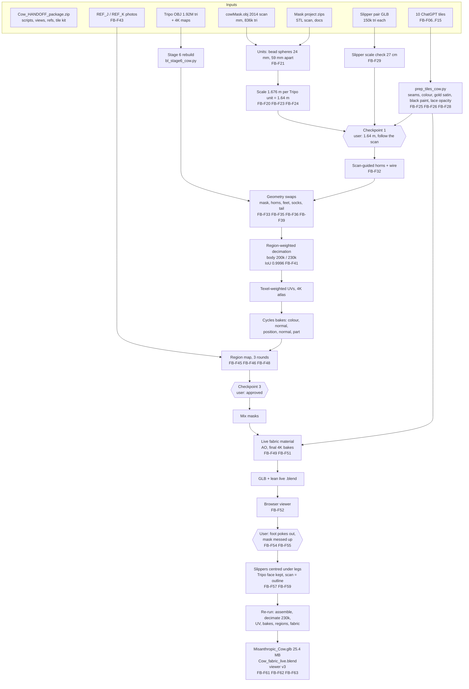

# WINDOW REPORT: Claude (Claude Code on the web, model claude-opus-5-5) | "Misanthropic Cow 3D model project" | 2026-10-30

Window code used for figures: **FB** (full body). Figure files: `figures/FB-Fnn_<name>.<ext>`.

**Visibility note.** [RECORDED] The whole conversation is still visible to me. The session metadata reads `context_usage.used_tokens: 628,023` of `max_tokens: 1,000,000`, with an auto-compaction threshold of 784,000, so no compaction took place. Not every visual survived, though: 10 intermediate renders were overwritten on disk by later rounds of the same script. They're listed in §11 as "NOT AVAILABLE". I describe them from what I saw in the conversation.

**Time zone note.** [RECORDED] All clock times below are the container clock, in UTC: file times, git commit times, artifact version ids, and the session's `created_at`. [UNKNOWN] Your local time zone. No timestamps are shown on chat messages, so per-message times are bracketed by the nearest recorded file or commit time.

---

## 0. Window summary

- **AI program and model.**
  - [RECORDED] Claude Code (container version 2.1.316) in a cloud session started from claude.ai on the web (`origin: web_claude_ai`). Session id `session_01TFV9tjCskpRgWrT9UhCEx2`.
  - `configured_model` and `last_served_model` are both `claude-opus-5-5` (Claude Opus 5.5), with effort level `high` and permission mode `auto`.
- **Purpose and pipeline stage.**
  - [RECORDED] This window continued the full-body Misanthropic Cow model from its stage 6 (Tripo model cleaned) through to delivery:
    - real-world scale, from the mask scan
    - geometry swaps: mask, horns, slippers, black-sock feet, cord tail
    - decimation, UVs and bakes
    - the material region map
    - fabric tiles, the live material and the final bakes
    - GLB and live .blend deliverables
    - a browser viewer
    - a round of fixes from your feedback: the right sock poking out, and going back to Tripo's face
- **Received from earlier work.**
  - [RECORDED] `Cow_HANDOFF_package.zip`: the project folder, with HANDOFF.md, scripts, views, references, Tripo inputs, evaluation and the fabric-tile kit.
  - The Tripo model, as RAR parts 1–3.
  - `cowMask.rar`: the 2014 mask scan.
  - The slipper project's three parts (CONTEXT, FINAL_GLB, BLEND_LIVE).
  - `HANDOFF_costume.md` and `HANDOFF_slippers.md`.
  - The 10 ChatGPT fabric tiles, first pasted inline, then as `textures.zip`.
  - The mask project's three parts (CONTEXT, MODEL, SOURCES).
  - Not received: the `3D_Model_Pipeline_PLAYBOOK`, which you asked me to go without.
- **Handed off.**
  - [RECORDED] `Misanthropic_Cow.glb` and `Cow_fabric_live.blend` with its `textures/` folder.
  - Four handoff zips: `Cow_FINAL_Part1_GLB.zip`, `Cow_FINAL_Part2_LIVE_blend.zip`, `Cow_FINAL_Part3_LIVE_tiles.zip`, `Cow_FINAL_Part4_CONTEXT.zip`.
  - The updated HANDOFF.md.
  - The browser viewer artifact: https://claude.ai/artifact/XipWA3XmE5baJ84temvRp6
  - Every script, committed to `eccentricexhibits/main`, branch `claude/sleepy-keller-33h8gn`, folder `Misanthropic_Cow_Full_Body/`.
- **Date and time range.**
  - [RECORDED] The session was created 2026-10-30T03:48:37Z.
  - The first uploads have file times 2026-10-30 03:49:18–03:49:19 UTC.
  - The last commit before this report was 2026-10-30T19:46:43Z.
  - This report was requested on 2026-11-01; the container clock read 01:37 UTC.
  - Active modelling therefore ran from 2026-10-30 03:49 to 19:47 UTC.

---

## 1. Prompt log

Token estimates per exchange are [ESTIMATED]: the growth in context each exchange caused, covering your text, images, files read, tool calls and my replies. The method is in §9. Times are [RECORDED] file or commit times where shown; otherwise "not visible".

| # | Timestamp | User prompt (excerpt + summary) | What the AI did | Outputs (figures) | Est. tokens |
|---|---|---|---|---|---|
| 1 | Not visible. Its five attachments are dated 2026-10-30 03:49:18–03:49:19 UTC | "Continuing my Misanthropic Cow full-body 3D model project in a new window… Don't start any work until every file below has arrived…" You attached cowMask.rar, Cow_HANDOFF_package.zip and Cow_Slippers_Part1/2/3, listed 19 expected files, and gave the 5-step work plan. | Listed file sizes only, as instructed, and replied with the checklist (5 of 19 received). | – | 6k–8k |
| 2 | Attachments dated 03:51:22–03:51:24 UTC | No text. Attachments: Tripo part1/2/3.rar, HANDOFF_costume.md, HANDOFF_slippers.md. | Checked sizes. The two .md files were loaded into context automatically when attached. Flagged them as unlisted extras and noted the slipper project's Part 4 (SOURCES). | – | 10k–14k |
| 3 | Images dated 03:52 UTC | No text. Five fabric tiles pasted inline. | Checked their dimensions (1254×1254 WebP, 200–510 KB each). Matched them by eye to TILE_01–05. Warned that pasting had recompressed them and dropped the filenames. | FB-F01–F05 | 9k–12k |
| 4 | textures.zip dated 03:54:50 UTC | "I've combined the textures into a zip file - does this work?" | Listed the zip's contents (10 PNGs). Declared the checklist complete and started step 1: • installed the environment from HANDOFF §6 • extracted every archive into its own folder • searched every branch of the repo for the playbook (not found) • rebuilt `cow_high.blend` • stopped to ask for the playbook, as you had instructed | – | 25k–40k |
| 5 | Mask zips dated 13:46:34–13:46:36 UTC; commit e97d0b3 at 14:24:23 UTC | "Here's the mask files, and let's move on without the playbook" | Steps 1–4: • read HANDOFF, the mask handoff, the integration notes and `mask_placement_v10.json` • rendered and measured both scans; ICP attempts; eye-bead sphere fits; mask width • fitted the scan to Tripo's face; set the scale at 1.676 m per unit • checked the slippers' scale • checked and prepared the tiles (`prep_tiles_cow.py`) • built checkpoint 1 and committed Asked you to decide the height and the horn source. | FB-F16–F29 | 150k–190k |
| 6 | Not visible. Commit 00d5cb5 at 16:55:26 UTC | "1.64 m, follow the scan" | Step 5: • scan-guided horns • geometry swaps (scan mask, horns, slippers, socks, tail), over three rounds • assembly and decimation • HIGH vs LOW silhouette check (checkpoint 2) • UVs • started the bakes | FB-F30–F42 | 170k–210k |
| 7 | Not visible; during the bakes, before commit 4d3e20e at 17:21:55 UTC | "show me the region map when it's ready" | Waited for the bakes, fixed coverage detection, made the speck clean-up fast, fixed eye detection in REF_J, iterated on the region map (rounds 1–3), committed and sent checkpoint 3. | FB-F43–F48 | 40k–60k |
| 8 | Not visible; after 17:22, before 17:42 UTC | "approved" | Texturing: • built the mix masks • built the live fabric material • AO and final bakes • live vs baked renders • GLB export and the lean live .blend (fixed relative paths) • rewrote HANDOFF • made the handoff zips | FB-F49–F51 | 60k–80k |
| – | Not visible, before 17:42:31 UTC | Stop-hook message: "There are untracked files in the repository…" (a system hook, not your words) | Committed and pushed the new scripts (7fbd9d4, 17:42:31 UTC). Texturing went on; deliverables commit 49111e0 at 17:59:25 UTC. | – | 1k–2k |
| 9 | Not visible. Artifact v1 at 18:12:23 UTC, v2 at 18:20:42 UTC; commit 478f1cd at 18:21:04 UTC | "I don't have Blender. Can I view it in a browser window?" | Built the three.js viewer page and lighter web GLBs, base64-encoded them (the host refused `.glb`), tested in headless Chromium with three.js installed from npm, fixed the tone mapping, published. | FB-F52–F53 | 40k–55k |
| 10 | Not visible | "1) The side of the right foot is poking out of the slipper. 2) The mask looks all messed up. I think the original Tripo render was a lot closer." | Diagnosed both with viewer screenshots and a side-by-side comparison. Asked you which way to fix the mask. | FB-F54–F55 | 15k–20k |
| 11 | Not visible | Your answer: "Back to Tripo's face (Recommended)" | Added `face=tripo` mode and centred the slippers under the legs (two rounds). Re-ran the pipeline: assembly, decimation at 230k, UVs, bakes, regions (two rounds), mix masks, fabric bakes, export, web GLBs, viewer v3. Checkpoint 5. Commits 0875bd3 (19:10:17), 19d6026 (19:21:28), ce5041a (19:46:43 UTC). | FB-F56–F63 | 60k–80k |
| – | Not visible | Two stop-hook messages ("There are uncommitted changes…") | Committed and pushed each time. | – | 1k–2k |
| 12 | Not visible; the container clock read 2026-11-01 01:37 UTC | This documentation request | Gathered the recorded metadata, built the figure register and package, and wrote this report (Markdown and PDF). | this report | 40k–60k |

---

## 2. Inputs and source data

| File | Type / origin | Size | Contents, resolution, units | Defects / notes |
|---|---|---|---|---|
| `Cow_HANDOFF_package.zip` | Earlier Claude window (project folder) | 25,787,599 B [RECORDED] | HANDOFF.md, README.md, DESIGN_BRIEF.md, `scripts/` (16 scripts), `views/`, `reference/` (DESIGN_KEY, PROPORTION_BASE, PROPORTION_SKETCH, REF_J/K/L), `tripo_inputs/` (4 views 1536², lineup, upload notes), `tripo_eval/`, `prompts/`, `fabric_tiles/` (10 real-fabric crops + `Cow_fabric_tiles_kit`) | Identical to branch `claude/gallant-feynman-4ikhs2`, except that the branch also has `kit/`, `Cow_Tripo_inputs.zip` and `.gitignore` [RECORDED, via `diff -rq`] |
| `Tripo_cow_costume_3d_model.part1–3.rar` | Tripo output (image-to-3D, run by you) | 29,360,128 B / 29,360,128 B / 2,375,476 B [RECORDED] | `cow_costume_3d_model.obj` (193,779,648 B), `.mtl` (313 B), basecolor.jpg (9,502,143 B), normal.png (4,313,021 B), metallic.png (6,291,818 B), roughness.png (6,273,269 B). Mesh: 993,968 vertices split at UV seams (961,815 welded), 1,923,634 triangles. 0.978 × 0.623 × 0.301 Tripo units; OBJ axes +Y up, front +Z | The RAR checksums passed (unrar 7.00). Tripo's metallic map had mean 0.141 (from the earlier report); set to 0 |
| `cowMask.rar` → `cowMask.obj` | 3D scan of the real mask. You describe it as a 2014 MakerBot Digitizer scan [RECORDED in your request]; the OBJ's file date is 2014-04-11 [RECORDED] | 14,419,656 B → 65,070,162 B [RECORDED] | 417,895 `v`, 417,895 `vn`, 0 `vt`, 835,630 faces; no material or texture; 417,880 vertices after merging; 70 connected bodies; not watertight. Extents 233.7 × 175.3 × 302.9 in millimetres, Z up, face toward −Y [RECORDED] | The scanner closed it into a block: flat back and sides. The black-paint areas scanned noisily (§6). The horn tube, both horns and four wire strands were captured |
| `Cow_Slippers_Part1_CONTEXT.zip` | Earlier slipper window | 16,005,371 B | Slipper HANDOFF.md, references, scripts (including `prep_tiles.py`, `bl_adaptive.py`, `bl_unwrap.py`, `bl_bake.py`, `bl_bake_geom.py`, `bl_fabric2.py`), renders, prompts, tiles preview | No playbook inside [RECORDED] |
| `Cow_Slippers_Part2_FINAL_GLB.zip` → `Cow_Slippers_pair.glb` | Earlier slipper window | 19,005,991 B | One shared mesh `Cow_Slipper_A.001`: 137,564 vertices, 150,000 triangles, extents 0.49 × 0.397 × 0.98 GLB units (glTF, Y up, toe +Z). Nodes A at x +0.33 and B mirrored at −0.33. Material `Cow_Slipper_Baked` with 4K maps. 1 unit = 27.5 cm per its handoff | – |
| `Cow_Slippers_Part3_BLEND_LIVE.zip` | Earlier slipper window | 28,062,009 B | `Cow_Slippers_fabric_live.blend` (+ .blend1) and `textures/` | Not used beyond inspection [RECORDED] |
| `HANDOFF_costume.md` | Earlier window | 12,390 B | Byte-identical to the package's HANDOFF.md [RECORDED, `diff`] | – |
| `HANDOFF_slippers.md` | Earlier window | 13,583 B | Differs from the zip copy only in part sizes and the parts list [RECORDED, `diff`] | – |
| Five inline images (`1.webp`–`5.webp`) | ChatGPT fabric tiles, pasted inline by you | 382,496 / 406,370 / 389,912 / 510,422 / 214,962 B | 1254×1254 RGB WebP | The paste dropped the filenames and recompressed them; replaced by `textures.zip` |
| `textures.zip` | Your ChatGPT fabric tiles | 30,977,316 B | `TILE_01_white_faux_fur.png` (2,452,412 B), `TILE_02_black_shag_fur` (3,058,759), `TILE_03_pink_fleece` (2,682,575), `TILE_04_beige_satin` (3,676,143), `TILE_05_beige_lace` (4,201,495), `TILE_06_black_leggings` (3,259,517), `TILE_07_white_fabric_paint` (4,042,615), `TILE_08_white_knit` (2,378,730), `TILE_09_cracked_white_plaster` (3,138,486), `TILE_10_red_flocked_snout` (3,224,255); all 1254×1254 RGB | The zip itself is over your 29 MB transfer rule, but it arrived intact |
| `Misanthropic_Cow_Mask_Part1_CONTEXT.zip` | The separate mask project (for the "v10" cow pipeline) | 11,540,490 B | HANDOFF_mask.md, PROJECT_STATUS.md, INTEGRATION_back_into_the_cow.md, `mask_placement_v10.json`, references (2012 shoot, mask beside gloves, mask and head IMG_2003–2034, hood, earlier feedback screenshots), 4 scripts, 2 renders | – |
| `Misanthropic_Cow_Mask_Part2_MODEL.zip` | Mask project | 11,430,224 B | `Mask_piece_v10.glb` (5,466,084 B), `Mask_piece_with_hood_v10.glb` (6,338,252 B), 6 textures | Not used in the geometry |
| `Misanthropic_Cow_Mask_Part3_SOURCES.zip` | Mask project | 17,860,375 B | `cowMask1.stl` (15,734,284 B; header string `libthing_export`; 314,684 triangles, 157,421 merged vertices, 3 bodies, extents 227.0 × 201.2 × 158.1 mm, face-up +Z), `cowMask1_scan_in_v10_frame.glb`, `mask_v09_original_parts.glb`, v09 textures | A rougher, closed-block scan of the same mask [RECORDED by rendering] |
| `reference/REF_J_head_front_on_new_photo.webp`, `REF_K_…` | Your camera photos (from the package) | – | 794×1067 and 790×1056 px | Used for the mask regions in the scan version |

**The 10 fabric tiles as received (FB-F06 to F15):**

         

---

## 3. Methods

### 3.1 Software and conventions
- [RECORDED] Versions:
  - Python 3.13.17; bpy 5.2.3 (Blender 5.2.3 LTS, run as a Python module)
  - trimesh 5.2.0; pyrender 0.1.45 (EGL); PyOpenGL 3.1.10
  - opencv-python-headless 5.0.0.93; numpy 2.5.3; scipy 1.18.1; networkx 3.7
  - pymeshlab 2025.7.post1 (installed, not used); matplotlib 3.11.2; embreex 4.4.0.post1 (fast ray casting for trimesh)
  - Pillow 12.3.0; rtree 1.4.1; imageio 2.38.1; pyglet 1.5.29; freetype-py 2.5.1
  - unrar 7.00; Node 22.22.0 with Playwright 1.63.0 and Chromium (viewer tests); three.js 0.160.0
- [RECORDED] Hardware: a Linux cloud container with 4 CPUs and 15 GB RAM. All rendering and baking ran on the CPU (Cycles CPU, swiftshader WebGL).
- [RECORDED] Coordinate frames:
  - **Blender / work frame:** metres, Z up, the face toward −Y, the costume's own left toward +X.
  - **Tripo OBJ:** Y up, front +Z. Converted as (x, −z, y).
  - **glTF deliverable:** +Y up, the face toward +Z, own left +X, metres.
  - **Mask scan OBJ:** millimetres, Z up, the face toward −Y.
- [RECORDED] Untrusted inputs were extracted, one archive per new folder, into the scratchpad. Python scripts reading them were run with `python3 -I`.

### 3.2 Stage 6 rebuild
`bl_stage6_cow.py` (from the package) imported the Tripo OBJ (`forward_axis=NEGATIVE_Z`, `up_axis=Y`) and applied the transform. It found nothing to weld at 1e-5 (961,815 vertices). It set metallic to 0 and sheen weight to 0.3, and saved `cow_high.blend`, in 38 s [RECORDED]. Bounds were x −0.312…0.312, y −0.151…0.151, z 0…0.978 Tripo units.

### 3.3 Mask scan: units, comparison and fit to Tripo (Figs FB-F16–F24)
1. **Element counts:** counted OBJ elements and loaded both scans with trimesh (§2).
2. **Scan-to-scan ICP** (`fit_scan_to_scan.py`), OBJ face points onto STL face points:
   - Round 1: free-scale trimmed ICP from 12 spins about the face axis. It collapsed to scale 0.098–0.215 (§6).
   - Round 2: rigid ICP at each fixed scale on a grid 0.5–1.8, 30,000 points per side. Too slow, stopped after about 13 min.
   - Round 3: the same with 6,000 points, scale grid 0.70–1.40 in steps of 0.05, spins every 45°, 25 iterations. It did not converge (best scale 0.900, medians 13.5 / 15.6 mm), so it was abandoned in favour of landmarks.
3. **Eye-bead sphere fits** on the OBJ: `scipy.optimize.least_squares` with `soft_l1` loss (`f_scale` 0.5) on vertices within 16 mm of each eye, front 6/8/10 mm deep [RECORDED]:
   - Own-right bead: centre (−28.4, −54.4, 125.3) mm, diameter 24.1 mm (residual 0.12).
   - Own-left bead: (30.7, −49.4, 125.4) mm, diameter 27.3 mm (residual 0.44).
   - Centres 59.2 mm apart, against 56.9 mm and 23 mm measured on the STL by the mask project. **Conclusion: the OBJ is in millimetres.**
4. **Mask width at eye level:** measured on an orthographic render (FB-F21, 2.75 px/mm) at about 176 mm. That matches the mask project's 17.6 cm.
5. **Tripo face measurements:** taken on an orthographic textured render (FB-F20, 4000 px per Tripo unit). Eye centres at (−0.02125, 0.8543) and (0.01625, 0.8550) units, 0.0375 apart; mask width about 0.105 units.
6. **Scale:** 0.176 m ÷ 0.105 = **1.676 m per Tripo unit** (1676.19 mm/unit). Eye-level depth profiles at 0 and ±15 mm (FB-F23) confirmed the cross-sections match at this scale.
7. **Fit** (`fit_mask_scan_cow.py`): Tripo face samples (front-facing, |x − eye-mid| < 0.054, z 0.80–0.925) onto 59,223 scan relief samples (y < −2 mm, z < 212 mm). Starting pose from the eye midpoints.
   - Free scale: 80 iterations of trimmed ICP at the 75th percentile gave 1500.0 mm/unit (height 1.468 m).
   - Fixed scale (1676.2): 80 more iterations gave rotation 4.4°, residual Tripo→scan median 4.4 mm (p90 15.4) and scan→Tripo median 4.2 mm (p90 14.1).
   - Saved to `fit.json` as `scan_mm_to_tripo_units`.

*FB-F21: the scan front-on at 2.75 px/mm (units check)*

*FB-F20: Tripo's textured face, orthographic, 4000 px per unit (scale measurement)*

*FB-F23: eye-level depth profiles, scan vs Tripo at 1.676 m/unit*

*FB-F24: the fitted scan (orange) on the Tripo head*

### 3.4 Slipper scale check (FB-F14 in CHECKPOINT_1)
- The GLB slipper is 0.98 units long. Scaled by 0.275 (real slipper about 27 cm, per the slipper handoff), it is 0.270 × 0.135 × 0.109 m [RECORDED].
- Tripo's slipper is 0.170 × 0.105 units, i.e. 0.285 × 0.176 m at 1.676 m/unit.

*FB-F29: checkpoint 1: scan, scale, slippers on Tripo's feet, tiles*

### 3.5 Fabric tiles (`prep_tiles_cow.py`; FB-F25–F28)
- **Metrics per raw tile** [RECORDED, table in §4]:
  - Seam score: the mean jump across the wrap edge divided by the mean neighbouring-pixel difference.
  - Lighting unevenness: the standard deviation of luminance blurred over 1/8 of the size, divided by the mean.
  - Luminance compared with the real-fabric crop.
  - Autocorrelation repeat.
- **Processing:**
  - Resize to 2048 (INTER_AREA).
  - Light flattening if unevenness > 0.03. None needed it; the maximum was 0.019.
  - Seam fixing if the maximum seam score > 1.25: a half-roll cross-fade with a cosine ramp (22 % of the size). Contrast is restored with a wrap-padded Gaussian (σ 24) for random textures. Patterned tiles (satin, leggings, knit) instead use a period-aligned shift with no compensation.
- **Corrections after comparing with the real fabric** (`ADJUST`):

  | Tile | Correction |
  |---|---|
  | Black shag | Mean set to (34, 34, 36) |
  | Pink fleece | Mean (242, 192, 200) |
  | Beige satin | Contrast about the local mean × 0.35 |
  | Plaster | Mean (222, 219, 212) |
  | Red flock | Mean (112, 22, 28) |

- **Height maps:** a wrapped high-pass with σ 18, normalised as 0.5 + hp ÷ (4·std).
- **Derived tiles:**
  - Gold satin: the beige satin recoloured to (196, 150, 62), contrast 1.4.
  - Glossy black paint: the plaster recoloured to (22, 22, 24), contrast 1.8.
  - Lace opacity: luminance mapped linearly from the 25th to the 60th percentile.
- **Seam check:** the decision used visual crops at the 2×2 meeting point (FB-F25, FB-F28), because the numeric score proved unreliable (§6).

*FB-F25: raw tiles: full-resolution crops where four copies meet*

*FB-F26: tiles vs real-fabric crops*

*FB-F28: processed tiles, 2x2 repeat*

### 3.6 Scan-guided horns (`horns_from_scan_cow.py`; FB-F30–F32)
- **Long horn** (own left): the separate connected piece of the scan above z = 195 mm, 26,538 faces.
  - Centreline: geodesic (Dijkstra) distance from the root seed, split into 40 bins; bin centroids give the centreline and the mean distance to the centroid gives the radius.
  - Dropped the first 2 bins and the last one. Smoothed with σ 1.5 (centreline) and σ 2 (radius), resampled to 90 points.
  - Tip tapered over the last 14 % to 12 % of its radius (exponent 1.4), per the brief's "pointed tip". A 12 mm root extension plugs into the tube.
  - Swept as a closed tube: parallel-transport frames, 24 sides.
  - Result: 185 mm along the curve, root radius 10.2 mm, mid radius 16.7 mm.
- **Short horn** (own right): fused to the tube in the scan, so its axis was read off orthographic renders: A0 (−42, 0.5, 253) to A1 (−90, 0.5, 264) mm. Radius is the median of vertices in 2 mm slabs within 30 mm of the axis, 24 samples. Result: 49 mm long, root radius 17.9 mm, end radius 13.0 mm.
- **Wire tuft:** 5 strands (random seed 7) from the short horn's end. Each rises about 42 mm (+6/+8) and curls out about 26 mm (±6), with a slow twist (amplitudes 3 and 2 mm); radius 0.8 mm, 8 sides.
- **Black rings:** placed later by arc length. Long horn at fractions 0.30, 0.48 and 0.66; short horn at 0.35 and 0.70; each 5 mm wide.

*FB-F31: the scan's short horn and wire*

*FB-F32: swept horns (colour) over the scan's horns (grey)*

### 3.7 Geometry swaps (`build_swaps_cow.py`; FB-F33–F40, FB-F57)
- **Scale:** every Tripo vertex × 1.67619 to give metres.
- **Mask, scan version** (rounds 1–3; later replaced):
  - Relief: scan faces with every vertex at y < −2 mm and z < 212 mm, largest component: 246,986 faces, 1 boundary loop of 1176 vertices.
  - Rim skirt: 20 mm back and 10 mm inward (round 1 used 25 mm back, 3 mm inward).
  - Tripo's face: deleted inside the scan's front outline (2 mm grid, binary closing ×3, hole fill, chin extension 24 mm, dilation 3 cells = 6 mm) in front of the back plane (y < the rim median, −0.054 m), and capped. Deleted 63,901–67,442 faces.
- **Mask, final Tripo version** (`face=tripo`): Tripo's face is kept. The outline above is saved as `mask_footprint.npz` and used only for the regions.
- **Horns:**
  - Tripo's horns deleted by texture colour: yellow (r > 140, g > 100, b < 0.7g, r − b > 60) or dark (mean < 70), in the zone z > 0.915 u and y < 0.005 u, beyond the bolster ends at x = 0.032 / −0.036 u. Grown 6 rings outward; 34,731 faces deleted.
  - Bolster end centres: L (0.0536, −0.0491, 1.5707) m and R (−0.0603, −0.0463, 1.5671) m.
  - The scan horns were moved with the fit, then shifted root-to-bolster-end: long horn 63 mm (0.0015, −0.0474, 0.0421), short horn 27 mm.
- **Feet:**
  - Cut at z = 0.105 u = 0.176 m; 340,430 faces deleted.
  - Slipper GLB scaled by 0.275, toes at y = −0.074 u = −0.124 m.
  - Final placement centres each slipper under its ankle: ankle centres L (0.1086, 0.0898) and R (−0.1099, 0.0844) m. Offsets L (0.1069, 0.0108, 0.0000) and R (−0.1081, 0.0108, 0.0000) m, R mirrored in x. The footbed is at z = 0.033 m.
- **Sock feet:**
  - A loft from the leg's cut ring (welded topology, 48 samples by angle, radius × 1.04, top 1.5 cm above the cut) down to a superellipse foot outline (p = 2.5): 15 × 7 cm final (23.5 × 9 cm in rounds 1–2).
  - Heel 2 cm in front of the slipper's heel end; sole 4 mm above the footbed. 14 rings.
  - The foot runs forward only in the bottom 5.5 cm (smoothstep). The centre is the slipper centre.
- **Hole caps:** weld by position (rounded to 1e-7) for topology. Fan from a centre point: the face hole 6 cm back (4 cm in round 2), bolster ends 6 mm toward the centre, ankles 1 cm up. Winding is set against the neighbours' boundary edges.
- **Cord tail:**
  - Start: the bow's gold texels (r > 120, g > 80, b < 0.75g, r − b > 40, on the back, z 0.35–0.75 u), at 70th percentile y and 8th percentile z: (0.0061, 0.2320, 0.8575) m.
  - Drape: drops to z = 0.45 m (knee height). y is the running maximum of the back surface + 8 mm, smoothed (σ 3), with a 4 mm sideways sway.
  - Shape: radius 2 mm (4 mm cord), 10 sides; length 0.409 m.

*FB-F35: mask swap round 1 failure at the chin*

*FB-F36: mask swap round 2 (scan version)*

*FB-F39: sock feet after the welded-loop fix (scan version)*

*FB-F57: final: slipper centred under the leg, sock inside*

### 3.8 Assembly (`bl_assemble_cow.py`)
- The body becomes a Blender mesh with per-loop Tripo UVs, then welded at 1e-6: 27,516 seam duplicates in the final run, giving 774,596 vertices and 1,549,196 faces.
- The parts are separate objects with flat materials. The slipper GLB mesh is shared by `Slipper_L` and `Slipper_R`: `matrix_world = Translation(offset) · Diag(±0.275, 0.275, 0.275)`.

### 3.9 Stage 7 decimation (`bl_decimate_cow.py`; FB-F41)
- Blender Decimate modifier, `COLLAPSE`, `use_collapse_triangulate=True`.
- **Pass 1:** only a vertex group of "flat" vertices, removing 90 % of its share. Flat means:
  - legs below 0.74 m, excluding hands
  - plain back: y > 0.06, z 0.88–1.30 m
  - plain belly: y < −0.12, z 0.86–1.15 m
  - in each case excluding "detail": dark (mean colour < 0.27) above 0.76 m, pink, gold, and hands (|x| > 0.36, z < 1.05).
- **Pass 2:** global, down to the target.
- **Targets:** body 200,000 (scan version) or 230,000 (Tripo-face version). Scan mask 60,000; long horn 3,000; wires 3,000.

*FB-F41: checkpoint 2: swaps and HIGH vs LOW*

### 3.10 UVs (`bl_uv_cow.py`)
- **Join:** the LOW body, socks, tail, horns and wires are joined into `Cow_LOW`, with a FACE int attribute `part` (0–5).
- **Unwrap:** `smart_project` at 66°, `island_margin` 0, `area_weight` 0, `correct_aspect`.
- **Island scale weights:**

  | Area | Weight |
  |---|---|
  | Tripo face (final) | 2.0 |
  | Hands | 1.6 |
  | Udder | 1.3 |
  | Head and hood | 1.2 |
  | Plain back | 0.85 |
  | Legs | 0.7 |
  | Socks | 0.5 |
  | Tail | 0.8 |

- **Pack:** `pack_islands` (CONCAVE, margin 0.0012 FRACTION, rotate, scale). Scan version: 4,649 islands; the mask on its own 2K atlas.

### 3.11 Bakes (`bl_bake_cow.py`)
- **Engine:** Cycles CPU, 2 samples, margin 8 px EXTEND.
- **Selected-to-active:** cage extrusion 0.005 m, maximum ray distance 0.02 m.
- **Maps:** DIFFUSE colour only (Tripo texture) and tangent NORMAL, both 4096. Mask normal 2048 in the scan version.
- **Geometry maps:** EMIT bakes of position, normal and the `part` attribute into float images, saved as `.npy` with row 0 at the top. Coverage comes from rasterising the UV triangles (cv2.fillPoly, 8 px dilation), because the bake alpha was 1 everywhere.

### 3.12 Region map (`make_regions_cow.py`; FB-F43–F48, F58–F60)
- **Body classes:**

  | Class | Rule |
  |---|---|
  | Gloves | Within 20 cm of the fingertip along (±1, 0, −1)/√2 |
  | Hooves | Dark texels within the gloves |
  | Bloomers band | Per azimuth around the hips (36 bins; 1 cm height bins from 0.60 m): the longest run where the beige fraction is > 0.35, 1–2-bin gaps bridged, at least 3 bins, circular median of 5, linearly interpolated in azimuth. Torso only (\|x\| < 0.27) |
  | Lace | Where \|sin azimuth\| > 0.8 |
  | Satin | The rest of the bloomers band |
  | Leggings | Below the band, z < 0.80 |
  | Paint spots | Light (> 0.55) and \|r − b\| < 0.1 |
  | Udder | Pink above 1.0 m |
  | Bow | Gold on the back, z 0.78–0.95 |
  | Black shag | Dark above 0.76 m |
  | Socks, cord, wire | By part id |
  | Horn paint and rings | By arc length along the transformed centrelines |
  | White fur | Everything else |

- **Clean-up:** components under 60 px dropped and refilled from the nearest kept texel (distance transform).
- **Mask, scan version** (approved at checkpoint 3, later replaced):
  - Eyes from the bead spheres: radius from the fit + 1.5 mm. Pupils where the forward cosine > 0.93.
  - Photo classes from REF_J, projected by an affine fit on eye centres (377.9, 402.2) and (491.8, 398.5) px and a snout oval centred at (435, 570) px with semi-axes (98, 67) px. Nostril slits measured by hand at (377–397, 543–627) and (449–474, 543–627) px.
  - Below the snout the photo shows the costume, so those texels count as unknown and take the nearest front-facing class.
  - Clean-up threshold 25 px.
- **Mask, final Tripo version:**
  - The mask is body texels inside the scan outline, with y < back plane + 0.02 m and z from 0.03 m below the outline's bottom up to its top.
  - Classes from Tripo's colours: black (< 0.22); red (r > 0.40, r > 1.6g, r > 1.3b); slits are black inside the snout radius (92nd percentile of the red texels' distance, 48 mm); eyes are yellow (r > 0.5, g > 0.38, b < 0.6g) within the 95th-percentile radius (20 and 21 mm); pupils are a disc within 0.42 of the eye radius, facing front.
- **Mix masks** (`make_mix_masks_cow.py`): one-hot classes blurred by 1.2 px into sequential factors f_i = w_i / Σ_{j≤i} w_j, three per lossless PNG. 7 files in the final version (21 classes).

*FB-F45: REF_J projection check (scan version)*

*FB-F48: checkpoint 3: the approved region map (scan version)*

*FB-F59: final region map head (Tripo face, round pupils)*

### 3.13 Live material, AO and final bakes (`bl_fabric_cow.py`)
- **Projection:** box-projected tiles in object space (metres), blend 0.3, mapping scale = 100 ÷ tile size in cm.
- **Tile sizes:** fur 10 cm, black shag 10 cm, fleece 8, satin 8, lace 8, leggings 6, paint 6, knit 6, gold satin 8, socks 6, plaster 8, glossy black paint 8, flock 5.
- **Lace:** `mix(leggings tile, lace tile, lace opacity tile)`.
- **Solids** (linear RGB):

  | Solid | Colour | Roughness | Coat |
  |---|---|---|---|
  | Hooves | (0.012, 0.012, 0.014) | 0.25 | 0.6 |
  | Cord | (0.80, 0.80, 0.78) | 0.70 | – |
  | Horn paint | (0.85, 0.70, 0.10) | 0.50 | – |
  | Rings | (0.015, 0.015, 0.015) | 0.45 | – |
  | Wire | (0.33, 0.33, 0.35) | 0.30 | – |
  | Eye | (0.85, 0.62, 0.04) | 0.10 | 0.8 |
  | Pupil | (0.008, 0.008, 0.008) | 0.10 | 0.8 |
  | Slits | (0.01, 0.01, 0.01) | 0.85 | – |

- **Fabric roughness:** fur 0.92, shag 0.85, fleece 0.88, satin 0.35, lace 0.70, leggings 0.75, paint 0.80, knit 0.90, gold 0.35, socks 0.80, plaster 0.75, black paint 0.35 (coat 0.3), flock 0.95.
- **Sheen:** 0–0.6. Metallic is 0 everywhere. Specular IOR level 0.35.
- **Bump:** tile height maps into a Bump node (strength 0.3, distance 1.5 mm) on top of the baked detail normal.
- **AO:** 2048, 16 samples, world AO distance 0.05 m. Saved separately, never multiplied into the colour.
- **Final bakes:** base colour, roughness and tangent normal at 4096, 2 samples.

*FB-F51: checkpoint 4: live vs baked (scan version)*

*FB-F61: live vs baked (final, Tripo face)*

### 3.14 Export (`bl_export_cow.py`) and viewer (`bl_export_web_cow.py`, `viewer/cow_viewer.html`)
- **GLB:** `export_scene.gltf` with format GLB, JPEG quality 88, Y up, modifiers applied. The baked material uses AO through a "glTF Material Output" node group (occlusion). Slipper maps scaled to 2048.
- **Live .blend:** tiles as 2K JPG (q90), heights as 1K JPG, mix masks as PNG, detail normals as JPG, slipper maps as 2K JPG. Paths made relative with `make_paths_relative` after "save as" (§6), and the reopened file checked for missing or absolute paths.
- **Web GLBs:** body maps at 2K (AO 1K); slippers at 1K, JPEG quality 85. Published as base64 `.txt` files, because the host serves only standard web types.
- **Viewer:** three.js 0.160.0 from jsDelivr through an import map. OrbitControls; GLTFLoader `parseAsync` on the decoded base64. RoomEnvironment PMREM at intensity 0.55; directional light 1.25 with PCF soft 2048 shadows; a ground ShadowMaterial at opacity 0.22; `NoToneMapping`. A 0–1.64 m ruler built from LineSegments and canvas sprites.

*FB-F52: the browser viewer (v1) in headless Chromium*

*FB-F62: viewer v3: right foot and Tripo face*

### 3.15 How 2D images were related to 3D
- **Tripo texture → regions** [RECORDED]: Tripo's base colour (itself generated from your multiview images in earlier windows) was baked through the UVs onto the new atlas. It was then classified per texel (§3.12).
- **REF_J → scan mask** (scan version only): orthographic projection of each texel's (x, z) through the 3-landmark affine above.
- **Tile scale:** tiles are box-projected in world metres at the size each ChatGPT prompt specified (10, 8, 6 or 5 cm square).

### 3.16 Image-generation prompts
[RECORDED from `fabric_tiles/Cow_fabric_tiles_kit/<TILE>/PROMPT.txt`; the kit was written in an earlier window. You generated the tiles in ChatGPT, outside this window. Number of attempts, model and settings: [UNKNOWN].] Each prompt was used with its real-fabric crop attached (`1_FABRIC_n_….png`). The shared lines in every prompt were:

> - View: straight down at a flat piece, filling the entire square edge to edge.
> - Lighting: completely flat and even. No shadows, highlights, shine, vignetting or gradients.
> - Nothing else: no seams, stitching, edges, folds, objects or text.
> - It must tile seamlessly when repeated left-right and up-down.
> - Square image, as large as you can make it.

The tile-specific lines:
- **TILE_01:** "Create a seamless, tileable square texture of the long-pile white faux fur (a slightly matted, lumpy costume fur) in the attached photo. Make it in warm white." / "Scale: the square shows about 10 cm x 10 cm. Pile about 2-3 cm long, lying mostly in one direction with soft clumps and gentle shading between them. Slightly matted in places, like a well-used costume."
- **TILE_02:** "Create a seamless, tileable square texture of the long black shaggy faux fur in the attached photo. Make it in black with a slight sheen. Important: the 3D model already has the big tufts as shapes. This texture is only the surface of the fur: fine strands lying flat and fuzz, NOT big clumps or tufts." / "Scale: the square shows about 10 cm x 10 cm. Long, glossy, slightly wavy strands."
- **TILE_03:** "…the smooth pink fleece / minky fabric… Make it in soft baby pink." / "Scale: the square shows about 8 cm x 8 cm. A very short, velvety pile with a faint soft sheen. No pattern, no seams."
- **TILE_04:** "…the smooth beige satin… Make it in pale beige / nude." / "Scale: the square shows about 8 cm x 8 cm. Fine satin weave with a soft sheen; only the faint weave texture, no folds or wrinkles."
- **TILE_05:** "…the beige floral lace… Make it in pale beige / nude, the same colour as the satin." / "Scale: the square shows about 8 cm x 8 cm. A fine net background with a dense floral pattern of leaves and petals outlined in thicker threads, like the photo."
- **TILE_06:** "…the black opaque jersey knit (leggings fabric)… Make it in deep black." / "Scale: the square shows about 6 cm x 6 cm. A very fine knit with tiny vertical ribs, matte, with a faint soft sheen. No paint, no spots."
- **TILE_07:** "…the thick white fabric paint brushed onto black fabric… Make it in off-white." / "Scale: the square shows about 6 cm x 6 cm. The paint only (filling the whole square): slightly uneven, rough and dry-brushed, with fine cracks and creases and a few thin spots where the black fabric shows through faintly. No edge of the spot, no black background."
- **TILE_08:** "…the fuzzy white knit (like a chenille or plush sock knit)… Make it in warm white." / "Scale: the square shows about 6 cm x 6 cm. Small soft loops in neat rows, slightly fuzzy."
- **TILE_09:** "…the painted white plaster / papier-mache surface… Make it in clean warm white." / "Scale: the square shows about 8 cm x 8 cm. Matte white paint over a slightly lumpy surface, with fine hairline cracks and a few tiny chips, like an old hand-made mask. Clean white, not dirty or grey."
- **TILE_10:** "…the shaggy red flocked fabric (short, dense, slightly matted fibres)… Make it in crimson red." / "Scale: the square shows about 5 cm x 5 cm. Short tangled fibres with darker red in the gaps, a little sparkle. Ignore the two black slits in the photo: no slits, no stitching."

The full text of each prompt is in the kit files. [RECORDED] In this window I offered one optional prompt fix for the satin: "Make it a smooth, glossy satin: the weave should be barely visible, with no diagonal twill lines." It was not used; the satin was softened in code instead.

---

## 4. Quantitative results

**Scale** [RECORDED]

| Method | m per Tripo unit | Resulting height |
|---|---|---|
| Mask width at eye level (176 mm / 0.105 u), **used** | 1.676 | 1.640 m (1.648 m with the scan-guided long horn) |
| Eye spacing (59.2 mm / 0.0375 u) | 1.579 | 1.544 m |
| Free-scale ICP | 1.500 | 1.468 m |
| Wearer ~1.6 m + horns (estimate given to you) | – | about 1.72 m |

**Geometry counts** [RECORDED]

| Item | Before | After |
|---|---|---|
| Tripo body | 1,923,634 tri, 961,815 v (welded) | – |
| Faces deleted | horns 34,731; feet 340,430; face 63,901 (scan v. round 3) / 0 (final) | – |
| Body HIGH (final) | – | 1,549,196 faces, 774,596 v (welded) |
| Body HIGH (scan version) | – | 1,486,100 faces, 743,050 v |
| Body after flat pass (scan v.) | 1,482,624 | 1,012,346 |
| Body LOW | – | 200,000 (scan v.) / 230,000 (final) |
| Scan mask HIGH → LOW | 249,338 | 60,000 (scan version only) |
| Long horn | 4,368 | 3,000 |
| Short horn | 1,200 | 1,200 |
| Wires | 4,800 | 3,000 |
| Socks | 2,784 | 2,784 |
| Tail | 2,400 | 2,400 |
| Slippers (each, unchanged) | 150,000 | 150,000 |
| Cow_LOW joined | – | 212,384 (scan v.) / **242,384 (final)** |
| Whole scene LOW | – | 572,384 (scan v.) / **542,384 (final)** |
| HIGH vs LOW silhouette IoU, 8 views (scan v.) | – | 0.9996, 0.9997, 0.9997, 0.9997, 0.9996, 0.9997, 0.9997, 0.9997 |

**Raw tile metrics** [RECORDED, from `prep_tiles_cow.py`]

| Tile | Seam x/y raw → fixed | Light | Luma vs real | Notes |
|---|---|---|---|---|
| 01 white fur | 1.79/1.52 → 1.74/1.67 | 0.003 | 228.8 vs 225.9 (1.01) | – |
| 02 black shag | 1.17/1.65 → 1.46/1.76 | 0.018 | 14.2 vs 38.2 (0.37) | Lifted to (34, 34, 36) |
| 03 pink fleece | 1.55/1.26 → 1.62/1.70 | 0.001 | 210.2 vs 208.0 | Red channel 255 → (242, 192, 200) |
| 04 beige satin | 1.51/2.95 → 1.64/1.40 | 0.001 | 207.0 vs 199.1 | Contrast × 0.35 |
| 05 beige lace | 1.62/1.14 → 2.24/2.38 | 0.004 | 193.0 vs 174.2 | Opacity mask |
| 06 black leggings | 0.93/1.42 → 1.36/1.83 | 0.019 | 13.8 vs 6.4 | – |
| 07 white paint | 1.58/1.31 → 1.95/1.99 | 0.002 | 219.4 vs 70.0 | The real crop includes black fabric |
| 08 white knit | 3.17/4.36 → 0.62/0.44 | 0.001 | 223.4 vs 129.9 | Period-aligned fix |
| 09 plaster | 1.36/1.10 → 1.37/1.81 | 0.001 | 234.6 vs 185.0 | → (222, 219, 212) |
| 10 red flock | 1.71/1.68 → 1.95/1.72 | 0.013 | 41.3 vs 31.7 | Tile mean (117, 9, 12) → (112, 22, 28) |

The numeric seam score was not a reliable judge (§6). Visually, every tile was seamless after processing (FB-F28).

**Timings** [RECORDED]

| Run | Steps (seconds) | Total |
|---|---|---|
| UVs, scan version | smart project 4, weighting 29, pack 57, mask pack 85 | 86 s |
| UVs, final | – | 68 s |
| Geometry bakes, scan version | colour 117, normal 94, mask normal 6, position/normal/part 29/28/22, mask geometry 6/7 | 310 s |
| Geometry bakes, final | colour 118, normal 117, position/normal/part 28/29/25 | 318 s |
| Fabric bakes, scan version | AO 215, base colour 122, roughness 116, normal 120, mask AO 43, mask base colour 26, roughness 24, normal 23 | 694 s |
| Fabric bakes, final | AO 331, base colour 175, roughness 176, normal 169 | 852 s |

**Deliverable sizes** [RECORDED]

| Item | Scan version | Final (Tripo face) |
|---|---|---|
| GLB | 28.1 MB (images 12.8 MB, geometry 15.3 MB) | **25.4 MB** |
| Live .blend + textures | 15.5 MB + 34.1 MB (37 files) | 14.5 MB + 33.5 MB (36 files) |
| Web GLBs | body 9.5, mask 2.8, slippers 7.0 MB | body 10.5, slippers 7.0 MB |
| Base64 web files | – | 13,980,384 and 9,375,420 B |
| Handoff zips | – | Part1 25,355,726; Part2 23,415,720; Part3 23,354,478; Part4 8,711,953 B |

Final GLB: nodes `Cow_body`, `Slipper_L`, `Slipper_R`; bounds X ±0.522, Y 0–1.648, Z ±0.253 m; 542,384 triangles.

**Final region texel counts** (4096² atlas, Tripo-face version) [RECORDED in `checkpoints/regions.json`]

| Class | Texels |
|---|---|
| White fur | 4,952,736 |
| Black shag | 1,438,269 |
| Fleece | 652,007 |
| Satin | 299,179 |
| Lace | 265,079 |
| Leggings | 2,104,937 |
| Paint spots | 113,597 |
| Knit | 695,757 |
| Hooves | 628,460 |
| Bow | 45,424 |
| Socks | 138,395 |
| Cord | 73,846 |
| Horn paint | 135,990 |
| Rings | 11,115 |
| Wire | 57,338 |
| Plaster | 466,003 |
| Black paint | 442,930 |
| Eye | 66,264 |
| Pupil | 13,415 |
| Flock | 183,490 |
| Slits | 32,506 |

---

## 5. Decisions, assumptions and judgment calls

| Decision | Rationale | Approved? |
|---|---|---|
| Go on without the playbook | It wasn't in any upload or repo branch | **Yes**, your instruction ("let's move on without the playbook") [RECORDED] |
| Treat cowMask.obj as millimetres | Bead diameter 24 mm and spacing 59 mm match the STL's 23 / 56.9 mm; mask width 176 mm | Units were clear, so not asked (as you instructed) [RECORDED] |
| Real height 1.64 m (mask-width scale) | The mask fills Tripo's hood opening at real size; the slippers corroborate it | **Yes**, "1.64 m" [RECORDED] |
| Horns follow the scan's real horns | The scan captured the real horn shapes and sizes | **Yes**, "follow the scan" [RECORDED] |
| Keep Tripo's horn tube (bolster) | Its length (~114 mm at scale) matches the real tube (~113 mm per the mask project) | Not asked [RECORDED] |
| Horn roots moved onto the bolster ends (63 mm and 27 mm shifts) | The scan's horns sit relative to the scan's own tube, not Tripo's | Not asked [RECORDED] |
| Tiles: none regenerated; fixed in code | Seams, colour and lace see-through all fixable | Reported to you; you sent no regenerations [RECORDED] |
| Lace see-through over the leggings | The tile's gaps were skin-toned; the brief forbids visible skin | Not asked [RECORDED] |
| AO as a separate occlusion map, not in the colour | The mask project's rule: "No baked lighting" | Not asked [RECORDED] |
| Slipper maps at 2K in the GLB | Keeps the GLB under 29 MB | Not asked [RECORDED] |
| Bloomers back continues the front | HANDOFF §3 plan (the back design is unknown) | From an earlier window [RECORDED in HANDOFF] |
| Region map (scan version) | Checkpoint 3 | **Yes**, "approved" [RECORDED] |
| Back to Tripo's face; the scan only for scale, horns and outline | You found the scan mask "all messed up" | **Yes**, "Back to Tripo's face (Recommended)" [RECORDED] |
| Slippers centred under the legs; smaller sock | Diagnosed the overhang | Done in response to your report; you have not yet confirmed the result [RECORDED] |
| The Tripo-face region map went to texturing without a separate approval step | You had chosen Tripo's face explicitly; the head crop was shown | [INFERRED] acceptable; not explicitly approved |
| Web viewer: base64 `.txt` instead of `.glb`; lighter maps | Host file-type and 15 MB limits | Not asked [RECORDED] |

---

## 6. Problems, failed attempts and fixes

1. **Playbook missing.** Searched every remote branch after a shallow fetch. Not found; you said to proceed without it.
2. **Black render backgrounds.** pyrender RGBA rendered the background black. Fixed by compositing alpha onto white (FB-F16 → later renders).
3. **Scan-to-scan ICP failed.**
   - Round 1: free-scale ICP collapsed (scale 0.098–0.215).
   - Round 2: a fixed-scale grid took too long (more than 10 min), and `pkill -f` also killed the calling shell.
   - Round 3: lighter, but no convergence (13–16 mm residuals).
   - Fix: landmarks instead (eye-bead sphere fits and mask width).
4. **Free-scale fit to Tripo shrank to 1.468 m.** ICP shrink bias, and the AI face's shape differs from the real one (p90 16 mm). Fix: hold the scale from the mask width; ICP sets the pose only.
5. **Eye-bump detection in the Tripo depth map was noisy** (FB-F19). Replaced by measurements on a textured orthographic render (FB-F20).
6. **Tile seam score unreliable.** Processed tiles scored the same as or worse than raw ones. Diagnosed by full-resolution crops at the 2×2 meeting point (FB-F25), which showed real seams only on shag, leggings, paint and knit. Contrast compensation switched to a wrap-padded blur.
7. **Sock round 1: tent-shaped wedges** (FB-F33). The loft swung forward too early. Fix: keep the ankle section down to 5.5 cm above the sole.
8. **Mask swap round 1: push-back** (FB-F34, FB-F35). Pushing Tripo's face behind the scan left Tripo's larger snout below the real chin, stretched spike triangles, holes at the bolster ends, and the rim skirt visible on the own-right side.
9. **Mask swap round 2:** deleted Tripo's face inside the dilated scan outline, extended below the chin, and capped holes with fans (FB-F36).
   - A sub-attempt to remove the scanner's flat side walls and chin plate broke the rim into 133 loops, so it was dropped.
   - The skirt was changed to 20 mm back and 10 mm inward.
   - Forehead fur above the mask top was kept so the hood closes over it.
10. **Sock round 2: flat sheets** (FB-F38). The boundary loops were taken on the UV-split mesh, so a seam loop was picked instead of the ankle cut. Fix: weld by position before finding loops (FB-F39).
11. **Decimation legs counted as "detail".** Black leggings matched the dark-shag rule. Fix: dark counts only above 0.76 m, and legs are flat by height.
12. **Bake coverage.** The bake alpha was 1 everywhere, so empty texels weren't detected. Fix: rasterise the UV triangles.
13. **Speck clean-up too slow** at 4K (one full-image dilation per speck). Replaced by a distance-transform fill.
14. **REF_J eye detection failed:** the yellow rings around the pupils, plus the yellow horns. Fix: morphological closing (21 px) within a face band.
15. **Region map rounds 1 → 3** (FB-F44 → F47 → F48):
    - Round 1 problems: gloves ran up the forearm; the bloomers' bottom edge was classed as paint spots; beige specks appeared on the fur hem; the snout was too small; the nostrils were missed (shadows read as nostrils); the own-left eye was partly black.
    - Fixes in round 2: gloves by fingertip distance; bloomers band per azimuth; paint must not be beige; snout oval and slits measured by hand on REF_J (FB-F46); eye radii per bead.
    - Fixes in round 3: forearm excluded from the bloomers (\|x\| < 0.27); azimuth interpolation removed the stair-steps; chin-cap stripes set to fur.
16. **Live .blend texture paths.**
    - Round 1: paths were relative to the source folder (`//../../fabric/textures`).
    - Round 2: absolute paths stayed absolute after `relative_remap`.
    - Round 3 fixed it: "save as", then `make_paths_relative`, then save. Verified by reopening the file.
    - An orphan Tripo texture was also exported; fixed by purging orphans.
17. **Handoff zip over 29 MB** (Part 2 at 29.7 MB). The slipper maps moved to Part 3.
18. **Viewer.**
    - `.glb` was refused by the artifact host, so the files are served as base64 `.txt`.
    - jsDelivr is blocked inside the container (403), so local tests used three.js 0.160.0 from npm.
    - The first headless screenshot timed out; fixed with a smaller viewport and a longer timeout.
    - ACES tone mapping made the yellow horns look olive, so it was switched to `NoToneMapping`.
19. **Your feedback 1: the right foot poked out** (FB-F54).
    - Diagnosis: the sock foot (9 cm wide, 23.5 cm long) broke through the slipper's side and head.
    - Fix round 1: a 15 × 7 cm sock centred on the slipper (FB-F56). The ankle column still overhung the inner edge, because Tripo's legs are 2.7 cm inboard of Tripo's slippers.
    - Fix round 2: each slipper centred under its ankle (FB-F57). Verified in the viewer (FB-F62).

    
    *FB-F54: the right foot problem in the viewer*
    
20. **Your feedback 2: "The mask looks all messed up"** (FB-F55).
    - [INFERRED from the comparison] Causes: the scanner's noisy black-paint areas, ragged projected patch edges, a dark smear under the snout, and the mask sitting deep in a wide hood.
    - I offered two options and you chose Tripo's face.
    - The new region round 1 had ring-shaped pupils (FB-F58), from Tripo's dark iris outline. Round 2 used a geometric disc (FB-F59).
    - Abandoned: the scanned mask geometry and the REF_J projection. The code path is kept as `face=scan`.

*FB-F55: REF_J, Tripo's original face and the scanned mask, side by side*

*FB-F63: checkpoint 5: both fixes*

---

## 7. Outputs

| Deliverable | Format | Specs | Purpose |
|---|---|---|---|
| `deliver/Misanthropic_Cow.glb` | glTF 2.0 binary | 25.4 MB. Cow_body 242,384 tri (body with Tripo face, socks, tail, horns, wire); maps 4K base colour, roughness and normal, plus 2K occlusion; slippers 150,000 tri each with 2K maps. JPEG; metallic 0; Y up; metres; 1.648 m | The finished model for any app or engine |
| `deliver/live/Cow_fabric_live.blend` + `textures/` (36 files) | Blender 5.2 file + JPG/PNG | 14.5 MB + 33.5 MB. Live `Cow_Fabric` material with box-projected tiles and 7 mix masks; relative paths | Editable fabric material for renders and rigging |
| `Cow_FINAL_Part1_GLB.zip` … `Part4_CONTEXT.zip` | Zip | 25.4 / 23.4 / 23.4 / 8.7 MB | Transfer to new windows (each under 29 MB) |
| Browser viewer artifact, v3 | HTML + 2 base64 GLB text files | Views, turntable, clay mode, part toggles, metre ruler; private | Viewing without Blender |
| `viewer/cow_viewer.html`, `viewer/README.md` | HTML / Markdown | – | Viewer source and rebuild notes |
| Scripts | Python | 24 new or edited cow scripts (listed in HANDOFF §7) | Reproducible pipeline |
| `checkpoints/` | JPG + JSON | CHECKPOINT_1–5; `mask_scan_fit.json`, `tile_report.json`, `swaps.json`, `horns.json`, `regions.json` | Approvals and recorded numbers |
| `HANDOFF.md` | Markdown | Rewritten | Handoff to the next window |

---

## 8. Division of labour

- **You:**
  - Supplied every input: archives, scans, tiles, photos, the earlier windows' work.
  - Made the ChatGPT fabric tiles and the Tripo model (in earlier work).
  - Decided: go without the playbook; height 1.64 m; horns follow the scan; approved the region map; asked for a browser viewer; reported the foot and mask problems; chose Tripo's face.
  - Set the 29 MB rule, the checkpoint pictures, and the ending with a next step.
- **This AI (Claude):**
  - All analysis, measurement and modelling code (24 scripts).
  - Running Blender headless, every render and bake.
  - Diagnoses and fixes; the region maps, materials and exports.
  - The viewer page; HANDOFF and this report; git commits and pushes.
- **Other software:**
  - Blender 5.2.3 (Cycles bakes, decimation, UV unwrap and pack, glTF export).
  - trimesh / embreex (ray casting), pyrender (OpenGL renders), OpenCV / SciPy (image and geometry maths).
  - Chromium via Playwright (viewer screenshots); three.js (viewer).
  - claude.ai artifact hosting.
- **Other AI tools (outside this window):**
  - ChatGPT made the 10 fabric tiles.
  - Tripo made the 3D body from the multiview images. [RECORDED in HANDOFF]
  - ChatGPT and Gemini made the views in earlier windows. [RECORDED in HANDOFF]

---

## 9. Token accounting

**[RECORDED]** from the session metadata at 2026-11-01 ~01:36 UTC, during this report:

| Measure | Value |
|---|---|
| `input_tokens` (uncached) | 4,178 |
| `output_tokens` | 299,010 |
| `cache_write_tokens` | 837,071 |
| `cache_read_tokens` | 102,707,223 (the cached context re-read on every model call) |
| `context_usage.used_tokens` | 628,023 / 1,000,000 |
| `cost_usd` | 33.246 |

These cover the whole session up to that moment, not including the rest of this report.

**[ESTIMATED]** split of the ~628k-token context by category. Method: character counts ÷ ~4 for text, and about (width × height ÷ 750) for images at their displayed size. These are estimates.
- Your text: 2k–4k
- My visible replies: 30k–45k
- Uploaded images (5 pasted tiles): 6k–9k
- Generated or rendered images viewed (about 60): 90k–140k
- Attached or read files (HANDOFFs, mask docs, scripts read, prompt kit): 40k–60k
- Tool inputs (scripts written, commands): 150k–200k
- Tool outputs (logs, listings, JSON): 120k–180k
- Range of the total: about 450k–640k, consistent with the recorded 628k.

---

## 10. Open questions and handoff

- **Pending your review:** the final viewer (v3) and the GLB with Tripo's face and the fixed right foot. You haven't confirmed either since the fix.
- **Pending your choice:** "rig it" (Rigify or AccuRig), or more visual fixes.
- **Known limitations** (HANDOFF §5):
  - The bolster-end caps are flat fans.
  - The mask's patches follow Tripo's painted face, not REF_J.
  - The body's black patches and leg spots follow Tripo's texture.
  - The horns follow the 2014 scan, which hooks more than REF_J.
  - The slipper maps are 2K in the GLB.
  - Silhouette IoU was measured on the scan-mask version, not repeated for the final body at 230k.
- **State:**
  - All work is committed and pushed (last commit ce5041a, 2026-10-30T19:46:43Z) to `claude/sleepy-keller-33h8gn`.
  - The viewer is published (v3, 2026-10-30T19:42:48Z).
  - No pull request has been opened.
  - The scratchpad work files (`cow_*.blend`, bakes) exist only in this container and can be rebuilt with HANDOFF §7.

---

## 11. Figure register (visual materials)

Files are in `figures/` inside this package. "NOT AVAILABLE" means a later run overwrote the file during the session; the description comes from what I saw in the conversation.

| Figure ID | Filename | Type | Who made it | What it shows | Step / round | Generation prompt | Master doc? |
|---|---|---|---|---|---|---|---|
| FB-F01 | FB-F01_pasted_tile_black_shag.webp | texture (AI-generated image, pasted inline) | the user, made in ChatGPT (outside this window) | Black shag fur tile as pasted into the chat (WebP 1254x1254, recompressed by the paste); later replaced by the PNG in textures.zip. | Input: tile upload, message 3 | ChatGPT prompt in Cow_fabric_tiles_kit/TILE_02_black_shag_fur/PROMPT.txt (verbatim in report §3.12) | no |
| FB-F02 | FB-F02_pasted_tile_pink_fleece.webp | texture (AI-generated image, pasted inline) | the user, made in ChatGPT (outside this window) | Pink fleece tile as pasted (WebP 1254x1254). | Input: tile upload, message 3 | ChatGPT prompt in Cow_fabric_tiles_kit/TILE_03_pink_fleece/PROMPT.txt (verbatim in report §3.12) | no |
| FB-F03 | FB-F03_pasted_tile_beige_satin.webp | texture (AI-generated image, pasted inline) | the user, made in ChatGPT (outside this window) | Beige satin tile as pasted (WebP 1254x1254). | Input: tile upload, message 3 | ChatGPT prompt in Cow_fabric_tiles_kit/TILE_04_beige_satin/PROMPT.txt (verbatim in report §3.12) | no |
| FB-F04 | FB-F04_pasted_tile_beige_lace.webp | texture (AI-generated image, pasted inline) | the user, made in ChatGPT (outside this window) | Beige lace tile as pasted (WebP 1254x1254). | Input: tile upload, message 3 | ChatGPT prompt in Cow_fabric_tiles_kit/TILE_05_beige_lace/PROMPT.txt (verbatim in report §3.12) | no |
| FB-F05 | FB-F05_pasted_tile_white_fur.webp | texture (AI-generated image, pasted inline) | the user, made in ChatGPT (outside this window) | White faux fur tile as pasted (WebP 1254x1254). | Input: tile upload, message 3 | ChatGPT prompt in Cow_fabric_tiles_kit/TILE_01_white_faux_fur/PROMPT.txt (verbatim in report §3.12) | no |
| FB-F06 | FB-F06_TILE_01_white_faux_fur.png | texture (AI-generated image, attached file) | the user, made in ChatGPT (outside this window) | TILE 01 white faux fur: the raw ChatGPT tile, PNG 1254x1254 RGB, from textures.zip. | Input: textures.zip, message 4 | ChatGPT prompt in Cow_fabric_tiles_kit/TILE_01_white_faux_fur/PROMPT.txt (verbatim in report §3.12) | yes |
| FB-F07 | FB-F07_TILE_02_black_shag_fur.png | texture (AI-generated image, attached file) | the user, made in ChatGPT (outside this window) | TILE 02 black shag fur: the raw ChatGPT tile, PNG 1254x1254 RGB, from textures.zip. | Input: textures.zip, message 4 | ChatGPT prompt in Cow_fabric_tiles_kit/TILE_02_black_shag_fur/PROMPT.txt (verbatim in report §3.12) | yes |
| FB-F08 | FB-F08_TILE_03_pink_fleece.png | texture (AI-generated image, attached file) | the user, made in ChatGPT (outside this window) | TILE 03 pink fleece: the raw ChatGPT tile, PNG 1254x1254 RGB, from textures.zip. | Input: textures.zip, message 4 | ChatGPT prompt in Cow_fabric_tiles_kit/TILE_03_pink_fleece/PROMPT.txt (verbatim in report §3.12) | yes |
| FB-F09 | FB-F09_TILE_04_beige_satin.png | texture (AI-generated image, attached file) | the user, made in ChatGPT (outside this window) | TILE 04 beige satin: the raw ChatGPT tile, PNG 1254x1254 RGB, from textures.zip. | Input: textures.zip, message 4 | ChatGPT prompt in Cow_fabric_tiles_kit/TILE_04_beige_satin/PROMPT.txt (verbatim in report §3.12) | yes |
| FB-F10 | FB-F10_TILE_05_beige_lace.png | texture (AI-generated image, attached file) | the user, made in ChatGPT (outside this window) | TILE 05 beige lace: the raw ChatGPT tile, PNG 1254x1254 RGB, from textures.zip. | Input: textures.zip, message 4 | ChatGPT prompt in Cow_fabric_tiles_kit/TILE_05_beige_lace/PROMPT.txt (verbatim in report §3.12) | yes |
| FB-F11 | FB-F11_TILE_06_black_leggings.png | texture (AI-generated image, attached file) | the user, made in ChatGPT (outside this window) | TILE 06 black leggings: the raw ChatGPT tile, PNG 1254x1254 RGB, from textures.zip. | Input: textures.zip, message 4 | ChatGPT prompt in Cow_fabric_tiles_kit/TILE_06_black_leggings/PROMPT.txt (verbatim in report §3.12) | yes |
| FB-F12 | FB-F12_TILE_07_white_fabric_paint.png | texture (AI-generated image, attached file) | the user, made in ChatGPT (outside this window) | TILE 07 white fabric paint: the raw ChatGPT tile, PNG 1254x1254 RGB, from textures.zip. | Input: textures.zip, message 4 | ChatGPT prompt in Cow_fabric_tiles_kit/TILE_07_white_fabric_paint/PROMPT.txt (verbatim in report §3.12) | yes |
| FB-F13 | FB-F13_TILE_08_white_knit.png | texture (AI-generated image, attached file) | the user, made in ChatGPT (outside this window) | TILE 08 white knit: the raw ChatGPT tile, PNG 1254x1254 RGB, from textures.zip. | Input: textures.zip, message 4 | ChatGPT prompt in Cow_fabric_tiles_kit/TILE_08_white_knit/PROMPT.txt (verbatim in report §3.12) | yes |
| FB-F14 | FB-F14_TILE_09_cracked_white_plaster.png | texture (AI-generated image, attached file) | the user, made in ChatGPT (outside this window) | TILE 09 cracked white plaster: the raw ChatGPT tile, PNG 1254x1254 RGB, from textures.zip. | Input: textures.zip, message 4 | ChatGPT prompt in Cow_fabric_tiles_kit/TILE_09_cracked_white_plaster/PROMPT.txt (verbatim in report §3.12) | yes |
| FB-F15 | FB-F15_TILE_10_red_flocked_snout.png | texture (AI-generated image, attached file) | the user, made in ChatGPT (outside this window) | TILE 10 red flocked snout: the raw ChatGPT tile, PNG 1254x1254 RGB, from textures.zip. | Input: textures.zip, message 4 | ChatGPT prompt in Cow_fabric_tiles_kit/TILE_10_red_flocked_snout/PROMPT.txt (verbatim in report §3.12) | yes |
| FB-F16 | NOT AVAILABLE (overwritten during the session) | render | this AI (Claude, scripts in this window) | First clay render of cowMask.obj from 7 directions (black background bug); showed the 2014 scan contains the face, horn tube, both real horns and the wire tuft on a scanner block. | Step 2: mask scan inspection | - | maybe |
| FB-F17 | FB-F17_mask_stl_7views.jpg | render | this AI (Claude, scripts in this window) | Clay render of the mask project's cowMask1.stl from 7 directions (black background): a rougher scan, face-up, without horns. | Step 2: comparing the two scans | - | maybe |
| FB-F18 | FB-F18_tripo_head_clay.jpg | render | this AI (Claude, scripts in this window) | Clay render of the Tripo head (vertices above 0.78 Tripo units): front, both sides, top. | Step 2: Tripo head reference | - | maybe |
| FB-F19 | FB-F19_tripo_face_depth_debug.png | diagram | this AI (Claude, scripts in this window) | Front depth map of the Tripo face and its high-pass version, used to look for the eye bumps. | Step 2: landmark search (abandoned for the textured render) | - | no |
| FB-F20 | FB-F20_tripo_head_textured_front.png | render | this AI (Claude, scripts in this window) | Orthographic textured front view of the Tripo head at 4000 px per Tripo unit with 1 cm ticks; used to measure Tripo's eye spacing (0.0375 units) and mask width (0.105 units). | Step 2: scale measurement | - | yes |
| FB-F21 | FB-F21_mask_obj_front_ortho.png | render | this AI (Claude, scripts in this window) | Orthographic clay front view of cowMask.obj at 2.75 px/mm with tick marks; eyes about 61 mm apart and mask about 176 mm wide by eye. | Step 2: units check | - | yes |
| FB-F22 | FB-F22_mask_stl_faceon.png | render | this AI (Claude, scripts in this window) | Orthographic face-on view of cowMask1.stl (3.52 px/mm). | Step 2: units check | - | no |
| FB-F23 | FB-F23_eye_level_depth_profiles.png | diagram | this AI (Claude, scripts in this window) | Depth profiles of the scan and of Tripo (x1.676 m/unit) at eye height and +/-15 mm: the cross-sections match closely at this scale. | Step 2: scale validation | - | yes |
| FB-F24 | FB-F24_scan_on_tripo_overlay.jpg | comparison sheet | this AI (Claude, scripts in this window) | The fitted scan (orange) overlaid on the Tripo head (grey) from front, both sides and 3/4. | Step 2: scan fit (1.676 m/unit, median 4.2-4.4 mm) | - | yes |
| FB-F25 | FB-F25_tile_seam_crops_raw.jpg | comparison sheet | this AI (Claude, scripts in this window) | Full-resolution 400 px crops at the 2x2 corner meeting point of each raw tile (dark tiles brightened 3x): visible seams on black shag, leggings, fabric paint and knit. | Step 4: tile seam check | - | yes |
| FB-F26 | FB-F26_tiles_vs_real_fabric.jpg | comparison sheet | this AI (Claude, scripts in this window) | Each of the 10 tiles (bottom) under the real-fabric photo crop it was made from (top). | Step 4: colour/brightness check | - | yes |
| FB-F27 | NOT AVAILABLE (overwritten during the session) | comparison sheet | this AI (Claude, scripts in this window) | First processed-tile seam check (before the colour corrections). | Step 4, round 1 | - | no |
| FB-F28 | FB-F28_tiles_ready_seams_v2.jpg | comparison sheet | this AI (Claude, scripts in this window) | Processed tiles repeated 2x2 around the seam point, plus gold satin and glossy black paint (dark tiles brightened 3x): no visible seams. | Step 4, round 2 (final) | - | yes |
| FB-F29 | FB-F29_CHECKPOINT_1.jpg | comparison sheet | this AI (Claude, scripts in this window) | Checkpoint 1 sheet: the scan (A), scan on Tripo at 1.676 m/unit (B), slippers at 27 cm on Tripo's feet (C), tiles vs real (D), ready tiles (E). | Checkpoint 1 (shown to the user) | - | yes |
| FB-F30 | FB-F30_scan_horns_closeup.png | render | this AI (Claude, scripts in this window) | Close orthographic views of the scan above the block (front, top, side): tube, horns, wire. | Step 5a: horn study | - | no |
| FB-F31 | FB-F31_scan_short_horn_wire.png | render | this AI (Claude, scripts in this window) | The scan's short horn with its four wire strands, from four directions. | Step 5a: horn study | - | maybe |
| FB-F32 | FB-F32_horns_vs_scan.jpg | comparison sheet | this AI (Claude, scripts in this window) | Scan-guided swept horns (orange long, blue short, green wires) over the scan's horns (grey). | Step 5a: horns built from the scan | - | yes |
| FB-F33 | FB-F33_first_assembly_wedge_socks.jpg | render | this AI (Claude, scripts in this window) | First full assembly (HIGH): body grey, scan mask orange, horns blue, socks dark (wrong, tent-shaped), slippers lilac, tail red. | Step 5b, round 1 | - | maybe |
| FB-F34 | NOT AVAILABLE (overwritten during the session) | render | this AI (Claude, scripts in this window) | Head after the first face swap (Tripo face pushed behind the scan): holes at the bolster ends, Tripo snout under the chin, spikes. | Step 5b, round 1 (failed) | - | no |
| FB-F35 | FB-F35_chin_closeup_pushback_failure.png | render | this AI (Claude, scripts in this window) | Close-ups of the chin from both sides and below: Tripo's snout below the scanned chin, stretched spikes, the rim skirt showing. | Step 5b, round 1 diagnosis | - | yes |
| FB-F36 | FB-F36_head_swap_v2_deleted_capped.jpg | render | this AI (Claude, scripts in this window) | Head after the second approach (Tripo face deleted inside the scan outline, holes capped). | Step 5b, round 2 | - | maybe |
| FB-F37 | NOT AVAILABLE (overwritten during the session) | comparison sheet | this AI (Claude, scripts in this window) | First HIGH vs LOW comparison (before the sock fix). | Step 6, round 1 | - | no |
| FB-F38 | NOT AVAILABLE (overwritten during the session) | render | this AI (Claude, scripts in this window) | Feet after decimation: socks built from a UV-seam loop came out as flat sheets. | Step 5b, sock round 2 (failed) | - | no |
| FB-F39 | FB-F39_feet_low_v2.jpg | render | this AI (Claude, scripts in this window) | Feet after the sock fix (welded loops): proper sock feet in the slippers; cord tail to knee height. | Step 5b, sock round 3 | - | maybe |
| FB-F40 | FB-F40_head_low_scan_mask.jpg | render | this AI (Claude, scripts in this window) | LOW head with the scanned mask (orange) and the scan-guided horns. | Step 5b/6 (scan-mask version) | - | maybe |
| FB-F41 | FB-F41_CHECKPOINT_2.jpg | comparison sheet | this AI (Claude, scripts in this window) | Checkpoint 2: swaps (A), head (B), feet (C), HIGH vs LOW with silhouette IoU 0.9996-0.9997 (D). | Checkpoint 2 (shown to the user) | - | yes |
| FB-F42 | FB-F42_body_color_bake_atlas_v1.png | texture | this AI (Claude, scripts in this window) | 1024 px preview of the first 4K Tripo-colour bake on the body atlas (scan-mask version). | Step 7: colour bake | - | maybe |
| FB-F43 | FB-F43_REF_J_REF_K_side_by_side.jpg | reference photo (composite) | this AI (Claude, scripts in this window) | REF_J and REF_K (the user's straight-on head photos) side by side, resized to 700 px high. | Step 8: mask region source | - | yes |
| FB-F44 | NOT AVAILABLE (overwritten during the session) | render | this AI (Claude, scripts in this window) | First region map (gloves up the forearm, bloomers stair-steps, small snout, no slits). | Step 8, round 1 | - | no |
| FB-F45 | FB-F45_REF_J_projection_check.png | diagram | this AI (Claude, scripts in this window) | REF_J with its photo classes and the projected scan texels (blue dots) and landmarks (magenta): the alignment check. | Step 8, round 1 diagnosis | - | yes |
| FB-F46 | FB-F46_REF_J_snout_crop.png | reference photo (crop) | this AI (Claude, scripts in this window) | 3x crop of REF_J's snout used to measure the oval and the two nostril slits by hand. | Step 8, round 2 | - | maybe |
| FB-F47 | NOT AVAILABLE (overwritten during the session) | render | this AI (Claude, scripts in this window) | Second region map (forearm lace leak, stair-steps, chin stripes). | Step 8, round 2 | - | no |
| FB-F48 | FB-F48_CHECKPOINT_3_region_map_scan.jpg | comparison sheet | this AI (Claude, scripts in this window) | Checkpoint 3: the approved colour-coded region map (scan-mask version) on the model plus both UV atlases and the legend. | Step 8, round 3 (approved by the user) | - | yes |
| FB-F49 | FB-F49_baked_basecolor_atlas_scan.jpg | texture | this AI (Claude, scripts in this window) | The first fabric base-colour bake (4K atlas, downscaled) with a 1:1 crop showing fur, shag, knit, satin and lace. | Step 9: fabric bake (scan-mask version) | - | maybe |
| FB-F50 | NOT AVAILABLE (overwritten during the session) | render | this AI (Claude, scripts in this window) | Cycles render of the head with the live fabric material (scan mask). | Step 9: live render | - | no |
| FB-F51 | FB-F51_CHECKPOINT_4_live_vs_baked_scan.jpg | comparison sheet | this AI (Claude, scripts in this window) | Live fabric material vs baked GLB maps, same Cycles cameras (front, back, head 3/4, hand + bloomers), scan-mask version. | Checkpoint 4 | - | yes |
| FB-F52 | FB-F52_viewer_v1_front.png | screenshot | this AI (Claude, scripts in this window) | The browser viewer (three.js) as rendered by headless Chromium: front view with the metre ruler. | Step 11: viewer test | - | yes |
| FB-F53 | FB-F53_viewer_v1_head.png | screenshot | this AI (Claude, scripts in this window) | The browser viewer's Head view (scan mask), before the colour fix. | Step 11: viewer test | - | maybe |
| FB-F54 | FB-F54_right_foot_problem.jpg | screenshot | this AI (Claude, scripts in this window) | Three viewer views of the right foot: the black sock breaking through the slipper's inner side (middle). | User feedback 1 diagnosis | - | yes |
| FB-F55 | FB-F55_mask_REFJ_tripo_scan_compare.jpg | comparison sheet | this AI (Claude, scripts in this window) | REF_J photo, Tripo's original textured face and the scanned mask in the viewer, side by side. | User feedback 2 diagnosis | - | yes |
| FB-F56 | NOT AVAILABLE (overwritten during the session) | render | this AI (Claude, scripts in this window) | New 15x7 cm sock against the right slipper: the ankle column still overhangs the inner edge. | Fix round 1 | - | no |
| FB-F57 | FB-F57_sock_fit_v2.jpg | render | this AI (Claude, scripts in this window) | Slipper centred under the leg (blue), sock (orange) inside its outline from front, both sides and top. | Fix round 2 (final) | - | yes |
| FB-F58 | NOT AVAILABLE (overwritten during the session) | render | this AI (Claude, scripts in this window) | Region map with Tripo's face (pupils as rings). | Fix: Tripo face, round 1 | - | no |
| FB-F59 | FB-F59_region_head_tripo_round_pupils.jpg | render | this AI (Claude, scripts in this window) | Region map head close-up with Tripo's face: black paint, red snout with two slits, yellow eyes with round pupils. | Fix: Tripo face, round 2 | - | yes |
| FB-F60 | FB-F60_region_map_tripo_full.jpg | render | this AI (Claude, scripts in this window) | Full region map sheet for the Tripo-face version (only its head crop, F59, was shown in the chat). | Fix: Tripo face, round 2 | - | maybe |
| FB-F61 | FB-F61_live_vs_baked_tripo.jpg | comparison sheet | this AI (Claude, scripts in this window) | Live vs baked, same Cycles cameras, Tripo-face version. | Final textures | - | yes |
| FB-F62 | FB-F62_viewer_v3_feet_head.jpg | screenshot | this AI (Claude, scripts in this window) | Viewer v3: the right foot from inside and outside (sock hidden) and the head with Tripo's face. | Final check | - | yes |
| FB-F63 | FB-F63_CHECKPOINT_5.jpg | comparison sheet | this AI (Claude, scripts in this window) | Checkpoint 5: both fixes (viewer screenshots) and the live vs baked sheet for the Tripo-face version. | Checkpoint 5 (shown to the user) | - | yes |

## 12. Pipeline diagram

