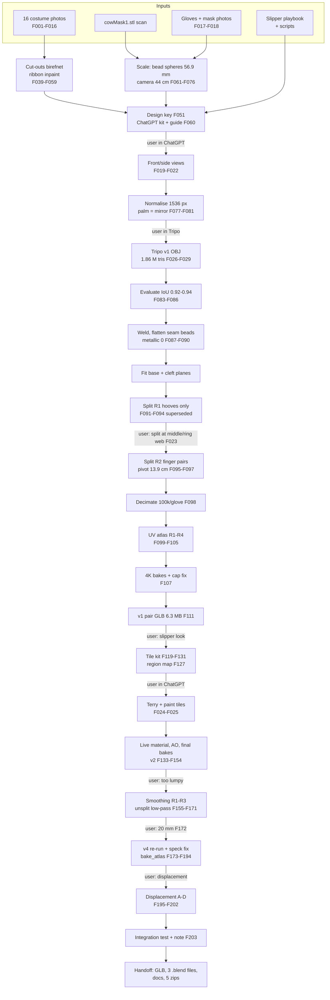

# WINDOW REPORT: Claude (Claude Code, model `claude-opus-5-5`) | "3D glove model for Misanthropic Cow" | 2026-10-28

**Window code:** GLOVES · **Session:** `session_01TFV9tjKBmiqmMVJECeYn3N` (claude.ai cloud session, origin `web_claude_ai`) ·
**Repository:** `eccentricexhibits/main`, branch `claude/misanthropic-cow-glove-model-i5406l`, folder `Misanthropic_Cow_Gloves/`

> **Visibility notice (read first).** This conversation exceeded the model's working context once. At
> **2026-10-28 23:33:32 UTC** the earlier part (18:22–23:33 UTC) was replaced in my working memory by an automatic
> summary. However, the complete session transcript (JSON lines, 2,996 events, 63.2 MB) is still stored in the
> container, together with every uploaded file, every script and the git history. **This report was reconstructed from
> those primary records**, not from memory. Consequences:
> - Sections 1–7 and 11 for the period before 23:33 UTC are drawn from the transcript, tool outputs, files and commits,
>   and are marked [RECORDED] where read directly from them.
> - My internal reasoning ("thinking") for that period is only partly stored (30.7 k characters survive). Rationales
>   for that period are therefore taken from what I *wrote* to the user at the time, and are marked as such.
> - Timestamps are **UTC** as recorded by the system. **Local time is not visible** [UNKNOWN time zone].
> - The report covers this window only. The current exchange (the documentation request) was still running when the
>   token figures were read.

Labels: **[RECORDED]** visible in the conversation, tool output, files or git; **[INFERRED]** my deduction, with the
reason; **[UNKNOWN]** not determinable; **[ESTIMATED]** a numeric estimate with its method stated.

---

## 0. Window summary

| Item | Content |
|---|---|
| AI program and model | Claude Code (Anthropic) running in a claude.ai cloud container; model **`claude-opus-5-5`** (Opus 5.5) for all 985 assistant messages [RECORDED: transcript `model` field; session `configured_model` and `last_served_model`]. Effort level "high", permission mode "auto" [RECORDED: session metadata]. Claude Code container version 2.1.316 [RECORDED]. |
| Other AI used in this window's pipeline | **ChatGPT** image generation (run by the user from prompt kits written here): three glove views and two texture tiles [RECORDED]. ChatGPT model/version [UNKNOWN]. **Tripo** image-to-3D multiview (run by the user): one model [RECORDED]; Tripo version and settings [UNKNOWN]. **Gemini**: not used in this window [RECORDED: no mention; the kit README says the prompts "work in ChatGPT image generation or Gemini", but the user used ChatGPT]. |
| Purpose / pipeline stage | Build the character's **costume gloves** (left + mirrored right): references → ChatGPT multiview → Tripo → Blender cleanup, split into animatable finger pairs, optimisation, UVs, bakes, "slipper look" materials from AI tiles, terry smoothing, optional true displacement, and integration notes for the full-character window. |
| Received from earlier work | `3D_Model_Pipeline_PLAYBOOK.zip` (19.2 MB) and `PLAYBOOK.md` (20 KB) from the earlier **slippers** window (process, scripts, worked example); 16 reference photos (2 RAR parts); later the mask scan `cowMask1.stl` (2014 MakerBot Digitizer scan per the user's master-document brief; the file itself carries no date) [RECORDED: uploads]. |
| Handed off | Final glove pair (v4, 20 mm terry smoothing) as GLB + baked .blend + live-material .blend + displacement .blend, renders, all scripts, `HANDOFF_gloves.md`, `PROJECT_STATUS.md`, `INTEGRATION_blender_render.md`; five handoff zips each < 29 MB; everything committed and pushed [RECORDED]. |
| Time range | First message **2026-10-28 18:22:55 UTC**; last production work **2026-10-29 01:21:00 UTC** (integration note sent); this documentation request **2026-11-01 01:35:49 UTC** [RECORDED]. Session created 2026-10-28 18:22:45 UTC [RECORDED]. |

---

## 1. Prompt log

Token columns are **[RECORDED]** from the per-request `usage` fields in the transcript (364 API requests in total, de-duplicated by request ID, taking the final streamed values). "Output" = tokens the model generated (visible text + thinking + tool-call code). "Context processed" = input + cache-read + cache-write tokens summed over every request in the exchange; it is large because each request re-reads the whole conversation (mostly from cache).

| # | Timestamp (UTC; local not visible) | User prompt (verbatim excerpt + summary) | What the AI did | Outputs (figure IDs) | Tokens for this exchange |
|---|---|---|---|---|---|
| 1 | 2026-10-28 18:22:55 (+ intake answers 18:26:47; stop-hook notice 19:09:04) | *"Read PLAYBOOK.md and use this process to build a 3D model of gloves for my character "The Misanthropic Cow". I've supplied reference photos and handoff files from a previous Claude window…"* + 4 attachments (playbook zip, PLAYBOOK.md, 2 RAR parts). Intake (dialog): "No, use AI views"; "Worn, hoof closed, but please keep both hooves separate (I would like to be able to animate both parts separately)"; "Satin black, grey wear"; "Static, one mesh". | Unpacked archives (installed `unar`); viewed all 16 photos; asked 4 intake questions; installed the 3D toolchain; built white-background cut-outs with rembg (isnet failed → birefnet), inpainted a ribbon, made 5 detail crops, a 10-point design key, a 5-step ChatGPT prompt kit + fix-ups, a guide page (published artifact); committed `8a284f0`. Stop hook flagged an untracked stray wheel file; the AI deleted it. | F030–F060 (working crops, segmentation tests, cut-outs, design key, guide page screenshot); kit zips | 59 requests; output **70,350**; context processed 10,933,759 |
| 2 | 19:11:46 | *"I've got a 3D scan of the mask, and I've got two pictures of the gloves next to the mask. Does that help for scale?"* + `cowMask1.stl` + 2 photos. | Rendered/analysed the STL (installed EGL libs), sphere-fit the bead eyes, matched photo 2 to the EXIF-tagged D800 frame, computed camera height and real glove size, rebuilt the kit with measured proportions, updated the guide page; commit `7360511`. | F017, F018 (inputs); F061–F076 | 30 requests; output **45,327**; processed 9,590,949 |
| 3 | 20:24:30 | *"Here's the first image that came back; the hooves are attached together. Is this correct? I was looking to animate both parts separately. Is this a problem with our prompts or ChatGPT?"* + 1 image. | Explained that the closed hoof is intended (split happens in 3D), checked the view against the checklist (hoof 36 % of height, ~3.1× tall/wide), approved it. | F019 | 2; out 2,844; processed 721,431 |
| 4 | 20:27:23 | *"Is there a reason why we're skipping step 2, and keeping the same window open? …"* | Explained the step numbering (Step 1 makes no image; the front view *is* Step 2) and why one ChatGPT chat is used. | – | 1; out 1,350; processed 363,684 |
| 5 | 20:35:13 | *"How are these?"* + 3 images (front re-sent, little-finger side, thumb side). | Checked consistency (hoof 35–36 % in all; side silhouettes IoU 0.80), mirrored the front to make the palm view, normalised all four to 1536 px squares, found and fixed a Left/Right slot error in the kit, sent the Tripo zip; commit `e30970b`. | F020–F022 (inputs); F077–F082 | 8; out 11,864; processed 3,057,170 |
| 6 | 20:46:38 | *"here's the result!"* + 2 RAR parts (Tripo download). | Extracted (the 313-byte `.mtl` failed, recreated), measured the 1.86 M-triangle OBJ, rendered turnarounds, silhouette-compared against the inputs, listed defects and two decisions (cuff, thickness); commit `53b610a`. | F026–F029 (inputs); F083–F086 | 16; out 17,953; processed 6,471,220 |
| 7 | 20:59:34 | *"Let's keep it closed and keep the current thickness, if you recommend it (the glove is long gone) …"* | Welded the mesh in Blender, flattened invented seam beads, set metallic 0, fitted base and cleft planes, split the hoof into two toes (round 1: hooves only, pivot at hoof base), exported a low-res test GLB; commit `69828a8`. | F087–F094 | 23; out 48,882; processed 10,559,167 |
| 8 | 21:55:42 | *"The pivot needs to go lower. The actual costume was just white gloves with painted carboard hooves that covered the index / middle fingers together, and the ring / pinky fingers together. The split must happen as if you were splitting your middle / ring fingers apart."* + 1 photo. | Rebuilt the split (round 2) as two finger pairs parting at the middle/ring web, pivot 13.9 cm above the cuff; fixed a protruding palm stub and a thumb cut; commit `c44b026`. | F023 (input); F095–F097 | 7; out 21,968; processed 3,594,675 |
| 9 | 22:03:33 | *"Looks good; let's do the optimizing"* | Decimated (tested 150k/100k/64k; chose 100k per glove), unwrapped (4 UV rounds; fixed sliver-island specks), baked 4K colour/normal, painted the cut walls, exported the real-size v1 pair; offered "keep" vs "slipper look"; commit `87629ba`. | F098–F118 | 30; out 55,192; processed 17,542,278 |
| 10 | 22:26:31 | *"Let's go with slipper look. Can we ensure that the hooves keep the long paint brush strokes that the actual hooves had?"* | Made rotated photo swatches (strokes vertical), wrote two tile prompts, built the geometric paint/terry region map; commit `3c6c888`. | F119–F132 | 11; out 19,478; processed 7,237,844 |
| 11 | 22:43:32 | *"Are these good?"* + 2 tiles. | Prepared tiles (seams, height, roughness), built the live material, baked AO, fixed charcoal paint (gamma 1.3) and AO greying (normalise, ×0.5), final 4K bakes, v2 export, lean live .blend, renders, handoff doc, 4 zips; commit `76ca285`. | F024, F025 (inputs); F133–F154 | 20; out 42,335; processed 14,587,820 |
| 12 | 23:25:00 (context compacted 23:33:32; same message re-delivered by the user mid-turn 23:49:05) | *"The glove looks a tad too lump at the moment. Can you smooth it out?"* | Smoothing round 1–2 on the split parts (5/10 mm, pits survived), round 3 on the unsplit mesh (10 mm), full re-run of split→bake→export, before/after renders; worker restart during a bake (exit 137) recovered by baking passes separately; commit `c7cf833`. | F155–F171 | 59; out 54,719; processed 12,936,168 |
| 13 | 2026-10-29 00:04:37 | *"is there some way of building the little bumpy bits that are naturally a part of the material … or is that traditionally handled via a different process?"* | Answered: normal/bump maps (current), displacement, hair/curve loops; recommended options. | – | 1; out 1,777; processed 212,477 |
| 14 | 00:06:45 | *"The original Tripo conversion added a bunch of artifacts … Would your new version just reuse their mesh data, or actually come up with something new?"* | Explained what is Tripo's (shape, folds, hoof grooves) and what is new (fine terry from the tile); offered stronger smoothing or a rebuild. | – | 1; out 1,811; processed 214,341 |
| 15 | 00:07:50 | *"yes, show me the stronger smoothing side by side"* | Ran 20 mm and 30 mm unsplit smoothing, split both, clay renders vs 10 mm, reported widths and side effects. | F172 | 7; out 3,972; processed 1,544,430 |
| 16 | 00:18:31 | *"Let's go with 20mm."* | Full pipeline re-run at 20 mm; diagnosed white specks on the hoof (tile lint flecks + bake-margin overwrite between parts), fixed both (`bake_atlas.py`, fleck inpainting), v4 delivery, zips; commit `4e19ad4`. | F173–F194 | 48; out 43,645; processed 12,887,576 |
| 17 | 00:50:19 | *"try the displacement option for the terry bumps"* | Built a displacement mask and a Cycles displacement .blend; tested 4 settings (A bump, B raw 1.5 mm, C softened 0.3 mm, D softened 0.12 mm, delivered); one out-of-memory run (1 px screen dicing); five handoff zips; commit `b520515`. | F195–F202 | 27; out 35,113; processed 9,334,027 |
| 18 | 01:14:35 | *"I think this looks great, but will this only work in Blender? I plan on adding the model to a 3D model of the Misanthropic Cow that I'm doing in another Claude window."* | Explained portability (GLB anywhere; displacement Cycles-only) and integration rules. | – | 1; out 1,670; processed 375,502 |
| 19 | 01:17:04 | *"Yes, write the integration note for a Blender render"* | Tested appending into a fresh character file with a stand-in rig, verified spread signs, relative paths after moving the folder and a Cycles render, wrote `INTEGRATION_blender_render.md`; commit `9ce16ec`. | F203 | 10; out 20,161; processed 3,915,820 |
| 20 | 2026-11-01 01:35:49 | *"DOCUMENTATION REQUEST: Misanthropic Cow 3D model, process report for this window …"* | This report, the figure register and package. | report.md / report.pdf / figures | In progress when measured (≥ 3 requests; output ≥ 5,319) [RECORDED partial] |

---

## 2. Inputs and source data

| Input | Type / origin | Size | Resolution / polycount / units | Defects or notes |
|---|---|---|---|---|
| `3D_Model_Pipeline_PLAYBOOK.zip` | Earlier Claude window (slippers): `PLAYBOOK.md`, 29 scripts, templates, worked example (`HANDOFF_slippers.md`, slipper reference images incl. `real_fabric_swatches/`) [RECORDED] | 19,190,005 B | – | The slipper reference images in it were not opened in this window [RECORDED: no reads]. |
| `PLAYBOOK.md` | Same (also attached separately) | 20,054 B | – | – |
| `Glove_Reference_Materials.part1/2.rar` | User's photo set | 30,408,704 B + 16,777,083 B | 16 JPEGs (table below) | Needed `unar` 1.10.1 to extract [RECORDED]. |
| 13 × "Original Costume - Glove Reference (n of 13).jpg" (F002–F014) | Camera photos; EXIF Model "Leaf Aptus 22"; DateTimeOriginal 2012-11-30 12:00 – 2012-12-01 16:52; processed in Lightroom Classic 15.6 [RECORDED EXIF] | 2.5–5.6 MB each | 4000×5336 or 5336×4000 | Coloured studio light (green/pink/teal) shifts terry colour; costume shots, gloves small in frame. |
| "Left Hand Glove - No Hand Inside.jpg" (F001) | Camera photo; NIKON D800, 24 mm (35 mm-equiv 24); DateTimeOriginal 2013-10-31 21:16; edited in Photoshop 27.11 [RECORDED EXIF] | 1,254,074 B | 3159×3072 | Toes parted; grey dirt mark on the terry. Key frame for front view, scale and swatches. |
| "Right Hand Glove - No Hand Inside.jpg" (F016) | Photo, no camera EXIF [RECORDED] | 2,648,843 B | 2922×2850 | Did not segment cleanly; not used for cut-outs [RECORDED]. |
| "Right Hand Glove - Alt Image - No Hand Inside.jpg" (F015) | Canon EOS 6D, EF40mm f/2.8 STM; DateTimeOriginal 2016-05-24 [RECORDED EXIF] | 2,153,587 B | 3465×2285 | Glossy green-black hoof and a cyan drawn ellipse; excluded [RECORDED]. |
| `cowMask1.stl` | 3D scan of the mask (user: "a 3D scan of the mask"; 2014 MakerBot Digitizer per the master-document brief) | 15,734,284 B | Extent ≈ 227 × 201 × 158 units, interpreted as **mm** [RECORDED tool output; unit INFERRED from size] | A relief on a rectangular base block rather than a full head [RECORDED]. Triangle count [UNKNOWN: not recorded in visible output]. |
| Photos 1 and 2 of the gloves beside the mask (F017, F018) | Camera photos uploaded inline | 272,680 B; 364,389 B | 2000×1335 each (as received) | Photo 1: segmentation lost both hooves (darker); photo 2 = same D800 24 mm frame as F001 (template match 0.987) [RECORDED]. |
| ChatGPT front view (F019; re-sent identically as F020) | AI image (ChatGPT) | 146,696 B (WebP) | 1172×1832 | Not square (prompt asked 1:1) → padded during normalisation. Slightly glossier/marbled hoof than the real satin [RECORDED assessment]. |
| ChatGPT side views (F021, F022) | AI images | 66,850 B; 64,070 B | 1254×1254 | Little-finger side has diagonal "twisted sock" wrinkles [RECORDED]. |
| User's hand photo (F023) | Phone/camera photo | 261,724 B | 1506×2000 | Shows the Vulcan-salute split location. |
| `furry_glove_3d_model.part1/2.rar` | Tripo output (OBJ + PBR maps) | 30,408,704 B + 29,743,216 B | OBJ 185,803,706 B: **1,863,202 triangles, 948,007 vertices** (931,603 after welding), extent X 0.482 × Y 0.972 × Z 0.258 model units (1 unit = 25.4 cm at the measured length); maps: base colour 8192², normal 4096², metallic 4096², roughness 4096² (F026–F029) [RECORDED] | `.mtl` (313 B) failed to extract; recreated [RECORDED]. Metallic hoof 0.923 mean; roughness lost on import; invented seam beads; closed flat cuff; fused toes [RECORDED]. |
| ChatGPT tiles (F024, F025) | AI images | 407,614 B; 488,262 B (WebP) | Terry 2000×2000 (the chat preview copy was 1932×1932); paint 1254×1254 | Terry already seamless (edge/interior ratio < 1); paint seam in the vertical direction (ratio 1.5) and ~290 small cream lint flecks (found later) [RECORDED]. |

---

## 3. Methods

**Environment [RECORDED].** Ubuntu 24.04.5 LTS container (claude.ai cloud), CPU only, 16 GB RAM (stated in the handoff), Python 3.13.17. Blender as a Python module: **bpy 5.2.3 LTS** (headless; scripts run with plain `python3`). numpy 2.5.3, scipy 1.18.1, OpenCV 5.0.0, Pillow 12.3.0, trimesh 5.2.0, pyrender 0.1.45 (installed `--no-deps`, EGL offscreen), rembg 2.0.86 with onnxruntime 1.29.0 (model `birefnet-general`), networkx 3.7, rtree 1.4.1, imageio 2.38.1, `unar` 1.10.1, Chromium (Playwright-bundled) for page screenshots and this PDF. Versions were read at report time; the same container environment was used throughout [INFERRED: the main install ran at 18:42–18:44 UTC, EGL libraries were added at 19:12 UTC, and nothing was reinstalled afterwards]. Non-Blender scripts that read downloaded data were run with `python3 -I`.

**Coordinate and unit conventions [RECORDED].** Work files in the Tripo model's units: glove 0.972 units tall = 24.7 cm, so 1 mm = 1/254 unit (≈ 3.93 units/m). Blender frame: Z up, back of the hand toward −Y, thumb (left glove) toward +X. Deliverables in **metres**, real size; left glove cuff centre at x = −0.12 m, right glove = mirrored node at +0.12 m. glTF: Y up, back of the hand toward +Z. Tripo slot convention: Left = the object's own left (= thumb side of this left glove).

1. **Intake (18:22–18:27).** Read PLAYBOOK.md; one 4-question intake dialog; answers in §1 row 1 [RECORDED].
2. **Reference preparation (`prep_refs_gloves.py`).** rembg `isnet-general-use` kept only the black hooves (F039, F040), so **birefnet-general** was used (F041). One cut-out job per process: several birefnet jobs in one process exhausted 16 GB [RECORDED]. Colour neutralisation strength 0.8; keep components > 15 % of the largest. A lilac ribbon in Original Costume 10 of 13 was **inpainted before segmentation**. Removing it afterwards cut a false notch (F044 → F045). Outputs: REF_A/B/C cut-outs 1536 px (F052–F054), DETAIL_1–5 crops 1024 px (F055–F059), reference sheet F049.
3. **Design key (`design_key_gloves.py`).** Three panels with 10 numbered feature badges placed via grid overlays (F046–F048); output F051 (2860×1650).
4. **ChatGPT prompt kit (`kit_content.py` → `build_kit.py` → `build_page.py`).** Steps 1–5 + fix-ups A–J, packaged as zips with images numbered in attach order; guide page published as a private artifact "Hoof Glove View Kit" (https://claude.ai/artifact/5wPgSKLfAkQaDFmgiLiA6y; screenshot F060). Rebuilt at 19:27 (measured proportions) and at 20:36 (Tripo slot fix only). **The user ran the 19:27 version**: generation happened between 19:27 and 20:24, and the Step 1–4 prompt text is identical in the 19:27 and 20:36 builds (git diff of `kit_content.py` shows only the slot table changed) [RECORDED + INFERRED timing]. Verbatim prompts: Appendix A.
5. **Real-world scale (`measure_scale.py`).** The STL is a relief on a base block (F061). A sphere was fitted to each bead eye on the scan: centre-to-centre **56.9 mm**, beads ~23 mm across. Photo 2 matched the D800 frame (template match 0.987), and its EXIF lens gives f = 24 mm on a 35.9 mm sensor, so f_px = 24/35.9 × image width. Hough circles on the yellow beads gave their pixel spacing (F066–F069), hence the camera distance to the eye plane. The eye centres sit ~65 mm above the mat (scan centre Z 122.7, rim at Z ≈ 58), so the camera was ~44 cm above the mat. Scale was evaluated at each part's height (terry ~10 mm, hoof outline ~15 mm). Landmarks were picked on gridded zooms (F072, F073); widths come from birefnet glove masks (F070). Cross-checks: beads 22.7 mm vs 23 mm; mat 598 mm vs a 610 mm (24 in) cutting mat. Uncertainty ±5 % [RECORDED]. A plotting bug drew the eye line without the crop offset (F074); the numbers were unaffected and the drawing was fixed (F075, F076).
6. **AI views (user in ChatGPT).** The front view was the first image returned (user's words); attempts for the other views [UNKNOWN]. Checks: hoof 35–36 % of the height in all three views; side silhouettes mirror each other with IoU 0.80 [RECORDED].
7. **Tripo inputs (`normalize_glove_views.py`).** 1536×1536 white squares; glove spans y = 115…1421 px (85 % of the height); horizontally centred on the hand axis taken from the top 30 % (hoof) rows, so the thumb doesn't shift the glove. Back = mirrored front. Line-up check F077; files F078–F081 [RECORDED].
8. **Tripo evaluation (`render_model.py`, `measure_tripo_glove.py`, `compare_to_views.py`).** pyrender turnarounds (F083, F084); orthographic silhouettes vs inputs (IoU 0.92–0.94; F085); measurements in §4; close-ups of defects (F086). trimesh `split()` on 1.86 M triangles ran out of memory, so a scipy connected-components count was used instead (1 component) [RECORDED].
9. **Import and weld (`bl_import_weld.py`, `bl_dump_mesh.py`).** OBJ import (forward −Z, up Y), transforms applied, `remove_doubles` 1e-6 → watertight, no holes [RECORDED]. Metallic set to 0.
10. **Seam-bead flattening (`flatten_seams.py`).** Feathered band where the heavily smoothed normal faces sideways (|n_y| 0.18–0.40 smoothstep) plus the bottom 8–15 mm of the cuff, terry only (luminance ≥ 110, feathered). Vertices projected back onto a smoothed surface along the normal, 2 passes, max move 1.4 mm; the hoof's real beaded rim kept (F090) [RECORDED].
11. **Cut planes (`fit_hoof_planes.py`).** The hoof mask is the dark vertex colour, graph-smoothed for 30 iterations, largest component kept.
    - **Base plane:** least squares through the paint edge, thumb excluded: 64.6 % of the height, 6.9° tilt, 4 mm residual. The first fit had a 34 mm residual and was fixed by the graph smoothing [RECORDED].
    - **Cleft plane:** fitted through the groove bottom found front and back at several heights; 2.9 mm residual.
    - Values: `05_cleanup_and_split/cut_planes.json` [RECORDED].
12. **Split, round 1 (superseded).** Hooves only, pivot at the hoof base, mitten extended ~2 cm inside the toes (F091–F094).
13. **Split, round 2 (`bl_split_fingers.py`, adopted).**
    - **Web plane:** parallel to the base plane, 20 mm below it, where the crease under the cleft fades.
    - **Palm:** cut flat at the web plane; the thumb is excluded from the cut (`skip_x_above` = hand x-max + 3 mm).
    - **Toes:** split by the cleft plane; openings filled flat (materials `Hoof_InnerWall` above the base, `Terry_Inner` below).
    - **Pivot:** (−0.0478, −0.0029, 0.5469) model units, i.e. 13.9 cm above the cuff, mid-thickness. `view_layer.update()` before parenting; palm stub 0 mm (a 15 mm stub poked out between the toes; F095).
    - Thumb tip piece (21,842 faces) removed from the toe as a stray component [RECORDED].
    - Animation axes: spread = local Y, curl = local X.
14. **Optimisation (`bl_optimize_parts.py`, `compare_glove_lods.py`).** Full mesh kept as `<part>_HIGH`. LOW copy:
    1. Interior vertices of hidden flat faces (cut caps, cuff bottom) decimated to 3 % of their faces.
    2. One global Decimate (collapse) pass to the budget: palm 60,000 + each toe 20,000 = **100,000 triangles per glove**.
    - Compared with 150k and 64k over 8 cameras (F098) [RECORDED].
15. **UV atlas (`bl_unwrap_parts.py`).** One shared atlas for the three parts.
    - **Rounds 1–2:** smart-project at 66° and 80° (~1,800 islands; F099, F100). Sliver islands baked as specks (F101, F104).
    - **Round 3:** unwrap on Laplacian-smoothed proxies (30 iterations, λ 0.5; F103).
    - **Round 4 (adopted):** islands under 40 faces merged into their neighbour chart, seams only between charts, angle-based unwrap per chart (F105).
    - Texel weights: hoof 1.3, terry 1.0, inner walls 0.6, cuff bottom 0.3, palm top 0.25 [RECORDED].
16. **Selected-to-active bakes (`bl_bake_parts.py`).**
    - Settings: Cycles CPU, 4096 px, 2 samples, cage extrusion 0.012, max ray 0.03, margin 16 px EXTEND; colour + tangent normal; cap edges marked sharp.
    - Cut walls painted directly into the maps (`bl_fix_cap_texels.py`; paint RGB (25,25,24), terry (223,213,179), wall roughness 0.75), because coplanar caps baked as a grey "sheet".
    - Roughness derived from colour: 0.90 − 0.35·dark, since Tripo's roughness map was lost on import [RECORDED].
17. **v1 export (`bl_export_pair.py`).** Real size 24.7 cm, metres, mirrored right glove sharing meshes; GLB 6.3 MB (F111) [RECORDED].
18. **Tile kit (`prep_tile_refs.py`).** Swatches cropped and rotated so brush strokes run vertically (paint A rotated 50° CCW, B 125° CCW), 1024 px; prompts in Appendix A.6 (F128–F131) [RECORDED].
19. **Region mask (`bl_bake_geom_parts.py` → `make_masks_glove.py`).** EMIT bakes of world position and part ID (4096 px). Paint = finger-pair texels above the hoof base plane; Gaussian σ 0.8 px; unbaked texels take the nearest class. Region map F127 approved by the user [RECORDED: user "Are these good?" + continued].
20. **Tile preparation (`prep_tiles_glove.py`).** All tiles 2048 px.
    - **Terry:** colour × (1.00, 0.99, 0.95).
    - **Paint:** vertical seam fixed by a half-offset crossfade (ramp 0.22, contrast compensation with a σ 24 blur); darks deepened with gamma 1.3.
    - **Height maps:** terry = 0.5 + 0.25·HP(σ 16); paint = 0.5 − 0.15·HP(σ 4) − 0.10·HP(σ 30), dark = raised.
    - **Paint roughness:** 0.50 + 0.22·grey-streak mask.
    - **v4 addition:** isolated bright flecks (> 100 above a 7 px median, dilated 3×3) inpainted with OpenCV Telea (radius 3, 32 px wrap padding); 288 flecks removed; seam scores unchanged (1.20/1.37 → 1.21/1.40) (F175, F176, F184) [RECORDED].
21. **Live material (`bl_glove_material.py`).** Principled BSDF; specular IOR level 0.4; metallic 0.
    - **Projection:** tiles box-projected from each part's **own object coordinates**, terry 4 cm and paint 6 cm, blend 0.3, so the strokes run base-to-tip and move with the toes. The UV mask switches between terry and paint.
    - **Roughness and sheen:** terry roughness 0.92 and sheen 0.45; paint roughness from its map.
    - **Bump:** tile height bump (strength 0.45, distance 0.15 cm; paint height scaled 0.45) on top of the baked detail normal.
    - **AO:** baked at 2048 px with 12 samples, distance 1.5 cm; denoised with 2 bilateral passes (9, 0.15, 6) and (9, 0.12, 6); divided by the 90th percentile; cubic upscale to 4K; gamma 0.8; multiplied in at factor 0.5. At 0.6 un-normalised it greyed the terry by ~20 % [RECORDED].
    - **Final bakes:** 4096 px, 4 samples (diffuse colour, roughness, tangent normal), ~51–58 s each.
22. **v2 export and packaging.** GLB 14.5 MB; baked .blend + `textures/`; live .blend made portable (`bl_lean_live.py`: copy textures, set absolute paths, save, make relative, save). A moved-copy test passed (F138) [RECORDED].
23. **Terry smoothing.** Rounds 1–2 smoothed the split parts (`scripts/superseded/bl_smooth_terry.py`): HIGH parts low-passed and LOW snapped with Shrinkwrap. It failed at the web (F158), because the cut walls had to stay pinned.
    - **Round 3 (adopted; `smooth_terry_unsplit.py`)** smooths the unsplit 931,603-vertex mesh **before the split**.
    - Low-pass: V' = V + w·(2S(V) − S(S(V)) − V), where S is uniform-graph Laplacian diffusion with (r/ē)² iterations (ē = mean edge length, 0.31 mm). This removes lumps smaller than r while undoing shrinkage to second order.
    - Weight w = 0 on the hoof (paint side of the base plane, smoothstep 1–4 mm below it, thumb never pinned) and on the cuff bottom (feathered ~5 mm).
    - r = 10 mm (v3), then **20 mm (v4, user's choice)**, with 30 mm tested. Everything downstream was re-run (§4) [RECORDED].
24. **Speck fix (`bake_atlas.py`).** Each part is baked into a cleared image. Its own UV triangles are rasterised (OpenCV `fillPoly`, 4-bit subpixel, pixel-centre convention) to decide texel ownership. The margin is applied once with an EDT nearest fill (16 px; 4 px for geometry bakes). The ownership raster matched Blender's own part bake on 100.00 % of covered texels [RECORDED].
25. **True displacement (Cycles only).**
    - **Mask (`bl_make_displace_mask.py`):** terry only; 0 on the hoof and cut walls; smoothstep fade-in from 0.5 mm to 3 mm, by 3D distance (cKDTree) from 3,403 points sampled every 0.3 mm along the wall edges; 0.7 px blur; islands padded with EDT [RECORDED].
    - **Blend (`bl_terry_displace.py`):** Subdivision modifier type SIMPLE with adaptive subdivision in object space at a **0.3 mm** edge length (`max_subdivisions` 12). Displacement node in object space, midlevel 0.5, scale **1.2 mm**, using the terry height softened by a σ 0.12 mm Gaussian (σ ≈ 6.1 px at 2048 px per 4 cm), with half the contrast lost to the blur restored. Terry bump disabled where displaced [RECORDED].
26. **Integration test.** Appended the six objects into a fresh .blend with a stand-in armature and parented the palms to `hand.L`/`hand.R` bones. Checked spread (12° → tip gap 0.6 → 4.8 cm on both gloves), bone following (toe pivot moved 7.2 cm for a 30° bone turn), relative paths after moving the project folder (10/10 textures found), and a Cycles render (F203) [RECORDED].

**How 2D images were related to 3D geometry.**
- Photos and AI views drove Tripo's geometry.
- The photo-derived scale set real size.
- The paint/terry boundary was derived from **geometry** (a plane through Tripo's colour edge), not from image projection.
- Tiles are box-projected in object space, not photo-projected [RECORDED].

**Image-generation prompts.** All verbatim in Appendix A.
- **Requested settings:** square 1:1, white background, glove ~85 % of the height, near-orthographic.
- **Tiles:** square, "as large as you can make it".
- **Received:** the front view came back 1172×1832; the sides 1254×1254; tiles 2000² and 1254² [RECORDED].
- **ChatGPT model:** [UNKNOWN]. **Attempts:** front view = attempt 1 (user's words); all others [UNKNOWN].

---

## 4. Quantitative results [RECORDED unless marked]

**Real size (measured, ±5 %):** cuff → hoof tip 24.7 cm (both gloves); terry cuff → hoof base 15.8 cm (L) / 16.0 cm (R); toe caps 8.5/9.0 cm (L), 9.4/8.3 cm (R); width at the wrist laid flat ~8 cm (L) / ~8.6 cm (R); thumb ≈ 4.5–5 cm; hoof ≈ 36 % of the length.

**Tripo v1 (`04_tripo_v1_evaluation/measurements.txt`).**

| Quantity | Value |
|---|---|
| Triangles / vertices | 1,863,202 / 948,007; 1 connected component |
| Hoof share of length | top 37 % (real 36 %) |
| Width incl. thumb at 5/25/45/60/70/85/95 % height | 8.9 / 8.3 / 10.3 / 11.5 / 8.4 / 6.9 / 3.3 cm |
| Thickness at the same heights | 6.5 / 5.7 / 5.8 / 5.5 / 5.3 / 4.5 / 2.3 cm |
| Cleft groove depth (front/back) at 70/80/90 % | 9.3/7.0, 7.3/6.4, 2.6/2.8 mm; hoof thickness 53/50/36 mm |
| Metallic | mean 0.335, hoof mean 0.923, terry 0.133 |
| Roughness | mean 0.840, hoof 0.750, terry 0.871 |
| Silhouette IoU vs inputs | 0.92–0.94 |

**Split parts (v2 build).**
- Palm 1.24 M faces; toes ~0.32 M faces each; toe lengths 11.1 cm (index-middle) and 10.8 cm (ring-little); pivot 13.9 cm above the cuff [RECORDED: v3/v4 runs print palm 1,238,317 / 1,237,597 faces etc.].
- Low-res test GLB: 1,794,516 B.

**Decimation (8 cameras vs the 1.88 M-triangle split mesh).**

| Budget per glove | Mean shading diff (0–255) | Silhouette mismatch |
|---|---|---|
| 150k | 2.58 | 0.05 % |
| **100k (chosen)** | 3.03 | 0.06 % |
| 64k | 3.57 | 0.08 % (hoof rim jagged) |

**UV atlas.** v2: 64 islands, 63.9 % coverage; v3: 58 islands, 65.0 %; v4: 76 islands, 63.8 % (all 4096²).

**Bake timings (CPU).**
- Selected-to-active, 4K, 2 samples: colour ~47–63 s, normal ~44–50 s, roughness ~53 s.
- Final material bakes, 4 samples: 51–58 s each. AO 2K, 12 samples: 24–48 s.

**Terry smoothing (unsplit mesh, 931,603 vertices, mean edge 0.31 mm).**

| Radius | Iterations | Terry move mean / p99 / max | Width incl. thumb | Outcome |
|---|---|---|---|---|
| 0 (v2) | – | – | 12.0 cm | lumpy |
| 10 mm (v3) | 1,065 | 0.45 / 1.34 / 2.44 mm | 12.0 cm | folds kept |
| **20 mm (v4)** | 4,260 | 0.92 / 3.12 / 5.68 mm | 11.8 cm | most folds gone |
| 30 mm (test) | 9,584 | 1.58 / 5.59 / 9.67 mm | 11.4 cm | thumb slimmer, wobbly cuff edge |

Hoof maximum move 0.000 mm in all runs. Per-part smoothing (rejected), 10 mm: palm mean 0.46 mm / max 7.55 mm; toes 0.82 / 13.72 mm, concentrated at the web.

**Specks.** Colour outliers on the paint (> 90 from a 5 px median): 402 → 119 after the tile fleck fix. Remaining bright patches were margin overwrite: e.g. texel (2126, 3521) went from RGB (213, 204, 175) to (21, 21, 21) after the compositing fix. Bright blobs (> 185) in the hoof close-up: 0.

**Displacement.** One run with 1 px screen-space dicing was killed (exit 137, out of memory). With object-space dicing at 0.3 mm: peak memory ~6.0 GB (sampled with `free -m` every 5 s); 4 close-ups at 800 px and 32 samples took 2 min 19 s. Mask covers 71.3 % of covered texels at > 0.5 (padded; the first unpadded value was 56.0 %).

**Final deliverables (v4).**
- `Glove_pair.glb` 15,047,220 B, 100k triangles per glove, 4K colour/normal + 2K roughness JPEG.
- Baked .blend 4.22 MB; live .blend 4.23 MB; displacement .blend 4.23 MB.
- Handoff zips: Part1 22.9 MB, Part2 14.4 MB, Part3 16.9 MB, Part4 18.5 MB, Part5 28.4 MB.

---

## 5. Decisions, assumptions and judgment calls

| Decision | Rationale (as stated at the time) | Approved by the user? |
|---|---|---|
| AI views instead of a photo re-shoot | Real gloves no longer available | **Yes** (intake) |
| Worn, hoof closed, toes separate for animation | User's specification | **Yes** (user's own answer) |
| Satin black hoof with grey wear | Matches studio photos, not the glossy "Alt Image" | **Yes** (intake) |
| "Static, one mesh" (no rig) | Intake answer; later superseded by the user's request for separable finger pairs (parented objects, still no armature) | **Yes** |
| Generate the hoof **closed and joined**; split in 3D | Tripo fuses touching parts; a parted hoof bakes in the pose | User asked, accepted the explanation [RECORDED] |
| One ChatGPT chat for all views | Consistency; slipper precedent | User asked; accepted ("It's fine if 1 window provides better results") |
| Palm view = mirrored front; thumb view optional | Mirrored approved view is better Tripo input | Implicitly (user followed the kit) [INFERRED] |
| Measure scale from photo 2 + scan (not photo 1) | Photo 1 lost hooves in segmentation; photo 2 has lens data | Not explicitly approved [RECORDED: no objection] |
| Accept Tripo v1 without round 2 | IoU 0.92–0.94, proportions within 1 % | Implicitly (user proceeded) |
| Cuff closed; thickness as Tripo | Sleeve hides the cuff; no hand close-ups exist | **Yes** |
| Flatten seam beads (terry only; keep hoof rim) | Beads are Tripo inventions at view seams | Shown; not objected |
| Split as two **finger pairs** at the middle/ring web | User's correction about the real costume | **Yes** (user's instruction; "Looks good") |
| Web 20 mm below the hoof base | Where the modelled crease fades | **Yes** (approved split) |
| 100k triangles per glove | Lowest budget that kept the rim beads | User approved optimising; budget not separately approved |
| One shared 4K atlas for 3 parts | Right glove reuses the maps | Not separately approved |
| Slipper look (ChatGPT tiles), keep long brush strokes | User's choice | **Yes** |
| Paint region from geometry (plane), not colour | The real paint edge was a clean cut | Region map shown; user proceeded [INFERRED approval] |
| Paint gamma 1.3; terry warmed; AO normalised × 0.5 | Paint read charcoal; terry read grey; AO greyed the glove | Not separately approved |
| Smooth the terry (user asked), on the **unsplit** mesh | Pinned walls left pits in the split-part method | Requested; method not separately approved |
| 20 mm smoothing | User's choice after a 10/20/30 mm comparison | **Yes** |
| Fix specks via per-part bake compositing and tile fleck removal | Root-caused bugs | Not asked (bug fix) |
| Displacement variant D (1.2 mm, softened 0.12 mm, 0.3 mm dicing) as a **separate** file | B was spiky, C patchy, 1 px dicing exhausted memory | User: "I think this looks great" |
| Split handoff into 5 zips | Keep each file < 29 MB (user's standing rule) | Rule from user |
| Assumptions: hoof side profile (slim wedge) and palm = mirror of back; thickness 5.3–5.8 cm from AI views | No photos show these | Flagged; not verified [RECORDED] |

---

## 6. Problems, failed attempts and fixes

| # | Problem | Diagnosis | Fix / outcome |
|---|---|---|---|
| 1 | RAR archives would not open (`rarfile` wheel download attempt) | No RAR tool | Installed `unar`; the stray downloaded wheel was flagged by the git stop hook (19:09:04) and deleted |
| 2 | rembg `isnet-general-use` dropped the cream terry (F039, F040) | Low contrast cream vs light background | Switched to `birefnet-general` (F041) |
| 3 | birefnet out-of-memory when several jobs shared a process | 16 GB limit | One job per process |
| 4 | False notch in the hoof after removing the ribbon (F044) | Masking after segmentation | Inpaint the ribbon **before** segmentation (F045) |
| 5 | Kit size guess (30 cm) wrong | No measurement | Scale from mask scan + photo 2 → 24.7 cm; kit rebuilt (19:27) |
| 6 | Measurement image: eye line misdrawn (F074) | Crop offset omitted in drawing only | Fixed (F075) |
| 7 | Tripo Left/Right slots swapped in the kit | Convention mismatch with the slippers | Kit fixed at 20:36 before the user uploaded to Tripo |
| 8 | `.mtl` failed to extract; metallic map at a different resolution broke a lookup; thumb test caught the cuff | Archive and script issues | `.mtl` recreated; lookups fixed |
| 9 | trimesh `split()` OOM on 1.86 M triangles | Memory | scipy connected components |
| 10 | pyrender needed EGL; networkx build failed | Packaging | apt EGL libs; pyrender `--no-deps` |
| 11 | OBJ import stored a rotation as object transform | Importer behaviour | Transforms applied |
| 12 | Base-plane fit residual 34 mm | Noisy colour edge | Graph-smoothed hoof mask → 4 mm |
| 13 | Split round 1: area missing where the toes meet the mitten extension (F091) | Extension shrink direction OK; toe region missing | Rendered parts separately (F092); fixed (F093) |
| 14 | Children landed offset after parenting | Stale matrices | `view_layer.update()` before parenting |
| 15 | **Round 1 → Round 2 split** (user: pivot must be lower; caps glued to finger pairs) | Construction misunderstanding | Finger-pair split at the web (F097) |
| 16 | Palm stub poked out between the toes (F095); web plane cut the thumb | Stub folds in the crease; thumb rises above the web | Stub 0; thumb excluded from the cut |
| 17 | Mixed quads/triangles broke `foreach_get` | Bisect creates quads | Read faces through loops |
| 18 | **UV rounds 1–4:** ~1,800 islands, sliver islands baked as black/white specks (F099–F104, F112) | Sub-texel islands | Proxy smoothing + chart merging + angle-based unwrap: 64 islands (F105) |
| 19 | Coplanar cut caps baked as a grey translucent sheet; shading line at the web | Selected-to-active on coplanar caps | Walls painted into the maps; cap edges sharp |
| 20 | Tripo roughness lost on import | Importer | Roughness derived from colour |
| 21 | Paint read charcoal; AO greyed terry ~20 %; terry read grey (F135) | Tile values and un-normalised AO | Gamma 1.3; AO ÷ p90 at 0.5; terry B × 0.95 |
| 22 | Handoff Part 1 (34.7 MB) and Part 4 (32.8 MB) over 29 MB | Packaging | Rebalanced (21.2/13.9/28.8/26.5 MB) |
| 23 | **Smoothing round 1 → 2 → 3:** Taubin too weak; per-part low-pass left the toe band lumpy (pins); relaxed pins still left deep pits above the web (F158) | Cut walls must stay pinned | Smooth **before** the split (F159) |
| 24 | Script crashes: stale vertex-group handle after `modifier_apply`; slicing a bpy collection | API behaviour | Look up by name; `foreach_get` arrays |
| 25 | Stale `matrix_world` (identity) in a hidden collection made a move check misleading | Hidden objects not evaluated | Unhide + `view_layer.update()`; results unaffected |
| 26 | Worker restart killed a 4K bake (exit 137) | Process killed (memory or restart) [INFERRED] | Baked passes separately |
| 27 | **v4 white specks** on the hoof (F173, F174) | Hypothesis 1: ChatGPT tile lint flecks (F175), fixed (F176) but specks persisted (F177, F178). Pixel crops (F179) + raycast to UV: a later part's 16 px bake margin overwrote an earlier part's hoof texels | Per-part bake compositing (`bake_atlas.py`) → specks gone (F180, F181) |
| 28 | Displacement 1 px screen-space dicing: out of memory (exit 137) | 3 cm close-up diced to 0.04 mm/px | Object-space 0.3 mm dicing (~6 GB peak) |
| 29 | **Displacement A → B → C → D:** raw height gave spikes and dark slivers (B); 0.3 mm softening gave patchy nubs (C) | Detail finer than micro-polygons; softening ≈ loop size | 0.12 mm softening (D) (F198, F202) |
| 30 | UV seams would dip under linear filtering of the mask | Empty texels around islands | EDT padding of the mask |
| 31 | Render-time ratio claim not supported (parallel runs) | Measurement confound | Reworded with an absolute timing |
| 32 | Integration note: texture count misstated (12 vs 10) | Checked against files | Corrected |

Abandoned: hooves-only split (round 1); per-part smoothing (`scripts/superseded/bl_smooth_terry.py`); 30 mm smoothing; screen-space dicing; raw/over-softened displacement; `Glove_L.glb` single-glove export dropped from the final set (identical size to the pair, since both gloves share meshes; it remains in the superseded `07_deliverables_v1/`) [RECORDED].

---

## 7. Outputs

| Deliverable | Format | Specs | Purpose |
|---|---|---|---|
| `09_final/glb/Glove_pair.glb` | glTF binary | 15,047,220 B; 2 gloves (right = mirrored node sharing meshes); 100k tris/glove; 4K colour (AO baked in) + 4K tangent normal + 2K roughness; metallic 0; metres, Y-up | Any 3D software / engine |
| `09_final/blend_baked/Glove_pair_baked.blend` + `textures/` (3 maps) | Blender 5.2 | Same as the GLB; relative paths | Blender (Eevee/Cycles) |
| `09_final/blend_live/Glove_pair_live.blend` + `textures/` (10 files) | Blender 5.2 | Live tile material `Glove_Terry_Hoof_live` (box projection, mask, bump, AO) | Editing / renders |
| `09_final/blend_live/Glove_pair_live_displace.blend` | Blender 5.2 (Cycles) | Adds adaptive Simple subdivision 0.3 mm + 1.2 mm terry displacement | Close-up Cycles renders |
| Objects (all files) | – | `Glove_L_Palm` (root; origin = cuff bottom centre) → `Glove_L_Toe_IndexMiddle`, `Glove_L_Toe_RingLittle`; same for `Glove_R_*`; pivot 13.9 cm above the cuff; spread = local Y (Index +, Ring −), curl = local X | Animation |
| `09_final/renders/*` | JPEG | Final pair, close-ups, live-vs-baked, region map, before/after smoothing, bump vs displacement, pair with displacement | Review |
| `07_deliverables_v1/` | GLB/.blend | v1 (Tripo texture, 6.3 MB) – superseded | History |
| `05_cleanup_and_split/Glove_L_split_test_lowres.glb` | GLB | Low-res split test, model units | Approval of the split |
| `HANDOFF_gloves.md`, `PROJECT_STATUS.md`, `INTEGRATION_blender_render.md`, `01_design_brief.md` | Markdown | Process, decisions, reproduction, integration | Handoff |
| `02_chatgpt_kit/` (5 step zips + fix-ups + guide page), `08_fabric_tiles/` (tile kit, raw and prepared tiles, mask, region map), `03_tripo_inputs/` | Zip/PNG/JPEG/TXT | Prompt kits and AI inputs | Reproducibility |
| `scripts/` (45 scripts + `superseded/`) | Python | Entire pipeline | Reproducibility |
| Handoff zips (final set) | Zip | Part1 CONTEXT 22.9 MB · Part2 FINAL_GLB 14.4 MB · Part3 BLEND_BAKED 16.9 MB · Part4 BLENDS_LIVE 18.5 MB · Part5 SOURCES 28.4 MB (`high_full.glb`, the cleaned 20 mm-smoothed split full-detail mesh) | Transfer between chats |
| Artifact "Hoof Glove View Kit" | Private claude.ai page | https://claude.ai/artifact/5wPgSKLfAkQaDFmgiLiA6y | Step guide with copy buttons |
| 13 git commits `8a284f0` … `9ce16ec` | Git | Branch `claude/misanthropic-cow-glove-model-i5406l` (no PR opened) | Version history |

---

## 8. Division of labour

| Party | Contribution |
|---|---|
| **User (human)** | Supplied the photo set, the slipper playbook package, the mask scan and two scale photos; answered the intake; ran ChatGPT (3 views, 2 tiles) and Tripo (1 model) using the kits; approved/selected views; made the key design corrections (separate animatable toes; finger-pair split at the middle/ring web with a reference photo; keep cuff closed and thickness); chose the slipper look and long brush strokes; requested smoothing and chose 20 mm; asked for displacement and the integration note; set the 29 MB file rule. |
| **This AI (Claude, claude-opus-5-5)** | Planning against the playbook; all image processing (cut-outs, crops, design key, normalisation, swatches); scale measurement; all prompt writing; Tripo evaluation; all Blender/Python geometry work (weld, seam flattening, plane fitting, split, decimation, UVs, bakes, masks, materials, smoothing, displacement); diagnosis and fixes; renders and comparison sheets; packaging, documentation, git commits. |
| **ChatGPT** | Generated the front, little-finger-side and thumb-side views and the terry and hoof-paint tiles. |
| **Tripo** | Generated the 3D base mesh and PBR maps from the four normalised views. |
| **Other software** | Blender 5.2.3 (bpy) for geometry, baking and rendering (Cycles); rembg/birefnet (segmentation); pyrender/trimesh (analysis renders); OpenCV/scipy/numpy/Pillow (image and mesh processing); unar; Chromium (screenshots, PDF). |
| **Earlier windows** | Slipper project's playbook and scripts (reused: kit generator structure, tile prep, bake methods, conventions). |

---

## 9. Token accounting

**[RECORDED] session counters** (`get_session`, read 2026-11-01 01:35 UTC, i.e. before this report's work):
input 5,716; output **461,480**; cache read 120,410,716; cache write 935,989; reported cost **USD 40.83**.
Context window 1,000,000 tokens; auto-compaction threshold 784,000; one compaction (2026-10-28 23:33:32 UTC).

**[RECORDED] transcript sums** (364 API requests, final value per request, up to the moment of measurement):
input 730; output **505,730**; cache read 125,888,687; cache write 1,416,842; total context processed 127,306,259.
The two sources disagree (e.g. output 461k vs 506k). The reason is [UNKNOWN]; a plausible cause is that the session
counter excludes requests from before worker restarts [INFERRED, unverified]. Treat the window total as
**output ≈ 0.46–0.51 M tokens; input processed ≈ 121–127 M tokens (≈ 99 % cache reads)**.

**[ESTIMATED] breakdown** (method: characters measured in the transcript ÷ ~4 for prose, ÷ ~3.5 for code/JSON;
images by Anthropic's documented sizing, long edge ≤ 1568 px, tokens ≈ w×h/750; each item counted once, ignoring
the repeated cache reads that dominate the processed total):

| Category | Measured | Estimated tokens |
|---|---|---|
| User-typed text (21 messages incl. this request; plus intake answers) | 8,467 + ~600 characters | ~2.3k |
| Harness compaction summary (machine-written, not the user) | 15,270 characters | ~3.8k |
| AI visible text (replies) | 55,952 characters | ~14k |
| AI thinking (only 30,728 characters stored) | by subtraction from recorded output | ~290–330k |
| Tool inputs written by the AI (code, commands, file contents) | 624,806 characters | ~160–200k |
| Tool outputs returned (text) | 622,156 characters | ~150–180k |
| Uploaded images (9) | pixel dimensions | ~13.8k |
| Images viewed by the AI (127 incl. repeats) | pixel dimensions | ~154k |
| Attached files read as text (PLAYBOOK.md 20 KB, playbook scripts, docs) | included in tool outputs | (~5k for PLAYBOOK.md) |
| Generated images | none generated by this AI; renders enter only as viewed images above | 0 |
| Archives, STL, OBJ (binary) | processed by tools; only summaries entered the context | in tool outputs |

---

## 10. Open questions and handoff

**State at the end of production (2026-10-29 01:21 UTC) [RECORDED]:** v4 final (20 mm smoothing, specks fixed),
displacement variant, integration note; repo clean, last commit `9ce16ec` pushed; no pull request opened; latest
handoff zips (five parts) delivered. Nothing awaited the AI.

Open / unresolved:
1. **Approvals not explicitly given:** the 100k budget, atlas layout, AO/gamma/terry-warming adjustments, the
   smoothing *method* (only the strength was chosen) [RECORDED: no explicit approval].
2. **Known limitations** (in the handoff): AO baked with the toes closed (spread pose slightly dark); flat inner walls
   read grey at grazing angles; thumb not separately animatable; cuff closed; hoof side profile, palm and thickness
   follow AI views; faint terry tile mirrored repeat; displacement fade band across the knuckle line on closed gloves;
   GLB uses 4K maps (drop to 2K for real-time).
3. **[UNKNOWN] for the master document:** ChatGPT model/version and the number of attempts for the side views and
   tiles; Tripo version/settings; the user's local time zone; whether `cowMask1.stl` is the 2014 MakerBot Digitizer
   scan (stated in the brief, not in the file).
4. **Repository nit:** `scripts/bl_split_hoof.py` exists both in `scripts/` and `scripts/superseded/` (a later bulk
   copy restored it) [RECORDED: file listing]; harmless.
5. **Next steps offered:** integrate via `INTEGRATION_blender_render.md`; optional spread-pose AO re-bake, 2K/50k
   real-time LOD, hollow cuff, shorter displacement fade.

---

## 11. Figure register (visual materials)

203 figures, IDs **GLOVES-F001 … GLOVES-F203**, in chronological order. User-supplied inputs come first (F001–F029), then
everything made or viewed in this window. Each figure's file in the package is named `<ID>_<slug>.<ext>`.
- **Viewed images:** every image the AI opened is included. When the file had been overwritten later, the copy
  stored in the transcript is used, at the resolution the AI saw. The provenance column of `figures.csv` says which.
- **Thumbnails:** the AI's 16 thumbnails of the reference photos (viewed 18:23–18:24) are merged into F001–F016.
- **Git history:** superseded repo versions were recovered from git.
- **Not in the register:** the slipper worked-example images inside the playbook zip (never opened here).
- **Re-sent copies:** JPEG copies of figures sent in zips appear separately only where the content differs.

| Figure ID | Filename | Type | Who made it | What it shows | Step / round | Generation prompt (if AI-generated) | Recommended? |
|---|---|---|---|---|---|---|---|
| GLOVES-F001 | GLOVES-F001_left_flatlay_D800.jpg | reference photo | user | Left glove laid flat on a black cutting mat beside the cow mask, back of the hand up, hoof toes parted (Nikon D800, 24 mm; 3159x3072). Source of REF_A, the front view edit, the scale measurement frame and the paint/terry swatches. Viewed by the AI as a 1200 px thumbnail at 18:23-18:24. | S1 Intake/references | – | yes |
| GLOVES-F002 | GLOVES-F002_costume_01.jpg | reference photo | user | Full costume (cow mask, plaid robe, pink udder) seated in an office chair, grey backdrop; both gloves on the armrests. Viewed by the AI as a 1200 px thumbnail at 18:23-18:24. | S1 Intake/references | – | maybe |
| GLOVES-F003 | GLOVES-F003_costume_02.jpg | reference photo | user | Costume seated, pink backdrop, one gloved hand raised to the face; hoof seen from the side. Viewed by the AI as a 1200 px thumbnail at 18:23-18:24. | S1 Intake/references | – | maybe |
| GLOVES-F004 | GLOVES-F004_costume_03.jpg | reference photo | user | Costume seated, pink backdrop, arm across the body; glove seen from above. Viewed by the AI as a 1200 px thumbnail at 18:23-18:24. | S1 Intake/references | – | no |
| GLOVES-F005 | GLOVES-F005_costume_04.jpg | reference photo | user | Costume seated, pink backdrop, both gloves resting on the thighs. Viewed by the AI as a 1200 px thumbnail at 18:23-18:24. | S1 Intake/references | – | no |
| GLOVES-F006 | GLOVES-F006_costume_05.jpg | reference photo | user | Costume seated holding a tabloid magazine and a snack bag; gloves gripping props (source of crop h). Viewed by the AI as a 1200 px thumbnail at 18:23-18:24. | S1 Intake/references | – | no |
| GLOVES-F007 | GLOVES-F007_costume_06.jpg | reference photo | user | Performer standing in the bodysuit with a striped jacket, mask off; gloves at the sides, green backdrop (source of crop c). Viewed by the AI as a 1200 px thumbnail at 18:23-18:24. | S1 Intake/references | – | no |
| GLOVES-F008 | GLOVES-F008_costume_07.jpg | reference photo | user | Performer reclining on the floor, mask off, one gloved hand raised with the hoof toes parted (source of REF_B / crop b). Viewed by the AI as a 1200 px thumbnail at 18:23-18:24. | S1 Intake/references | – | yes |
| GLOVES-F009 | GLOVES-F009_costume_08.jpg | reference photo | user | Performer reclining, mask off, red lingerie top; glove resting on the knee. Viewed by the AI as a 1200 px thumbnail at 18:23-18:24. | S1 Intake/references | – | no |
| GLOVES-F010 | GLOVES-F010_costume_09.jpg | reference photo | user | Costume reclining with mask on, pink backdrop, holding a printed sheet (source of crop d). Viewed by the AI as a 1200 px thumbnail at 18:23-18:24. | S1 Intake/references | – | no |
| GLOVES-F011 | GLOVES-F011_costume_10.jpg | reference photo | user | Mask close-up, teal backdrop, gloved hand holding a scroll tied with a lilac ribbon; hoof closed (source of REF_C after ribbon inpainting, DETAIL crops and the terry/paint swatch B). Viewed by the AI as a 1200 px thumbnail at 18:23-18:24. | S1 Intake/references | – | yes |
| GLOVES-F012 | GLOVES-F012_costume_11.jpg | reference photo | user | Same set-up as 10 of 13, slightly different pose; hoof closed holding the scroll. Viewed by the AI as a 1200 px thumbnail at 18:23-18:24. | S1 Intake/references | – | maybe |
| GLOVES-F013 | GLOVES-F013_costume_12.jpg | reference photo | user | Costume with a police-costumed performer holding a baton; the cow holds a 'SAVE COWS SLAUGHTER HUMANS' cardboard sign. Viewed by the AI as a 1200 px thumbnail at 18:23-18:24. | S1 Intake/references | – | no |
| GLOVES-F014 | GLOVES-F014_costume_13.jpg | reference photo | user | Costume lying on red/yellow plastic sheeting, overhead view; one glove visible on the floor (source of crop g). Viewed by the AI as a 1200 px thumbnail at 18:23-18:24. | S1 Intake/references | – | no |
| GLOVES-F015 | GLOVES-F015_right_alt_6D.jpg | reference photo | user | Right glove on a collage of printed papers with a cyan hand-drawn ellipse; hoof looks glossy green-black (Canon EOS 6D, EF40mm). Not used for the cut-outs (did not segment cleanly). Viewed by the AI as a 1200 px thumbnail at 18:23-18:24. | S1 Intake/references | – | no |
| GLOVES-F016 | GLOVES-F016_right_flatlay.jpg | reference photo | user | Right glove laid flat on the black mat beside the mask (no EXIF camera data). Not used for the cut-outs. Viewed by the AI as a 1200 px thumbnail at 18:23-18:24. | S1 Intake/references | – | maybe |
| GLOVES-F017 | GLOVES-F017_gloves_with_mask_photo1.jpg | reference photo | user | Both gloves laid beside the cow mask on the black mat (darker exposure). Hooves lost in the glove segmentation of this frame, so photo 2 was used for measuring. | S2 Scale | – | maybe |
| GLOVES-F018 | GLOVES-F018_gloves_with_mask_photo2.jpg | reference photo | user | Same frame as photo 1, brighter; identified as the same Nikon D800 24 mm frame as the left flat-lay (template match 0.987); used to measure real glove size. | S2 Scale | – | yes |
| GLOVES-F019 | GLOVES-F019_chatgpt_front_view.webp | AI-generated image | ChatGPT image generation (run by the user) | ChatGPT front view (back of the hand), hoof closed and joined as requested, thumb on the right; 1172x1832. Approved as 1_FRONT_approved. | S3 ChatGPT views | Kit STEP 2 prompt (verbatim in report Appendix A.2), pasted after STEP 1 (Appendix A.1); attachments REF_A, REF_C, DETAIL_3, DETAIL_4. Attempt: first image returned (user: 'the first image that came back'). | yes |
| GLOVES-F020 | GLOVES-F020_chatgpt_front_view_resent.webp | AI-generated image | ChatGPT image generation (run by the user) | Byte-identical re-send of F019 (MD5 f216b0c040...) attached with the two side views at 20:35. | S3 ChatGPT views | Kit STEP 2 prompt (verbatim in report Appendix A.2), pasted after STEP 1 (Appendix A.1); attachments REF_A, REF_C, DETAIL_3, DETAIL_4 | no |
| GLOVES-F021 | GLOVES-F021_chatgpt_side_little_finger.webp | AI-generated image | ChatGPT image generation (run by the user) | ChatGPT little-finger side view: slim profile, one black hoof wedge on top, no thumb; 1254x1254. Approved. | S3 ChatGPT views | Kit STEP 3 prompt (Appendix A.3); attachments 1_FRONT_approved, REF_B, DETAIL_2. Attempts: [UNKNOWN]. | yes |
| GLOVES-F022 | GLOVES-F022_chatgpt_side_thumb.webp | AI-generated image | ChatGPT image generation (run by the user) | ChatGPT thumb side view: thumb toward the camera, plain terry; 1254x1254. Approved. | S3 ChatGPT views | Kit STEP 4 prompt (Appendix A.4); attachments 1_FRONT_approved, 2_SIDE_LITTLE_FINGER_approved, REF_A. Attempts: [UNKNOWN]. | yes |
| GLOVES-F023 | GLOVES-F023_user_hand_split_reference.jpg | reference photo | user | The user's own hand making a Vulcan-salute split between the middle and ring fingers, sent to show where the glove must part. | S7 Split round 2 | – | yes |
| GLOVES-F024 | GLOVES-F024_chatgpt_tile_terry.webp | texture (AI-generated) | ChatGPT image generation (run by the user) | ChatGPT terry tile: dense cream cotton loops, flat light; 2000x2000 (the chat attachment was downscaled to 1932 px). | S11 Tiles | TILE 1 prompt (Appendix A.6); attachments ref_a_terry_loops.jpg, ref_b_terry_closeup.jpg. Attempts: [UNKNOWN]. | yes |
| GLOVES-F025 | GLOVES-F025_chatgpt_tile_hoof_paint.webp | texture (AI-generated) | ChatGPT image generation (run by the user) | ChatGPT hoof-paint tile: black paint with long vertical brush strokes and grey drag streaks; 1254x1254. | S11 Tiles | TILE 2 prompt (Appendix A.6); attachments ref_a_brush_strokes.jpg, ref_b_satin_sheen.jpg. Attempts: [UNKNOWN]. | yes |
| GLOVES-F026 | GLOVES-F026_tripo_v1_basecolor_8k.jpg | texture | Tripo (run by the user) | Tripo v1 base-colour map, 8192x8192 JPEG, from the downloaded model. | S5 Tripo evaluation | Tripo multiview settings: [UNKNOWN] | maybe |
| GLOVES-F027 | GLOVES-F027_tripo_v1_normal_4k.png | texture | Tripo (run by the user) | Tripo v1 normal map, 4096x4096 PNG. | S5 Tripo evaluation | – | no |
| GLOVES-F028 | GLOVES-F028_tripo_v1_metallic_4k.png | texture | Tripo (run by the user) | Tripo v1 metallic map, 4096x4096 PNG; hoof mean metallic 0.923 (wrong for painted card; set to 0). | S5 Tripo evaluation | – | no |
| GLOVES-F029 | GLOVES-F029_tripo_v1_roughness_4k.png | texture | Tripo (run by the user) | Tripo v1 roughness map, 4096x4096 PNG (did not survive the OBJ import into Blender). | S5 Tripo evaluation | – | no |
| GLOVES-F030 | GLOVES-F030_crop_a_worn_ribbon.jpg | screenshot | this AI (Claude) | AI working crop: worn glove with hoof slightly parted and the lilac ribbon, from Original Costume 10 of 13 [INFERRED], assessed as a reference candidate. | S1 References | – | no |
| GLOVES-F031 | GLOVES-F031_crop_b_raised_hand_V.jpg | screenshot | this AI (Claude) | AI working crop: raised worn glove with the toes parted in a V, green backdrop (Original Costume 7 of 13 [INFERRED]). | S1 References | – | no |
| GLOVES-F032 | GLOVES-F032_crop_c_jacket.jpg | screenshot | this AI (Claude) | AI working crop: torso with striped jacket; glove too small to use (Original Costume 6 of 13). | S1 References | – | no |
| GLOVES-F033 | GLOVES-F033_crop_d_sheet.jpg | screenshot | this AI (Claude) | AI working crop: closed hoof holding a printed sheet (Original Costume 9 of 13). | S1 References | – | no |
| GLOVES-F034 | GLOVES-F034_crop_e_flat_toes_rim.jpg | screenshot | this AI (Claude) | AI working crop: flat left glove's two toe caps and raised rim, close-up (later DETAIL_1). | S1 References | – | maybe |
| GLOVES-F035 | GLOVES-F035_crop_g_floor.jpg | screenshot | this AI (Claude) | AI working crop: glove on red/yellow sheeting (Original Costume 13 of 13). | S1 References | – | no |
| GLOVES-F036 | GLOVES-F036_crop_h_snack.jpg | screenshot | this AI (Claude) | AI working crop: glove holding a snack bag (Original Costume 5 of 13). | S1 References | – | no |
| GLOVES-F037 | GLOVES-F037_crop_i_terry_dirt.jpg | screenshot | this AI (Claude) | AI working crop: terry of the flat left glove with a grey dirt mark (basis for the 'ignore dirt' instruction). | S1 References | – | no |
| GLOVES-F038 | GLOVES-F038_crop_j_alt_image.jpg | screenshot | this AI (Claude) | AI working crop of the 'Alt Image' right glove (glossy green-black hoof, cyan annotation). | S1 References | – | no |
| GLOVES-F039 | GLOVES-F039_seg_test_isnet_failed.jpg | diagram | this AI (Claude) | Background-removal test on the flat-lay (magenta = removed): the model kept only the black hooves and dropped the cream terry. | S1 References / failure | – | yes |
| GLOVES-F040 | GLOVES-F040_seg_test_2.jpg | diagram | this AI (Claude) | Second segmentation test on the flat-lay: still only the hooves retained. | S1 References / failure | – | no |
| GLOVES-F041 | GLOVES-F041_seg_test_birefnet_ok.jpg | diagram | this AI (Claude) | Segmentation with rembg birefnet-general: whole glove (terry + hooves) retained on magenta. | S1 References / fix | – | maybe |
| GLOVES-F042 | GLOVES-F042_refs_sheet_v1_notch.jpg | comparison sheet | this AI (Claude) | First reference cut-out sheet (as viewed; file later overwritten). | S1 References | – | no |
| GLOVES-F043 | GLOVES-F043_refs_sheet_v2.jpg | comparison sheet | this AI (Claude) | Reference cut-out sheet, second version. | S1 References | – | no |
| GLOVES-F044 | GLOVES-F044_REF_B_C_ribbon_notch.jpg | comparison sheet | this AI (Claude) | REF_B and REF_C cut-outs; removing the lilac ribbon after segmentation cut a false notch into the top hoof toe. | S1 References / failure | – | yes |
| GLOVES-F045 | GLOVES-F045_REF_B_after_inpaint.jpg | comparison sheet | this AI (Claude) | Cut-out after inpainting the ribbon before segmentation: clean hoof outline. | S1 References / fix | – | maybe |
| GLOVES-F046 | GLOVES-F046_grid_REF_A.jpg | diagram | this AI (Claude) | REF_A with a coordinate grid, used to place the design-key badges. | S1 Design key | – | no |
| GLOVES-F047 | GLOVES-F047_grid_REF_B.jpg | diagram | this AI (Claude) | REF_B with a coordinate grid. | S1 Design key | – | no |
| GLOVES-F048 | GLOVES-F048_grid_REF_C.jpg | diagram | this AI (Claude) | REF_C with a coordinate grid. | S1 Design key | – | no |
| GLOVES-F049 | GLOVES-F049_REF_ABC_final.jpg | comparison sheet | this AI (Claude) | The three final reference cut-outs side by side: A flat left glove, B worn toes slightly parted, C worn hoof closed. | S1 References | – | yes |
| GLOVES-F050 | GLOVES-F050_design_key_preview.jpg | diagram | this AI (Claude) | Preview of the annotated design key (numbered features on REF_A-C). | S1 Design key | – | no |
| GLOVES-F051 | GLOVES-F051_design_key.png | diagram | this AI (Claude) | Annotated design key, 2860x1650: three reference cut-outs with 10 numbered features (thumb has no hoof, exactly two toe caps, satin paint, closed cleft, etc.). Sent 19:08 and attached in kit steps 1 and fix-ups. | S1 Design key | – | yes |
| GLOVES-F052 | GLOVES-F052_REF_A_cutout.png | reference photo (processed) | this AI (Claude) | REF_A: white-background cut-out of the left flat-lay (1536 px). | S1 References | – | maybe |
| GLOVES-F053 | GLOVES-F053_REF_B_cutout.png | reference photo (processed) | this AI (Claude) | REF_B: cut-out of the worn glove, toes slightly parted (1536 px). | S1 References | – | maybe |
| GLOVES-F054 | GLOVES-F054_REF_C_cutout.png | reference photo (processed) | this AI (Claude) | REF_C: cut-out of the worn glove, hoof closed, ribbon inpainted (1536 px). | S1 References | – | maybe |
| GLOVES-F055 | GLOVES-F055_DETAIL_1.jpg | reference photo (processed) | this AI (Claude) | DETAIL_1 (1024 px): toe-cap shape and raised rim. | S1 References | – | no |
| GLOVES-F056 | GLOVES-F056_DETAIL_2.jpg | reference photo (processed) | this AI (Claude) | DETAIL_2 (1024 px): closed hoof seen from its tip, cleft across it. | S1 References | – | no |
| GLOVES-F057 | GLOVES-F057_DETAIL_3.jpg | reference photo (processed) | this AI (Claude) | DETAIL_3 (1024 px): terry loop texture. | S1 References | – | no |
| GLOVES-F058 | GLOVES-F058_DETAIL_4.jpg | reference photo (processed) | this AI (Claude) | DETAIL_4 (1024 px): hoof paint, brush streaks and rim. | S1 References | – | no |
| GLOVES-F059 | GLOVES-F059_DETAIL_5.jpg | reference photo (processed) | this AI (Claude) | DETAIL_5 (1024 px): closed hoof from above, cleft line. | S1 References | – | no |
| GLOVES-F060 | GLOVES-F060_guide_page_screenshot.png | screenshot | this AI (Claude) | Screenshot of the published 'Hoof Glove View Kit' guide page (artifact) used to check layout before publishing. | S1 Prompt kit | – | maybe |
| GLOVES-F061 | GLOVES-F061_mask_scan_views.png | render | this AI (Claude) | Four renders of cowMask1.stl: the mask is a relief on a rectangular base block (print-base-like), not a full head. | S2 Scale | – | yes |
| GLOVES-F062 | GLOVES-F062_mask_scan_top.png | render | this AI (Claude) | Top-surface renders of the mask scan from four angles. | S2 Scale | – | no |
| GLOVES-F063 | GLOVES-F063_mask_heightmap.png | diagram | this AI (Claude) | Colour height map of the scan's top surface, used to locate the bead eyes. | S2 Scale | – | maybe |
| GLOVES-F064 | GLOVES-F064_mask_heightmap_eyes.png | diagram | this AI (Claude) | Height-map crop around the two bead eyes. | S2 Scale | – | no |
| GLOVES-F065 | GLOVES-F065_mask_rotated.png | render | this AI (Claude) | Mask scan re-oriented for eye identification. | S2 Scale | – | no |
| GLOVES-F066 | GLOVES-F066_photo2_eye_detection.png | diagram | this AI (Claude) | Photo 2 crop with the yellow bead-eye colour detection (left bead leaked into warm-lit face). | S2 Scale | – | no |
| GLOVES-F067 | GLOVES-F067_photo2_eye_circlefit.png | diagram | this AI (Claude) | Circle fits to the two bead eyes in photo 2. | S2 Scale | – | maybe |
| GLOVES-F068 | GLOVES-F068_photo1_eye_circlefit.png | diagram | this AI (Claude) | Circle fits to the two bead eyes in photo 1. | S2 Scale | – | no |
| GLOVES-F069 | GLOVES-F069_scan_eye_hough.png | diagram | this AI (Claude) | Hough-circle check of the bead eyes on the scan height map [INFERRED from filename]. | S2 Scale | – | no |
| GLOVES-F070 | GLOVES-F070_glove_segmentation_photos12.jpg | diagram | this AI (Claude) | birefnet glove masks on photos 1 and 2 (left glove red, right glove blue); photo 1 lost both hooves. | S2 Scale | – | maybe |
| GLOVES-F071 | GLOVES-F071_photo2_axes.jpg | diagram | this AI (Claude) | Photo 2 with measurement axes drawn along each glove (cuff to hoof tip). | S2 Scale | – | maybe |
| GLOVES-F072 | GLOVES-F072_photo2_grid_right.png | diagram | this AI (Claude) | Gridded zoom of the right glove in photo 2 for picking landmarks. | S2 Scale | – | no |
| GLOVES-F073 | GLOVES-F073_photo2_grid_left.png | diagram | this AI (Claude) | Gridded zoom of the left glove in photo 2 for picking landmarks. | S2 Scale | – | no |
| GLOVES-F074 | GLOVES-F074_scale_annotation_v1_bug.jpg | diagram | this AI (Claude) | First annotated measurement image (as viewed): eye line drawn in the wrong place (crop offset omitted when drawing; numbers unaffected). | S2 Scale / failure | – | no |
| GLOVES-F075 | GLOVES-F075_eyeline_fixed.jpg | diagram | this AI (Claude) | Crop confirming the corrected eye line lands on the beads. | S2 Scale / fix | – | no |
| GLOVES-F076 | GLOVES-F076_scale_measured_photo2.jpg | diagram | this AI (Claude) | Measurement annotation on photo 2: bead-eye spacing, camera height ~44 cm, glove lengths 24.7 cm, terry 15.8/16.0 cm, toe caps 8.3-9.4 cm. | S2 Scale | – | yes |
| GLOVES-F077 | GLOVES-F077_tripo_inputs_lineup.jpg | comparison sheet | this AI (Claude) | The four normalised Tripo inputs side by side on 1536 px squares with common top/bottom lines and centre axis. | S4 Tripo inputs | – | yes |
| GLOVES-F078 | GLOVES-F078_tripo_input_front.png | AI-generated image (normalised) | this AI (Claude) | Tripo Front slot: approved front view normalised to 1536x1536 white square. | S4 Tripo inputs | – | maybe |
| GLOVES-F079 | GLOVES-F079_tripo_input_back.png | AI-generated image (normalised) | this AI (Claude) | Tripo Back slot: the front view mirrored (palm), 1536x1536. | S4 Tripo inputs | – | no |
| GLOVES-F080 | GLOVES-F080_tripo_input_left_thumb.png | AI-generated image (normalised) | this AI (Claude) | Tripo Left slot (object's own left = thumb side), 1536x1536. | S4 Tripo inputs | – | no |
| GLOVES-F081 | GLOVES-F081_tripo_input_right_little.png | AI-generated image (normalised) | this AI (Claude) | Tripo Right slot (little-finger side), 1536x1536. | S4 Tripo inputs | – | no |
| GLOVES-F082 | GLOVES-F082_tripo_inputs_lineup_sent.jpg | comparison sheet | this AI (Claude) | Line-up check as sent to the user (final file). | S4 Tripo inputs | – | no |
| GLOVES-F083 | GLOVES-F083_tripo_v1_turnaround_textured.jpg | render | this AI (Claude) | Tripo v1 model, textured turnaround (Tripo's own texture). | S5 Tripo evaluation | – | yes |
| GLOVES-F084 | GLOVES-F084_tripo_v1_turnaround_clay.jpg | render | this AI (Claude) | Tripo v1 model, clay turnaround (shape only). | S5 Tripo evaluation | – | yes |
| GLOVES-F085 | GLOVES-F085_tripo_v1_silhouette_check.jpg | comparison sheet | this AI (Claude) | Tripo v1 silhouettes over the four input views (IoU 0.92-0.94). | S5 Tripo evaluation | – | yes |
| GLOVES-F086 | GLOVES-F086_tripo_v1_closeups_defects.jpg | render | this AI (Claude) | Tripo v1 close-ups: invented bead seams down the sides and around the cuff, closed cuff cap, hoof rim and brush grooves. | S5 Tripo evaluation | – | yes |
| GLOVES-F087 | GLOVES-F087_highres_inspection_a.png | render | this AI (Claude) | Renders of the welded full-detail mesh for seam inspection (as viewed; file later overwritten) [INFERRED purpose]. | S6 Cleanup | – | no |
| GLOVES-F088 | GLOVES-F088_highres_inspection_b.png | render | this AI (Claude) | Second version of the same inspection renders. | S6 Cleanup | – | no |
| GLOVES-F089 | GLOVES-F089_seam_flatten_before_after_v1.jpg | comparison sheet | this AI (Claude) | First before/after of the bead-seam flattening (as viewed; superseded). | S6 Cleanup | – | no |
| GLOVES-F090 | GLOVES-F090_seam_flatten_before_after.jpg | comparison sheet | this AI (Claude) | Bead seams before (top) and after (bottom) flattening; terry only, hoof rim kept; max move 1.4 mm. | S6 Cleanup | – | yes |
| GLOVES-F091 | GLOVES-F091_split_r1_first_attempt.jpg | render | this AI (Claude) | Hoof-only split, first attempt (as viewed): a gap where the toes meet the mitten extension. | S7 Split round 1 / failure | – | no |
| GLOVES-F092 | GLOVES-F092_split_r1_parts_separated.jpg | render | this AI (Claude) | Mitten and two toes rendered separately to locate the missing area. | S7 Split round 1 | – | no |
| GLOVES-F093 | GLOVES-F093_split_r1_hoof_only_closed_spread.jpg | render | this AI (Claude) | Split round 1 (superseded): hooves only, pivot at the hoof base; closed and spread 18 deg (colours mark parts). | S7 Split round 1 | – | yes |
| GLOVES-F094 | GLOVES-F094_split_r1_sent_file.jpg | render | this AI (Claude) | Round-1 split image as sent (later deleted from the repo; recovered from git 69828a8). | S7 Split round 1 | – | no |
| GLOVES-F095 | GLOVES-F095_split_r2_attempt1.jpg | render | this AI (Claude) | Finger-pair split, first attempt (as viewed): palm stub poking out between the toes. | S7 Split round 2 / failure | – | maybe |
| GLOVES-F096 | GLOVES-F096_split_r2_attempt2.jpg | render | this AI (Claude) | Finger-pair split, second attempt (as viewed). | S7 Split round 2 | – | no |
| GLOVES-F097 | GLOVES-F097_split_r2_final_closed_spread.jpg | render | this AI (Claude) | Final split: two finger pairs parting at the middle/ring web (pivot 13.9 cm above cuff), closed and spread 18 deg each way. | S7 Split round 2 | – | yes |
| GLOVES-F098 | GLOVES-F098_decimation_150k_100k_64k.jpg | comparison sheet | this AI (Claude) | Decimation comparison: full mesh vs 150k / 100k / 64k triangles per glove (close-ups). | S8 Optimise | – | yes |
| GLOVES-F099 | GLOVES-F099_uv_r1_smartproject_66.png | diagram | this AI (Claude) | UV round 1: plain smart-project at 66 deg (~1,800 islands). | S9 UV / failure | – | maybe |
| GLOVES-F100 | GLOVES-F100_uv_r2_smartproject_80.png | diagram | this AI (Claude) | UV round 2: smart-project at 80 deg. | S9 UV | – | no |
| GLOVES-F101 | GLOVES-F101_bake_test_sheet_specks.jpg | render | this AI (Claude) | 1K test bake: black/white specks from sub-texel sliver islands. | S9 Bake / failure | – | maybe |
| GLOVES-F102 | GLOVES-F102_bake_test_preview.png | render | this AI (Claude) | Preview render of the 1K test bake. | S9 Bake / failure | – | no |
| GLOVES-F103 | GLOVES-F103_uv_r3_smoothed_proxies.png | diagram | this AI (Claude) | UV round 3: smart-project on smoothed proxy meshes. | S9 UV | – | no |
| GLOVES-F104 | GLOVES-F104_bake_test_zoom_specks.png | render | this AI (Claude) | Zoom on the speck artefacts. | S9 Bake / failure | – | no |
| GLOVES-F105 | GLOVES-F105_uv_r4_chart_merged.png | diagram | this AI (Claude) | UV round 4 (adopted): islands < 40 faces merged, angle-based unwrap per chart: 64 islands, 63.9 % coverage. | S9 UV / fix | – | yes |
| GLOVES-F106 | GLOVES-F106_bake_test2_clean.png | render | this AI (Claude) | Test bake after chart merging: no specks. | S9 Bake / fix | – | no |
| GLOVES-F107 | GLOVES-F107_bake_4k_preview.png | render | this AI (Claude) | 4K selected-to-active bake preview (colour + normal from the full mesh). | S9 Bake | – | maybe |
| GLOVES-F108 | GLOVES-F108_pair_v1_render_a.jpg | render | this AI (Claude) | v1 pair render, first iteration (as viewed). | S10 v1 delivery | – | no |
| GLOVES-F109 | GLOVES-F109_pair_v1_render_b.jpg | render | this AI (Claude) | v1 pair render, second iteration (as viewed). | S10 v1 delivery | – | no |
| GLOVES-F110 | GLOVES-F110_spread_inner_wall_check.png | render | this AI (Claude) | Close-up of a spread finger pair's flat inner wall (reads grey at grazing angles). | S10 v1 delivery | – | no |
| GLOVES-F111 | GLOVES-F111_pair_v1_render_final.png | render | this AI (Claude) | v1 pair: left glove spread 15 deg, right closed; Tripo's cleaned texture (route 9a). | S10 v1 delivery | – | yes |
| GLOVES-F112 | GLOVES-F112_uv_mistake_specks_doc.jpg | comparison sheet | this AI (Claude) | Documentation image of the sliver-island speck mistake. | S9 UV / failure | – | yes |
| GLOVES-F113 | GLOVES-F113_baked_4k_check_doc.jpg | render | this AI (Claude) | 4K bake check renders (documentation). | S9 Bake | – | no |
| GLOVES-F114 | GLOVES-F114_inner_walls_doc.jpg | render | this AI (Claude) | Spread inner walls close-up (documentation). | S10 v1 delivery | – | no |
| GLOVES-F115 | GLOVES-F115_uv_atlas_v1v2.jpg | diagram | this AI (Claude) | UV atlas layout used for v1/v2 (64 islands, 63.9 %). | S9 UV | – | maybe |
| GLOVES-F116 | GLOVES-F116_v1_tex_color.jpg | texture | this AI (Claude) | v1 baked base colour (Tripo's texture, cleaned), 4K. | S10 v1 delivery | – | no |
| GLOVES-F117 | GLOVES-F117_v1_tex_normal.jpg | texture | this AI (Claude) | v1 baked tangent normal, 4K. | S10 v1 delivery | – | no |
| GLOVES-F118 | GLOVES-F118_v1_tex_roughness.jpg | texture | this AI (Claude) | v1 roughness derived from colour (terry 0.90, paint 0.55), 2K. | S10 v1 delivery | – | no |
| GLOVES-F119 | GLOVES-F119_swatch_paint_p1.jpg | texture | this AI (Claude) | Candidate hoof-paint swatch 1 (rotated so strokes run vertically). | S11 Tile kit | – | no |
| GLOVES-F120 | GLOVES-F120_swatch_paint_p3.jpg | texture | this AI (Claude) | Candidate hoof-paint swatch 3. | S11 Tile kit | – | no |
| GLOVES-F121 | GLOVES-F121_swatch_paint_p2.jpg | texture | this AI (Claude) | Candidate hoof-paint swatch 2 (still diagonal at first). | S11 Tile kit | – | no |
| GLOVES-F122 | GLOVES-F122_swatch_terry_t1.jpg | texture | this AI (Claude) | Candidate terry swatch. | S11 Tile kit | – | no |
| GLOVES-F123 | GLOVES-F123_swatch_sheet_v1.jpg | comparison sheet | this AI (Claude) | Swatch sheet, first version (as viewed): second paint swatch diagonal. | S11 Tile kit | – | no |
| GLOVES-F124 | GLOVES-F124_swatch_sheet_paint.jpg | comparison sheet | this AI (Claude) | Corrected paint swatch sheet: strokes vertical. | S11 Tile kit | – | maybe |
| GLOVES-F125 | GLOVES-F125_swatch_sheet_terry.jpg | comparison sheet | this AI (Claude) | Terry swatch sheet. | S11 Tile kit | – | no |
| GLOVES-F126 | GLOVES-F126_region_map_v1.jpg | diagram | this AI (Claude) | Material region map, first version (as viewed). | S11 Region map | – | no |
| GLOVES-F127 | GLOVES-F127_region_map.png | diagram | this AI (Claude) | Approved region map: red = painted hoof (finger-pair texels above the hoof base plane), cream = terry. | S11 Region map | – | yes |
| GLOVES-F128 | GLOVES-F128_tilekit_terry_ref_a.jpg | reference photo (processed) | this AI (Claude) | Tile kit attachment: terry loops swatch from Original Costume 10 of 13 (1024 px). | S11 Tile kit | – | maybe |
| GLOVES-F129 | GLOVES-F129_tilekit_terry_ref_b.jpg | reference photo (processed) | this AI (Claude) | Tile kit attachment: closer terry swatch (1024 px). | S11 Tile kit | – | no |
| GLOVES-F130 | GLOVES-F130_tilekit_paint_ref_a.jpg | reference photo (processed) | this AI (Claude) | Tile kit attachment: brush-stroke swatch from the left flat-lay, rotated 50 deg CCW so strokes run vertically. | S11 Tile kit | – | maybe |
| GLOVES-F131 | GLOVES-F131_tilekit_paint_ref_b.jpg | reference photo (processed) | this AI (Claude) | Tile kit attachment: satin sheen swatch from Original Costume 10 of 13, rotated 125 deg CCW. | S11 Tile kit | – | no |
| GLOVES-F132 | GLOVES-F132_mask_paint_4k.png | texture | this AI (Claude) | Paint/terry mask in the UV atlas (4K, lossless): white = paint, from geometry. | S11 Region map | – | no |
| GLOVES-F133 | GLOVES-F133_tiling_check_v2_first.jpg | texture | this AI (Claude) | 2x2 tiling check of the prepared terry and paint tiles (first preparation, as viewed). | S12 Material | – | maybe |
| GLOVES-F134 | GLOVES-F134_live_material_first_check.png | render | this AI (Claude) | First live-material close-ups (whole glove, hoof strokes, terry, spread). | S12 Material | – | no |
| GLOVES-F135 | GLOVES-F135_pair_v2_render_a.jpg | render | this AI (Claude) | v2 pair render, first iteration (as viewed): paint read charcoal, AO greyed the terry. | S12 Material / failure | – | no |
| GLOVES-F136 | GLOVES-F136_pair_v2_render_b.png | render | this AI (Claude) | v2 pair render after an AO change ('barely changed'). | S12 Material | – | no |
| GLOVES-F137 | GLOVES-F137_live_vs_baked_v2.jpg | comparison sheet | this AI (Claude) | Live material (top) vs baked maps (bottom) from the same cameras, v2. | S12 Material | – | maybe |
| GLOVES-F138 | GLOVES-F138_moved_copy_test.png | render | this AI (Claude) | Render from a moved copy of the live .blend (relative texture paths test). | S12 Packaging | – | no |
| GLOVES-F139 | GLOVES-F139_final_pair_v2.png | render | this AI (Claude) | v2 final pair (slipper look): left spread, right closed. | S12 v2 delivery | – | yes |
| GLOVES-F140 | GLOVES-F140_final_closeups_v2.png | render | this AI (Claude) | v2 close-ups: glove, hoof strokes, terry, spread. | S12 v2 delivery | – | yes |
| GLOVES-F141 | GLOVES-F141_v2_tile_paint_prepared.jpg | texture | this AI (Claude) | Prepared paint tile v2 (vertical seam fixed, gamma 1.3), 2048 px; still contains the lint flecks. | S12 Material | – | maybe |
| GLOVES-F142 | GLOVES-F142_v2_height_paint.jpg | texture | this AI (Claude) | Paint height map v2 (dark = raised), 2048 px. | S12 Material | – | no |
| GLOVES-F143 | GLOVES-F143_v2_rough_paint.jpg | texture | this AI (Claude) | Paint roughness v2 (0.50 black - 0.72 grey streaks), 2048 px. | S12 Material | – | no |
| GLOVES-F144 | GLOVES-F144_v2_tiling_check.jpg | texture | this AI (Claude) | 2x2 tiling check of the v2 prepared tiles. | S12 Material | – | no |
| GLOVES-F145 | GLOVES-F145_tile_terry_prepared.jpg | texture | this AI (Claude) | Prepared terry tile (warmed, B x0.95), 2048 px; unchanged v2-v4. | S12 Material | – | maybe |
| GLOVES-F146 | GLOVES-F146_height_terry.jpg | texture | this AI (Claude) | Terry height map (high-pass of luminance), 2048 px; used for bump and, softened, for displacement. | S12 Material | – | no |
| GLOVES-F147 | GLOVES-F147_v2_tex_color.jpg | texture | this AI (Claude) | v2 final baked base colour (AO included), 4K. | S12 v2 delivery | – | maybe |
| GLOVES-F148 | GLOVES-F148_v2_tex_normal.jpg | texture | this AI (Claude) | v2 final baked tangent normal, 4K. | S12 v2 delivery | – | no |
| GLOVES-F149 | GLOVES-F149_v2_tex_roughness.jpg | texture | this AI (Claude) | v2 final baked roughness, 2K. | S12 v2 delivery | – | no |
| GLOVES-F150 | GLOVES-F150_v2_tex_ao.jpg | texture | this AI (Claude) | v2 ambient occlusion (denoised, normalised by p90, gamma 0.8), 2K. | S12 v2 delivery | – | no |
| GLOVES-F151 | GLOVES-F151_v2_tex_detail_normal.jpg | texture | this AI (Claude) | v2 detail normal baked from the full Tripo mesh (live material input), 4K. | S12 v2 delivery | – | no |
| GLOVES-F152 | GLOVES-F152_v2_final_pair_jpg.jpg | render | this AI (Claude) | v2 final pair as delivered (JPEG of F-final_pair_v2). | S12 v2 delivery | – | no |
| GLOVES-F153 | GLOVES-F153_v2_final_closeups_jpg.jpg | render | this AI (Claude) | v2 close-ups as delivered. | S12 v2 delivery | – | no |
| GLOVES-F154 | GLOVES-F154_v2_check_live_baked_jpg.jpg | comparison sheet | this AI (Claude) | v2 live-vs-baked check as delivered. | S12 v2 delivery | – | no |
| GLOVES-F155 | GLOVES-F155_smooth_perpart_clay_0_5_10.jpg | comparison sheet | this AI (Claude) | Clay: original vs per-part smoothing 5 mm vs 10 mm (whole glove). | S13 Smoothing round 1 | – | maybe |
| GLOVES-F156 | GLOVES-F156_smooth_perpart_clay_close.jpg | comparison sheet | this AI (Claude) | Clay close-up: original vs per-part 10 mm; toe terry band still lumpy. | S13 Smoothing round 1 | – | no |
| GLOVES-F157 | GLOVES-F157_smooth_perpart_clay_toepins.jpg | comparison sheet | this AI (Claude) | Clay: original vs per-part 10 mm with relaxed toe pins. | S13 Smoothing round 2 | – | no |
| GLOVES-F158 | GLOVES-F158_smooth_perpart_web_pits.jpg | comparison sheet | this AI (Claude) | Web close-ups, original (top) vs per-part 10 mm (bottom): deep pits above the web survive. | S13 Smoothing round 2 / failure | – | yes |
| GLOVES-F159 | GLOVES-F159_smooth_unsplit_web.jpg | comparison sheet | this AI (Claude) | Web close-ups, original (top) vs unsplit 10 mm smoothing (bottom, full-res): pits gone, crease kept. | S13 Smoothing round 3 / fix | – | yes |
| GLOVES-F160 | GLOVES-F160_before_after_v2_v3.jpg | comparison sheet | this AI (Claude) | Textured close-ups, v2 (top) vs v3 10 mm smoothing (bottom). | S13 v3 delivery | – | maybe |
| GLOVES-F161 | GLOVES-F161_final_pair_v3.png | render | this AI (Claude) | v3 final pair (10 mm smoothing). | S13 v3 delivery | – | no |
| GLOVES-F162 | GLOVES-F162_inner_wall_v2_v3.jpg | comparison sheet | this AI (Claude) | Spread toe inner wall, v2 (left) vs v3 (right): same grey grazing-angle look. | S13 v3 delivery | – | no |
| GLOVES-F163 | GLOVES-F163_uv_atlas_v3.jpg | diagram | this AI (Claude) | UV atlas for v3 (58 islands, 65 %). | S13 v3 delivery | – | no |
| GLOVES-F164 | GLOVES-F164_v3_tex_color.jpg | texture | this AI (Claude) | v3 baked base colour, 4K. | S13 v3 delivery | – | no |
| GLOVES-F165 | GLOVES-F165_v3_tex_normal.jpg | texture | this AI (Claude) | v3 baked tangent normal, 4K. | S13 v3 delivery | – | no |
| GLOVES-F166 | GLOVES-F166_v3_tex_roughness.jpg | texture | this AI (Claude) | v3 baked roughness, 2K. | S13 v3 delivery | – | no |
| GLOVES-F167 | GLOVES-F167_v3_tex_ao.jpg | texture | this AI (Claude) | v3 ambient occlusion, 2K. | S13 v3 delivery | – | no |
| GLOVES-F168 | GLOVES-F168_v3_tex_detail_normal.jpg | texture | this AI (Claude) | v3 detail normal (from the 10 mm smoothed full mesh), 4K. | S13 v3 delivery | – | no |
| GLOVES-F169 | GLOVES-F169_v3_tex_mask_paint.png | texture | this AI (Claude) | v3 paint mask, 4K. | S13 v3 delivery | – | no |
| GLOVES-F170 | GLOVES-F170_v3_final_closeups_jpg.jpg | render | this AI (Claude) | v3 close-ups as delivered. | S13 v3 delivery | – | no |
| GLOVES-F171 | GLOVES-F171_v3_check_live_baked_jpg.jpg | comparison sheet | this AI (Claude) | v3 live-vs-baked check. | S13 v3 delivery | – | no |
| GLOVES-F172 | GLOVES-F172_smoothing_10_20_30_clay.jpg | comparison sheet | this AI (Claude) | Clay comparison of 10 / 20 / 30 mm smoothing, back and thumb side (user chose 20 mm). | S14 Smoothing strength | – | yes |
| GLOVES-F173 | GLOVES-F173_before_after_v4_specks_a.jpg | comparison sheet | this AI (Claude) | v2/v3/v4 close-ups, first v4 (as viewed): white specks on the hoof. | S14 v4 / failure | – | no |
| GLOVES-F174 | GLOVES-F174_final_pair_v4_specks_a.jpg | render | this AI (Claude) | First v4 pair render (as viewed): white specks on the hoofs. | S14 v4 / failure | – | maybe |
| GLOVES-F175 | GLOVES-F175_paint_tile_lint_flecks.png | texture | this AI (Claude) | Pixel crops of the ChatGPT paint tile showing cream lint-like flecks. | S14 Speck diagnosis | – | maybe |
| GLOVES-F176 | GLOVES-F176_paint_tile_fleck_fix.png | texture | this AI (Claude) | Paint tile before (left) and after (right) inpainting the flecks. | S14 Speck diagnosis | – | no |
| GLOVES-F177 | GLOVES-F177_before_after_v4_specks_b.jpg | comparison sheet | this AI (Claude) | v2/v3/v4 close-ups after the tile fix (as viewed): specks persist. | S14 v4 / failure | – | no |
| GLOVES-F178 | GLOVES-F178_final_pair_v4_specks_b.jpg | render | this AI (Claude) | v4 pair after the tile fix (as viewed): specks persist. | S14 v4 / failure | – | no |
| GLOVES-F179 | GLOVES-F179_speck_render_crops.png | render | this AI (Claude) | Pixel crops of the specks: cream terry-coloured patches on the paint (bake-margin overwrite). | S14 Speck diagnosis | – | yes |
| GLOVES-F180 | GLOVES-F180_before_after_v2_v3_v4_final.jpg | comparison sheet | this AI (Claude) | Final v2 / v3 (10 mm) / v4 (20 mm) close-ups after the per-part bake compositing fix: no specks. | S14 v4 delivery | – | yes |
| GLOVES-F181 | GLOVES-F181_final_pair_v4.png | render | this AI (Claude) | v4 final pair (20 mm smoothing, specks fixed). | S14 v4 delivery | – | yes |
| GLOVES-F182 | GLOVES-F182_live_vs_baked_v4.jpg | comparison sheet | this AI (Claude) | Live material (top) vs baked v4 maps (bottom). | S14 v4 delivery | – | maybe |
| GLOVES-F183 | GLOVES-F183_uv_atlas_v4.jpg | diagram | this AI (Claude) | UV atlas for v4 (76 islands, 64 %). | S14 v4 delivery | – | maybe |
| GLOVES-F184 | GLOVES-F184_v4_tile_paint_prepared.jpg | texture | this AI (Claude) | Prepared paint tile v4: ~290 lint flecks inpainted, strokes and grey streaks kept, 2048 px. | S14 v4 delivery | – | yes |
| GLOVES-F185 | GLOVES-F185_v4_height_paint.jpg | texture | this AI (Claude) | Paint height map v4, 2048 px. | S14 v4 delivery | – | no |
| GLOVES-F186 | GLOVES-F186_v4_rough_paint.jpg | texture | this AI (Claude) | Paint roughness v4, 2048 px. | S14 v4 delivery | – | no |
| GLOVES-F187 | GLOVES-F187_v4_tiling_check.jpg | texture | this AI (Claude) | 2x2 tiling check of the v4 prepared tiles. | S14 v4 delivery | – | maybe |
| GLOVES-F188 | GLOVES-F188_v4_tex_color.jpg | texture | this AI (Claude) | v4 final baked base colour (AO included), 4096x4096 JPEG; in the GLB. | S14 v4 delivery | – | yes |
| GLOVES-F189 | GLOVES-F189_v4_tex_normal.jpg | texture | this AI (Claude) | v4 final baked tangent normal (OpenGL convention), 4096x4096; in the GLB. | S14 v4 delivery | – | maybe |
| GLOVES-F190 | GLOVES-F190_v4_tex_roughness.jpg | texture | this AI (Claude) | v4 final baked roughness, 2048x2048. | S14 v4 delivery | – | no |
| GLOVES-F191 | GLOVES-F191_v4_tex_ao.jpg | texture | this AI (Claude) | v4 ambient occlusion, 2K. | S14 v4 delivery | – | no |
| GLOVES-F192 | GLOVES-F192_v4_tex_detail_normal.jpg | texture | this AI (Claude) | v4 detail normal (from the 20 mm smoothed full mesh), 4K. | S14 v4 delivery | – | no |
| GLOVES-F193 | GLOVES-F193_v4_tex_mask_paint.png | texture | this AI (Claude) | v4 paint mask, 4K. | S14 v4 delivery | – | no |
| GLOVES-F194 | GLOVES-F194_v4_final_closeups_jpg.jpg | render | this AI (Claude) | v4 close-ups as delivered. | S14 v4 delivery | – | yes |
| GLOVES-F195 | GLOVES-F195_displace_mask_preview.png | texture | this AI (Claude) | Terry displacement mask (UV atlas, 1024 preview): white = displaced, feathered to 0 near cut walls, 0 on the hoof. | S15 Displacement | – | maybe |
| GLOVES-F196 | GLOVES-F196_bump_vs_displace_AB.jpg | comparison sheet | this AI (Claude) | A bump only vs B raw displacement 1.5 mm (as viewed). | S15 Displacement | – | no |
| GLOVES-F197 | GLOVES-F197_bump_vs_displace_ABC.jpg | comparison sheet | this AI (Claude) | A / B / C (softened 0.3 mm) comparison (as viewed). | S15 Displacement | – | no |
| GLOVES-F198 | GLOVES-F198_bump_vs_displace_closeups_ABCD.jpg | comparison sheet | this AI (Claude) | Raking-light and outline close-ups for A bump, B raw 1.5 mm, C softened 0.3 mm, D softened 0.12 mm (delivered). | S15 Displacement | – | yes |
| GLOVES-F199 | GLOVES-F199_final_pair_displacement.png | render | this AI (Claude) | Pair rendered with terry displacement (setting D) from the repo copy of the .blend. | S15 Displacement | – | yes |
| GLOVES-F200 | GLOVES-F200_displace_mask_4k.png | texture | this AI (Claude) | Terry displacement mask, 4096x4096 PNG (islands padded). | S15 Displacement | – | no |
| GLOVES-F201 | GLOVES-F201_height_terry_displace.png | texture | this AI (Claude) | Terry height softened 0.12 mm for displacement, 2048 px. | S15 Displacement | – | no |
| GLOVES-F202 | GLOVES-F202_bump_vs_displace_ABCD_full.jpg | comparison sheet | this AI (Claude) | Full 4x4 comparison sent to the user: rows A-D, columns raking light / outline / web spread / whole glove. | S15 Displacement | – | yes |
| GLOVES-F203 | GLOVES-F203_integration_test_render.png | render | this AI (Claude) | Integration test: gloves appended into a fresh character file, parented to stand-in hand bones, rendered in Cycles. | S16 Integration note | – | maybe |

Full metadata per figure (pixel size, bytes, MD5, source, provenance, whether and when it was sent to the user, when the AI first viewed it): `figures.csv`.

---

## 12. Pipeline diagram



---

## Appendix A. Image-generation prompts (verbatim, as delivered in the kits)

The user pasted these into ChatGPT. The Step 1–4 text below is identical in the 19:27 build the user received and
in the repo's final 20:36 build [RECORDED: git diff]. The README and checklists accompanying each step are included as
they appeared in the zips.

### A.1 STEP 1 (lock in the design; no image)
```text
THE MISANTHROPIC COW HOOF GLOVE — FOUR-VIEW KIT
============================================================

Goal: four matching views of ONE left-hand glove (back of hand, little-finger side, thumb side, palm) for Tripo multiview. Three are generated in ChatGPT; the palm view is a mirror of the back-of-hand view.
Work through STEP_1 to STEP_5 in order. Each package has a PROMPT.txt and the images to attach, numbered in attach order.
Works in ChatGPT image generation or Gemini. Use the same chat throughout unless told otherwise.

GROUND RULES:
  - One view per message. Never ask for a sheet or grid of views.
  - In ChatGPT, use the Select tool on the image to brush over only the wrong area before sending a fix. Then only that area is redrawn instead of the whole image.
  - If two fixes in a row make things worse, start a new chat: run Step 1 again, then attach your approved images and carry on from where you were.
  - Approve a view only after checking it against the design key. One wrong view teaches Tripo the wrong shape.

DESIGN_KEY.png is your checklist for every result.

STEP 1 OF 5 — LOCK IN THE DESIGN
============================================================

Get the image model to read the glove correctly before it draws anything. No image is made in this step.

WHERE: Start a brand-new chat.

ATTACH THESE, IN THIS ORDER:
  1. 1_REF_A_left_glove_flat_back_of_hand.png  (Real left glove, empty, laid flat, hoof toes parted)
  2. 2_REF_B_worn_side_hoof_almost_closed.png  (Real glove worn, toes slightly parted)
  3. 3_REF_C_worn_hoof_closed_from_above.png  (Real glove worn, hoof CLOSED)
  4. 4_DETAIL_1_hoof_toes_shape_and_rim.jpg  (Toe shape and rim, close-up)
  5. 5_DESIGN_KEY.png  (Annotated design key)

THEN PASTE THIS PROMPT (everything between the lines):
------------------------------------------------------------
I'm making a 3D model of a costume glove belonging to my character, The Misanthropic Cow. Over the next few messages I'll ask you for three product-reference views of ONE of these gloves (a left glove): the back of the hand, the little-finger side and the thumb side. They will be fed into an image-to-3D tool, so being accurate to the real glove matters far more than looking nice.

Attached, in order:
1. REF_A: the real left glove, empty and laid flat, seen from the back of the hand. The hoof toes are parted here; in my views they must be closed.
2. REF_B: the real glove being worn, hoof toes slightly parted. Ignore the black background.
3. REF_C: the real glove being worn with the hoof CLOSED, the way I want it.
4. DETAIL_1: close-up of the two toe caps and their rim. Ignore the white fur sleeve: it belongs to the bodysuit, not the glove.
5. DESIGN_KEY: my annotated breakdown of the parts. It is for understanding only. Never draw its numbers, circles, lines or text.

DESIGN BRIEF — THE MISANTHROPIC COW HOOF GLOVE
(Authoritative. Follow it for every image in this chat.)

WHAT IT IS: ONE handmade costume glove for a LEFT hand: a cream terry-cloth mitten with a separate thumb, whose fingers end in a hard black cow's CLOVEN HOOF made of exactly two toe caps. Not a pair. Not a five-finger glove. Not a furry paw. Not a cartoon plush hoof.

POSE (every view): as if worn by an invisible hand. Plump and filled out, fingers straight and together, the two hoof toes CLOSED. The glove stands upright: hoof at the TOP of the frame, cuff opening at the BOTTOM. The thumb angles out about 25-30 degrees from the hand, with a clear gap between thumb and hand down to the thumb's base. No hand, wrist, arm or skin is visible anywhere.

PROPORTIONS (measured from my photos against a 3D scan of the mask): about 25 cm from cuff to hoof tip and about 9 cm wide across the hand, so about 2.8 times as tall as wide. Each hoof toe cap is about 9 cm long: the hoof is the top ~36% of the length and the terry the lower ~64% (about 16 cm). The thumb is short, about 4.5-5 cm, and leaves the hand about halfway up the terry. From the side the glove is slim: about 4-5 cm thick at the knuckles.

PARTS, TOP TO BOTTOM:
1. HOOF (top ~36%): two hard, hollow black toe caps side by side, one over the index+middle fingers and one over the ring+little fingers. Seen from the back of the hand, each toe has a straight inner edge along the centre line and a curved outer edge, and its tip leans in toward the centre. CLOSED, the two toes touch along one straight cleft line down the middle of the hoof and their tips meet in a single point, so together they make a rounded, pointed-arch outline like a real cow's hoof.
2. HOOF FROM THE SIDE: from the little-finger or thumb edge, the hoof is a slim, rounded wedge, as thick as the hand at its base, tapering to a blunt point at the tip.
3. HOOF FINISH: satin black paint with soft grey brush-streak highlights, slightly uneven like painted papier-mache. A thin raised rim runs along the toe edges and catches light-grey highlights. Satin, not glossy; not metallic; no green or rainbow sheen.
4. HOOF BASE: each toe cap starts at a clean, straight, slightly slanted edge where the terry tucks inside it.
5. FINGERS: just below the hoof, the fingers sit in two terry compartments, with a soft crease between them that continues the cleft line a short way down the glove.
6. THUMB: a separate terry thumb with a rounded tip. Terry only: NO hoof, cap, claw or nail.
7. BODY: cream / off-white looped terry cloth, like a bath towel or a fluffy sock (small dense loops about 2-3 mm). Plain: no pattern, no visible seams. Clean cream: ignore the grey dirt marks and coloured studio light in my photos.
8. CUFF: a plain, straight, open edge at the wrist, about as wide as the palm. No ribbing, no band, no fur trim.

NEVER ADD: five separate fingers, claws, talons or nails, a hoof or cap on the thumb, a third hoof toe, a horseshoe, cow-print spots, a white fur cuff or sleeve, a knitted rib cuff, contrasting stitching, gloss, chrome or a green sheen on the hoof, a hand, wrist, arm or skin, a second glove, a stand or mannequin, or any text, labels, numbers or arrows.

Don't make an image yet. First reply with:
(a) anything in the photos that contradicts or adds to the brief, and
(b) one or two sentences each on what the back-of-hand view, the little-finger-side view and the thumb-side view of THIS glove should look like, with the hoof closed.
------------------------------------------------------------

BEFORE YOU APPROVE IT, CHECK:
  [ ] It says the hoof is exactly TWO toe caps (a cloven hoof), not five fingers or claws.
  [ ] It says the thumb is plain terry with NO hoof.
  [ ] It describes the hoof as CLOSED, with the toes meeting along a straight cleft and the tips meeting in one point.
  [ ] It calls the hoof satin black with grey brush highlights, not glossy.
  [ ] It does not add a fur cuff or sleeve.

NEXT: If it gets any of these wrong, correct it in one line (for example: "Correction: the thumb has no hoof; it is plain terry.") and wait for it to confirm before moving on.

Something wrong? Open the FIX_UP_PROMPTS package and paste the matching fix.
```
### A.2 STEP 2 (front view; produced F019)
```text
STEP 2 OF 5 — FRONT VIEW: BACK OF THE HAND
============================================================

REF_A already shows this view of the real glove, so this is an edit, not an invention. This view sets the scale and look for every other one.

WHERE: Same chat as Step 1.

ATTACH THESE, IN THIS ORDER:
  1. 1_REF_A_left_glove_flat_back_of_hand.png  (This exact view of the real glove (edit from it))
  2. 2_REF_C_worn_hoof_closed_from_above.png  (How the CLOSED hoof looks)
  3. 3_DETAIL_3_terry_loop_texture.jpg  (Terry loop texture)
  4. 4_DETAIL_4_hoof_surface_brush_texture.jpg  (Hoof paint, brush streaks and rim)

THEN PASTE THIS PROMPT (everything between the lines):
------------------------------------------------------------
IMAGE 1 OF 3: FRONT VIEW (BACK OF THE HAND).

Attached, in order: REF_A (the real glove from exactly this side; use it as the starting point), REF_C (how the CLOSED hoof looks), DETAIL_3 (the terry loops), DETAIL_4 (the hoof's paint, brush streaks and rim).

Make a photograph of this exact glove (one LEFT glove) seen straight-on from the back of the hand, starting from REF_A, with these changes only:
- It is worn by an invisible hand: plump and rounded, not flat and empty.
- The two hoof toes are CLOSED: they touch along one straight vertical cleft down the centre of the hoof, and their tips meet in a single point at the top. The closed hoof has a rounded, pointed-arch outline.
- The terry is clean cream (no grey dirt marks).
- The glove stands perfectly upright, hoof at the top, cuff at the bottom; the hoof is symmetrical about its cleft.

What this view must show, top to bottom:
- The closed black cloven hoof (top ~36% of the height): two toe caps side by side, straight cleft down the middle, satin black with soft grey brush highlights, thin rim along the edges.
- The clean straight edge where the terry tucks into the toe caps.
- The cream terry hand, with a soft crease continuing the cleft a short way down.
- The THUMB on the RIGHT side of the glove, angled out about 25-30 degrees, with white background visible between thumb and hand. Plain terry, rounded tip, NO hoof.
- The straight open cuff edge at the bottom of the frame, about as wide as the palm.

CAMERA AND FRAMING: Camera at the glove's mid-height, looking straight across (level, not from above). Long-lens, near-orthographic look with very little perspective distortion. Square 1:1 image. Pure white background. The glove is centred, upright, and fills about 85% of the image height. Soft, even, diffuse studio light; no hard shadows and no floor shadow. Photorealistic product photograph of the real handmade object, with its real terry and painted textures. No text, labels, numbers, arrows, borders or watermark.

Follow the design brief exactly.
------------------------------------------------------------

BEFORE YOU APPROVE IT, CHECK:
  [ ] Thumb on the RIGHT, plain terry, no hoof; white gap between thumb and hand.
  [ ] Exactly two toe caps, CLOSED: one straight cleft down the middle, tips meeting in one point.
  [ ] Hoof is satin black with grey brush highlights, not glossy, metallic or green.
  [ ] Hoof is roughly the top third of the glove; glove about 2.8 times as tall as wide; short thumb.
  [ ] Upright, straight-on, one glove, no arm, no fur cuff, no text, white background.

SAVE THE APPROVED IMAGE AS: 1_FRONT_approved.png

NEXT: Download it and rename it 1_FRONT_approved.png. You'll attach it to every later step and mirror it in Step 5.

Something wrong? Open the FIX_UP_PROMPTS package and paste the matching fix.
```
### A.3 STEP 3 (little-finger side; produced F021)
```text
STEP 3 OF 5 — SIDE VIEW: LITTLE-FINGER EDGE
============================================================

The simplest side: the thumb is hidden behind the hand, so this is just the glove's slim profile and the side of the hoof.

WHERE: Same chat. If the chat has started to drift, open a fresh one and run Step 1 again first.

ATTACH THESE, IN THIS ORDER:
  1. 1_FRONT_approved.png  <- YOUR approved image from an earlier step (not in this folder)
  2. 2_REF_B_worn_side_hoof_almost_closed.png  (Real glove worn: thickness of the toes)
  3. 3_DETAIL_2_closed_hoof_end_on_cleft.jpg  (Closed hoof seen from its tip end)

THEN PASTE THIS PROMPT (everything between the lines):
------------------------------------------------------------
IMAGE 2 OF 3: SIDE VIEW (LITTLE-FINGER EDGE).

Attached, in order: 1_FRONT_approved (my approved image 1; match it exactly), REF_B (the real glove worn, showing how thick the toe caps are), DETAIL_2 (the closed hoof seen from its tip end: rounded, with the cleft across it).

Make a photograph of the same single glove, rotated exactly 90 degrees so the camera looks straight at its LITTLE-FINGER EDGE. The glove is still upright: hoof at the top, cuff at the bottom. The back of the hand faces the RIGHT edge of the frame and the palm faces the LEFT edge.

What this view must show:
- A slim, upright profile: the glove is only about 4-5 cm thick, about half as wide as in the front view.
- At the top, the side of the closed hoof: a slim, rounded black wedge, as thick as the hand at its base, tapering to a blunt point at the tip. Only the outer side of ONE toe cap is visible; the cleft is on the far side and hidden. Same satin black, grey brush highlights and thin rim.
- The clean straight edge where the terry tucks into the hoof.
- Below it, the cream terry hand and wrist in profile, slightly fuller toward the knuckles.
- The THUMB is completely hidden behind the hand: no thumb visible.
- The open cuff edge at the bottom, seen edge-on.

MATCH MY APPROVED VIEW: same glove, same scale, same camera height, same lighting, same white background, same terry colour and hoof finish. The hoof tip and the bottom of the cuff sit at the same heights in the frame as in 1_FRONT_approved.

CAMERA AND FRAMING: Camera at the glove's mid-height, looking straight across (level, not from above). Long-lens, near-orthographic look with very little perspective distortion. Square 1:1 image. Pure white background. The glove is centred, upright, and fills about 85% of the image height. Soft, even, diffuse studio light; no hard shadows and no floor shadow. Photorealistic product photograph of the real handmade object, with its real terry and painted textures. No text, labels, numbers, arrows, borders or watermark.

Follow the design brief exactly.
------------------------------------------------------------

BEFORE YOU APPROVE IT, CHECK:
  [ ] True edge-on profile: much narrower than the front view.
  [ ] No thumb visible.
  [ ] Hoof side is one slim black wedge (no fingers, no claws), same finish as the front view.
  [ ] Hoof tip and cuff bottom at the same heights as in 1_FRONT_approved.
  [ ] One glove, no arm, no text, white background.

SAVE THE APPROVED IMAGE AS: 2_SIDE_LITTLE_FINGER_approved.png

NEXT: Save it as 2_SIDE_LITTLE_FINGER_approved.png and move on to Step 4.

Something wrong? Open the FIX_UP_PROMPTS package and paste the matching fix.
```
### A.4 STEP 4 (thumb side; produced F022)
```text
STEP 4 OF 5 — SIDE VIEW: THUMB EDGE
============================================================

The hardest view: the thumb comes toward the camera. It's optional. If it fights you after two fixes, skip it; Tripo works without it.

WHERE: Same chat.

ATTACH THESE, IN THIS ORDER:
  1. 1_FRONT_approved.png  <- YOUR approved image from an earlier step (not in this folder)
  2. 2_SIDE_LITTLE_FINGER_approved.png  <- YOUR approved image from an earlier step (not in this folder)
  3. 3_REF_A_left_glove_flat_back_of_hand.png  (Real glove: thumb shape and position)

THEN PASTE THIS PROMPT (everything between the lines):
------------------------------------------------------------
IMAGE 3 OF 3: SIDE VIEW (THUMB EDGE).

Attached, in order: 1_FRONT_approved and 2_SIDE_LITTLE_FINGER_approved (my approved images; match them), REF_A (the real glove; it shows the thumb's shape and where it joins the hand).

Make a photograph of the same single glove seen from the opposite side to image 2: the camera looks straight at its THUMB EDGE. The glove is upright: hoof at the top, cuff at the bottom. The back of the hand faces the LEFT edge of the frame and the palm faces the RIGHT edge.

What this view must show:
- The same slim profile as image 2, almost a mirror image of it: same height, same thickness, same hoof wedge at the top (one toe cap's outer side; the cleft is hidden).
- The THUMB is on the near side, pointing up and toward the camera, so it looks short and rounded. It overlaps the lower half of the hand, a little toward the palm side (right). Plain terry with a rounded tip: NO hoof, cap or nail.
- The cream terry and the open cuff edge at the bottom, as in image 2.

MATCH MY APPROVED VIEW: same glove, same scale, same camera height, same lighting, same white background, same terry colour and hoof finish. The hoof tip and the bottom of the cuff sit at the same heights in the frame as in 1_FRONT_approved.

CAMERA AND FRAMING: Camera at the glove's mid-height, looking straight across (level, not from above). Long-lens, near-orthographic look with very little perspective distortion. Square 1:1 image. Pure white background. The glove is centred, upright, and fills about 85% of the image height. Soft, even, diffuse studio light; no hard shadows and no floor shadow. Photorealistic product photograph of the real handmade object, with its real terry and painted textures. No text, labels, numbers, arrows, borders or watermark.

Follow the design brief exactly.
------------------------------------------------------------

BEFORE YOU APPROVE IT, CHECK:
  [ ] Same slim profile, height and hoof as image 2 (roughly its mirror).
  [ ] Thumb visible on the near side, plain terry, no hoof.
  [ ] Still exactly one glove, upright, no arm.

SAVE THE APPROVED IMAGE AS: 3_SIDE_THUMB_approved.png

NEXT: Save it as 3_SIDE_THUMB_approved.png. If you skip it, just leave that Tripo slot empty.

Something wrong? Open the FIX_UP_PROMPTS package and paste the matching fix.
```
### A.5 STEP 5 (palm view by mirroring; Tripo slots, final 20:36 version)
```text
STEP 5 OF 5 — PALM VIEW (MIRROR) AND TRIPO UPLOAD
============================================================

No AI needed. The palm side of a mitten is the mirror image of the back of the hand, and a mirrored approved view is better Tripo input than a freshly generated one.

WHERE: Any photo app, then Tripo.


DO THIS:
------------------------------------------------------------
MAKE THE PALM VIEW (no ChatGPT needed):
1. Open 1_FRONT_approved.png in any photo app.
2. Flip it horizontally (Mac Preview: Tools > Flip Horizontal; Windows Photos: Edit > Flip; Photoshop: Image > Image Rotation > Flip Canvas Horizontal).
3. Save the copy as 4_BACK_PALM_mirrored.png. The thumb is now on the LEFT.

THEN SEND ME ALL THE IMAGES FIRST (recommended): attach 1_FRONT_approved, 2_SIDE_LITTLE_FINGER_approved, 3_SIDE_THUMB_approved (if you made it) and 4_BACK_PALM_mirrored here. I'll normalise them (same height, same centring, white square) and give you back the exact files for Tripo.

Tripo slots are listed in TRIPO_UPLOAD.txt.
------------------------------------------------------------

BEFORE YOU APPROVE IT, CHECK:
  [ ] The mirrored copy has the thumb on the LEFT.
  [ ] All views show the hoof CLOSED and the same glove size.

SAVE THE APPROVED IMAGE AS: 4_BACK_PALM_mirrored.png

NEXT: Send the views back to me for normalising before you upload to Tripo.

Something wrong? Open the FIX_UP_PROMPTS package and paste the matching fix.

UPLOADING TO TRIPO (multiview)
============================================================

  Front  <- 1_FRONT_approved.png (back of hand, thumb on the right)
  Back   <- 4_BACK_PALM_mirrored.png (palm, thumb on the left)
  Left   <- 3_SIDE_THUMB_approved.png (thumb edge, the glove's own left; leave empty if you skipped Step 4)
  Right  <- 2_SIDE_LITTLE_FINGER_approved.png (little-finger edge, the glove's own right)

  - Send me the views first so I can normalise them; upload the normalised files I send back.
  - Tripo needs the front view plus at least one other. Leave out any view you don't trust.
  - Left/Right follow the slipper project (Left = the object's own left). If the model comes out twisted, or with a thumb on both sides, swap the Left and Right images and run it again.
  - When it's done, download the model as a zip (OBJ + PBR textures) and upload it here.
```
### A.6 Tile prompts (produced F024 and F025)
```text
TEXTURE TILES FOR THE COW HOOF GLOVES — 2 images to make in ChatGPT
====================================================================
For each folder:
  1. Open a NEW ChatGPT chat (one chat per tile keeps them from blending together).
  2. Attach the two reference images in that folder.
  3. Paste that tile's prompt from PROMPTS.txt and send.
  4. Download the result and name it as shown (TILE_1_terry.png, TILE_2_hoof_paint.png).
  5. Send both tiles back to Claude.

What a good tile looks like:
  - The material fills the whole square, edge to edge. No objects, edges, rims, folds or seams.
  - Flat, even light. No shadows, shine spots or dark corners.
  - Same size of detail everywhere (no zooming in at the centre).
  - Hoof tile: the brush strokes run straight UP AND DOWN (top edge to bottom edge). That is the
    direction they will run on the hooves, from the base to the tip.
  - Don't worry if it isn't perfectly seamless. Claude fixes the seams.

The reference photos look greenish/grey because of the studio lighting. The prompts give the real colours.
The hoof's raised rim and the brush grooves already in the 3D shape are kept as they are; the tile adds the
painted surface on top.

Paste one prompt per new chat, with that folder's two reference images attached.

------------------------------------------------------------
TILE 1: CREAM TERRY CLOTH (save as TILE_1_terry.png)
Attach: 1_Terry/ref_a_terry_loops.jpg and 1_Terry/ref_b_terry_closeup.jpg
------------------------------------------------------------
Create a seamless, tileable square texture of the looped terry cloth in the attached photos (a cream terry glove, like a bath towel or a fluffy sock).

Important: the 3D model already has the glove's soft lumps and folds as shapes. This texture is only the close-up fabric surface: small, dense, curly cotton loops.
- Colour: clean warm cream / off-white (about #EDE6D2), with very subtle natural variation between loops. The photos look greenish only because of the studio light. No dirt marks.
- View: straight down at a flat piece of terry, filling the entire square edge to edge.
- Scale: the square shows about 4 cm × 4 cm of fabric. Each loop is about 2-3 mm, densely packed, slightly tangled, like the second photo.
- Lighting: completely flat and even. No shadows, highlights, vignetting or gradients.
- Nothing else: no seams, edges, folds, objects or text.
- It must tile seamlessly when repeated left-right and up-down.
- Square image, as large as you can make it.

------------------------------------------------------------
TILE 2: PAINTED HOOF WITH LONG BRUSH STROKES (save as TILE_2_hoof_paint.png)
Attach: 2_Hoof_paint/ref_a_brush_strokes.jpg and 2_Hoof_paint/ref_b_satin_sheen.jpg
------------------------------------------------------------
Create a seamless, tileable square texture of the painted surface in the attached photos: black acrylic paint brushed by hand over papier-mache / cardboard (it's a costume cow hoof).

The most important feature is the LONG BRUSH STROKES:
- Long, parallel brush strokes running STRAIGHT UP AND DOWN, from the top edge of the square to the bottom edge, each stroke continuous for most of the height. They are slightly wavy and vary a little in width, like the first photo.
- Where the brush dragged thin, soft grey streaks show along the strokes (thin paint over grey card). These grey streaks are part of the paint, not reflections.
- Fine, faint bristle lines inside each stroke, also running up and down.
- Overall colour: deep satin black (about #1A1A1A) with the grey streaks (about #5A5A5A) covering roughly a quarter of the area. A few tiny pale specks are fine.
- Finish: satin, not glossy, not metallic, no green or rainbow sheen.
- View: straight down at a flat painted surface, filling the entire square edge to edge.
- Scale: the square shows about 6 cm × 6 cm of the hoof.
- Lighting: completely flat and even. No shadows, shine spots, vignetting or gradients.
- Nothing else: no edges, rims, seams, cracks, objects or text.
- It must tile seamlessly when repeated left-right and up-down (the strokes continue across the top and bottom edges).
- Square image, as large as you can make it.

------------------------------------------------------------
IF A RESULT IS WRONG (reply in the same chat):
- Strokes run sideways or diagonally: "Rotate the brush strokes so they run straight up and down, from the top edge to the bottom edge. Keep everything else the same."
- Strokes too short or blotchy: "Make the brush strokes long and continuous, running the full height of the square, like the first photo."
- Too glossy or shows reflections: "Make the lighting completely flat and even, like a scanned swatch. Satin finish, no shine. Keep the strokes the same."
- Zoomed in at the centre or uneven: "Keep the same size of detail across the whole square, like a uniform material swatch."
- Shows objects, edges, a rim or folds: "Only the flat material, filling the whole square edge to edge."
- Terry looks like fur or fleece: "These are small curly cotton loops like a bath towel, 2-3 mm each, not long fur or fleece. Keep the colour the same."
- Terry looks dirty, grey or green: "Clean warm cream colour (#EDE6D2), no dirt marks. Keep the loops the same."
```
### A.7 Fix-up prompts (available; whether any were used is [UNKNOWN])
```text
FIX-UP PROMPTS
============================================================

Paste the matching fix in the same chat. Attach the detail image noted beside the fix if the model needs reminding.
In ChatGPT, brush over just the wrong area with the Select tool first, so only that part is redrawn.

Fix A — Hoof became fingers, claws or more than two toes
------------------------------------------------------------
The hoof is wrong. This glove ends in a cow's cloven hoof: exactly TWO hard black toe caps side by side, one over the index+middle fingers and one over the ring+little fingers. No separate fingers, claws or nails (see DESIGN_KEY item 4). Keep everything else in the image exactly the same and fix only the hoof.

Fix B — Hoof is open instead of closed
------------------------------------------------------------
Close the hoof: the two toe caps must touch along one straight cleft line down the middle, with their tips meeting in a single point, like REF_C. Keep everything else exactly the same.

Fix C — Thumb got a hoof, or the thumb is missing
------------------------------------------------------------
The thumb is a separate plain cream terry thumb with a rounded tip. It has NO hoof, cap, claw or nail. It angles out about 25-30 degrees from the hand on the [RIGHT / LEFT] side, with white background between thumb and hand. Fix only the thumb.

Fix D — Hoof is glossy, metallic or green
------------------------------------------------------------
The hoof finish is satin black paint with soft grey brush-streak highlights and a thin rim catching light-grey highlights, like DETAIL_4. It is not glossy, metallic or iridescent and has no green sheen. Keep the shapes and everything else the same.

Fix E — A fur cuff, sleeve or arm appeared
------------------------------------------------------------
Remove the [fur cuff / sleeve / arm / hand]. The glove ends at a plain, straight, open terry cuff edge at the wrist, with nothing inside or around it. Keep everything else the same.

Fix F — Drew a pair
------------------------------------------------------------
Only one glove, please. Remove the second one and centre the remaining one. Keep everything else the same.

Fix G — Wrong angle (three-quarter, tilted or from above)
------------------------------------------------------------
This is a three-quarter / tilted / high view. I need a true [FRONT / SIDE] view: rotate the glove to exactly 90-degree steps, stand it perfectly upright (hoof at the top, cuff at the bottom) and put the camera level with its middle, looking straight across. Keep the glove itself identical.

Fix H — Terry looks like fur, fleece or knit
------------------------------------------------------------
The cream fabric is looped terry cloth, like a bath towel or a fluffy sock: small dense loops about 2-3 mm, like DETAIL_3. It is not long fur, sherpa fleece or a knit. Keep the shapes and everything else the same.

Fix I — Proportions are off
------------------------------------------------------------
The proportions are off. The glove is about 2.8 times as tall as it is wide. The black hoof is the top ~36% of the height and the cream terry is the lower ~64%. The thumb is short: about 4.5-5 cm on a 25 cm glove. Keep everything else the same.

Fix J — Text, labels or a border appeared
------------------------------------------------------------
Remove all text, labels, numbers, arrows and borders. Pure white background only. Keep the glove exactly the same.

Detail images in this folder:
  - REF_C_worn_hoof_closed_from_above.png  (Closed hoof (for Fix A, B))
  - DETAIL_4_hoof_surface_brush_texture.jpg  (Hoof finish and rim (for Fix D))
  - DETAIL_3_terry_loop_texture.jpg  (Terry loops (for Fix H))
  - REF_A_left_glove_flat_back_of_hand.png  (Thumb shape and position (for Fix C))
  - DESIGN_KEY.png  (Design key (for any fix))

If two fixes in a row make it worse: start a new chat, run Step 1 again, attach your approved images, continue.
```
