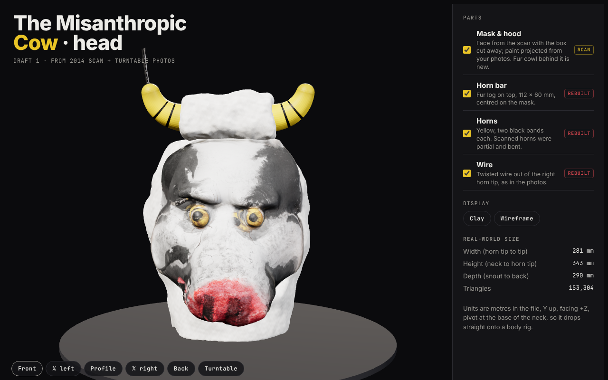
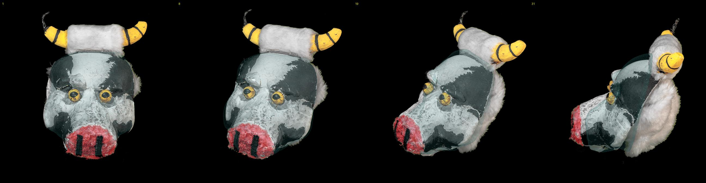

# The Misanthropic Cow: head, draft 1

A 3D model of the cow mask head, built from the 2014 MakerBot Digitizer scan plus the 2026 turntable photos.



## Files

| File | What it is |
| --- | --- |
| `model/misanthropic_cow_head.glb` | **Main deliverable.** Five named parts: `MaskAndHood` (textured), `HornBar`, `Horn.L`, `Horn.R`, `HornWire.R`. |
| `model/obj/` | Mask + hood as OBJ/MTL with its 2048² colour texture, for sculpting tools that prefer OBJ. |
| `model/mask_scan_cleaned_hi.ply` | The cleaned scan of the mask alone at full resolution (249k triangles, no colour). Use it as a sculpting base or reference. |
| `viewer/index.html` | Turntable viewer. Serve the `head/` folder (`python3 -m http.server`) and open `viewer/`. |
| `pipeline/` | Scripts that rebuild everything from the raw scan and photos (`run.sh`). |

**Conventions:** metres, Y up, facing +Z, character's left = +X. The pivot is at the base of the neck, so the head drops straight onto a body.
**Size:** 209 mm wide horn tip to horn tip, 343 mm tall from the neck to the top of the horns, 225 mm deep from snout to back of hood. The mask face alone is 175 × 210 mm, with the snout 101 mm in front of the rim.

## What came from where

| Part | Source |
| --- | --- |
| Mask face shape | **Scan.** The cardboard box and turntable were cut away. Scanner noise was removed, including the ring of bead-like blobs that the red yarn snout produced. The mask is mirror-symmetric to within 1.6 mm, and that symmetry plane sets the model's orientation. |
| Mask paint | **Photos.** Frames 1, 8, 19 and 31 were projected onto the mesh using camera poses fitted to the eye positions and outline.  |
| Fur hood / cowl | **New.** Not in the 2014 scan. Sized from the profile and back photos: a little wider than the mask rim, about 120 mm behind it, with a throat tucked under the snout. |
| Horn bar | **Rebuilt.** A 112 × 60 mm fur log, centred on the mask. In the scan the bar was partial and pushed to one side. |
| Horns | **Rebuilt.** Yellow, about 34 mm thick at the base, two black bands each. The scanned horns were partial, and the right one was bent. |
| Wire | **Rebuilt.** A twisted bundle out of the character's right horn tip, matching the photos and the scan. |

## Known weak spots

- **Character's right side of the mask:** the turned photos only show the left side. The right cheek's paint is projected from the front photo at a steep angle, with gaps filled from the mirrored left side. The black patches there are approximate, and there is a stretched smear on the lower right cheek beside the snout.
- **Snout nostrils:** the zippers come through, but softer than in the photos.
- **Hood and horn bar fur:** a plush lumpy surface with a procedural off-white colour. There is no fur card or strand detail yet.
- **Under the snout and chin:** the scanner never saw this area. The shape is smoothed guesswork.
- **Fur hood shape:** invented from photos, not measured. Adjust the `c, r` ellipsoid in `step2_head.py` if it needs to be fuller.

## Rebuilding

```
pip install trimesh scipy scikit-image xatlas fast-simplification pillow
pipeline/run.sh <folder with cowMask.obj and photos/> <work folder>
```

`cams.json` stores the fitted photo cameras, so a rebuild doesn't need the slow fitting step. To add another photo, add its eye positions to `PICKS` in `fit_cameras.py`, rerun it, then add the frame to `WEIGHT` in `step3_texture.py`.
